# PRD: Hotel Management

| | |
|---|---|
| **Estado** | Alcance cerrado. Se construye en cuatro fases y se entrega completo en la versión 1.0.0. |
| **Fecha** | 2026-11-02, revisado el 2026-11-17 |
| **Repositorio** | `PeakDevCol/HotelManagement` |
| **Responsable de producto** | Por definir |

> **Cómo leer este documento.**
> El alcance de la app quedó cerrado el 2026-11-02 y se construye en cuatro fases ([sección 5](#5-alcance-por-fase)).
> El hotel recibe la app una sola vez, con las cuatro fases terminadas: la versión 1.0.0, después de un piloto (M16, [sección 10](#10-hoja-de-ruta)).
> Lo que sale del código actual se escribe como hecho. Lo demás es el diseño acordado.
> Los valores marcados como **por defecto** los puede cambiar el administrador ([P33](#12-preguntas-abiertas), RF-EMP-06).
> Lo que todavía hay que comprobar técnicamente está en la [sección 12](#12-preguntas-abiertas) como validaciones (V1 a V8), cada una con el hito en que se resuelve.
> **Control de cambios:** una función nueva entra primero a la columna "Después" de la sección 5 y se anota en la [sección 13](#13-registro-de-decisiones). Solo pasa a una fase con una decisión explícita.
> Los riesgos están en la [sección 14](#14-riesgos), el glosario en la [15](#15-glosario) y los diagramas en la [16](#16-diagramas).

---

## 1. Resumen

Hotel Management es la app interna del **Hotel Juan Majestic** (desde 2014), un hotel de unas 30 habitaciones ([P30](#12-preguntas-abiertas)).
Con ella los empleados toman pedidos a habitaciones, mesas, piscina y bar, siguen su estado hasta el pago, administran el catálogo de productos y consultan el balance de ventas (fase 1).
El alcance sigue en tres fases más:

- **Fase 2, turnos y asistencia:** horarios y registro de la hora de llegada y de salida de cada empleado.
- **Fase 3, reservas y estadías:** habitaciones, reservas, check-in y check-out.
- **Fase 4, limpieza y mantenimiento:** tareas sobre cada habitación que se asignan o que el empleado toma, bloqueo de habitaciones, mantenimiento preventivo y objetos olvidados.

Las fases ordenan la construcción. El hotel empieza a usar la app cuando las cuatro están terminadas, primero en un piloto y después como la versión 1.0.0.

Es una sola base de código en Kotlin Multiplatform y Compose Multiplatform, que corre en **Android, iOS y escritorio** (macOS, Windows y Linux), con **Firebase** (Authentication y Firestore) como backend.
Al inicio se distribuye solo en Android y escritorio ([P22](#12-preguntas-abiertas)), y todo funciona en el plan gratuito de Firebase, Spark ([P34](#12-preguntas-abiertas)).

## 2. Problema y objetivos

### Problema
Hoy los pedidos del hotel se anotan en papel ([P12](#12-preguntas-abiertas)).
Así es difícil saber qué está pendiente de entregar o cobrar, cuánto se vendió en el día y qué empleado atendió cada pedido.
Las reservas, la asistencia, la limpieza y el mantenimiento tienen el mismo problema: sin un registro compartido, una habitación se puede reservar dos veces o entregarse sin limpiar, un daño reportado se olvida y no hay forma confiable de saber a qué hora llegó y salió cada empleado.

### Objetivos
| # | Objetivo | Métrica de éxito | Cómo se mide | Fase |
|---|---|---|---|---|
| O1 | Registrar todos los pedidos en la app | El 100 % de los pedidos del turno quedan en Firestore | Durante el piloto (M16), comparar en varios turnos las comandas en papel con los pedidos de la app | 1 |
| O2 | Saber en todo momento qué está pendiente | Cualquier empleado ve los pedidos en curso en tiempo real | Prueba con dos dispositivos: un cambio en uno se ve en el otro en menos de 5 s (RNF-05) | 1 |
| O3 | Cuadrar la caja | El balance coincide con el dinero recibido | La diferencia de cada cierre de caja (RF-BAL-06) es $0 o queda justificada en la nota | 1 |
| O4 | Tomar un pedido rápido | Crear un pedido de 3 productos toma menos de 1 minuto | Cronometrar a 3 empleados durante el piloto | 1 |
| O5 | Registrar la asistencia | El 100 % de los turnos tienen entrada y salida | Reporte de horas (RF-ASI-08): turnos sin marcación o corregidos por el administrador | 2 |
| O6 | No reservar dos veces la misma habitación | Cero noches con dos reservas | Imposible por diseño (RF-RES-03), y revisado en el calendario durante el piloto | 3 |
| O7 | Saber la ocupación en todo momento | Recepción ve el estado de cada habitación | Tablero en tiempo real (RF-HAB-04) | 3 |
| O8 | Entregar siempre habitaciones limpias | Cero check-ins en habitaciones sin limpiar | La app lo impide (RF-EST-03), y cada excepción queda con motivo | 4 |
| O9 | Atender los daños a tiempo | Las tareas de mantenimiento empiezan dentro del tiempo objetivo de su prioridad | Reporte de tareas (RF-TAR-09) | 4 |

Antes del piloto conviene medir cuánto tarda hoy tomar un pedido en papel y cuántas diferencias de caja hay, para tener con qué comparar.

### Fuera de alcance
- Facturación electrónica ante la DIAN.
- Pagos en línea dentro de la app. La app registra cómo se pagó, pero no cobra.
- Integración con datáfonos.
- Integración con agencias en línea (Booking, Airbnb, Expedia) o con un channel manager, y motor de reservas en la web del hotel.
- Nómina, horas extra y recargos. La app reporta las horas trabajadas, pero no las liquida.
- Inventario de lencería, amenities y repuestos, y compras a proveedores. Mantenimiento solo anota materiales y costo.
- Cerraduras electrónicas, sensores o domótica.
- Impresión de comandas o tiquetes, y pantallas de cocina.
- Pedidos o reservas hechos directamente por los huéspedes.
- Varias sedes: la app atiende un solo hotel.

Lo que se dejó para más adelante está en la columna "Después" de la [sección 5](#5-alcance-por-fase).

## 3. Usuarios y roles

El modelo tiene tres roles, `UserType.BASIC`, `UserType.RECEPTION` ([P23](#12-preguntas-abiertas)) y `UserType.ADMIN` (en `shared/.../domain/model/User.kt`). Desde M2 la app y las reglas exigen un perfil activo (RF-AUTH-07), y desde M6 el menú muestra las secciones según el rol (RF-AUTH-05).
El **rol** define los permisos. Además, cada empleado tiene un **área** (servicio, recepción, limpieza, mantenimiento o administración), que define qué tareas ve y qué aparece primero en su menú (RF-EMP-05). No hay un rol de supervisión ([P31](#12-preguntas-abiertas)).
Las cuentas las crea solo un administrador, y el primer administrador se crea a mano en la consola de Firebase ([P1](#12-preguntas-abiertas)).

| Acción | Empleado (`basic`) | Recepción (`reception`) | Administrador (`admin`) |
|---|:---:|:---:|:---:|
| Iniciar y cerrar sesión | ✅ | ✅ | ✅ |
| Crear y editar pedidos | ✅ | ✅ | ✅ |
| Cerrar la cuenta, reabrirla y registrar el pago | ✅ | ✅ | ✅ |
| Cancelar un pedido, con motivo | ❌ | ❌ | ✅ |
| Marcar entrada y salida, y ver su horario | ✅ | ✅ | ✅ |
| Ver quién tiene la entrada marcada (RF-ASI-09) | ❌ | ✅ | ✅ |
| Reportar un daño o un objeto olvidado | ✅ | ✅ | ✅ |
| Tomar y hacer tareas de limpieza o mantenimiento | ✅ (según su área) | ❌ | ✅ |
| Asignar tareas a un empleado | ❌ | ✅ | ✅ |
| Bloquear una habitación por mantenimiento | ✅ (área de mantenimiento) | ✅ | ✅ |
| Cancelar una tarea, con motivo | ❌ | ❌ | ✅ |
| Entregar un objeto olvidado a su dueño | ❌ | ✅ | ✅ |
| Ver el tablero de habitaciones | ✅ (sin datos de huéspedes) | ✅ | ✅ |
| Marcar limpia una habitación libre, hasta las tareas de la fase 4 (RF-HAB-03) | ✅ | ✅ | ✅ |
| Crear y modificar reservas, y hacer check-in y check-out | ❌ | ✅ | ✅ |
| Ver datos personales de huéspedes | ❌ | ✅ | ✅ |
| Hacer el cierre de caja | ❌ | ❌ | ✅ |
| Ver el balance | ❌ | ❌ | ✅ |
| Ver el reporte de horas, los reportes de limpieza y mantenimiento y el historial por habitación ([P37](#12-preguntas-abiertas)) | ❌ | ❌ | ✅ |
| Administrar productos, impuestos, habitaciones, tarifas, parámetros y planes preventivos | ❌ | ❌ | ✅ |
| Crear empleados, asignar rol, área y horario, y autorizar computadores | ❌ | ❌ | ✅ |
| Corregir marcaciones de asistencia y exportar respaldos | ❌ | ❌ | ✅ |

> Desde M2 la app no tiene registro (RF-AUTH-02), y una cuenta sin perfil activo no lee ni escribe nada, aunque se cree por la API REST (RF-AUTH-07). Se comprobó contra las reglas publicadas el 2026-11-14.

### Escenarios de uso
Sirven para revisar que los requisitos cubren el trabajo diario y para guiar el piloto.

1. **Pedido en la piscina.** Un mesero se acerca a una mesa de la piscina, agrega productos y confirma: el pedido queda En curso. Más tarde agrega otra ronda al mismo pedido. Si no hay señal, los productos quedan "pendientes de enviar" y se envían solos al volver la conexión.
2. **Servicio a la habitación.** Recepción recibe la llamada de la habitación 204 y crea el pedido con ese destino.
3. **Cobro en la mesa.** El huésped pide la cuenta. El mesero la cierra, cobra y registra el pago en efectivo o por transferencia, con la propina si la hay. Si el huésped pide algo más después de cerrar, el mesero reabre el pedido.
4. **Cierre de caja.** Al cambiar de turno o al final del día, el administrador revisa lo cobrado, cuenta el efectivo y registra el cierre.
5. **Empleado nuevo.** El administrador crea la cuenta con nombre, correo, rol y área. El empleado recibe un correo para crear su contraseña.
6. **Empleado que se retira.** El administrador desactiva la cuenta y el empleado pierde el acceso de inmediato, aunque conserve la app en su celular.
7. **Llegada al turno.** Una empleada llega al hotel y marca su entrada desde su celular, que confirma que está dentro del hotel. Si no tiene ubicación, marca en el computador de recepción. Al irse marca la salida.
8. **Reserva por teléfono.** Recepción busca una habitación doble libre del 20 al 23 y la reserva a nombre del huésped. Si el mismo huésped necesita otra habitación, recepción hace otra reserva ([P35](#12-preguntas-abiertas)).
9. **Check-in.** El huésped llega. Recepción confirma su documento, registra a los acompañantes y la autorización de datos, y le entrega la habitación, que pasa a Ocupada.
10. **Check-out.** Recepción registra el pago del saldo y la habitación pasa a Por limpiar. Si quedan pedidos sin pagar con destino a esa habitación, la app avisa.
11. **Mañana de limpieza.** Al abrir la app en la mañana ya están las tareas del día: salidas, repasos de habitaciones ocupadas y la limpieza profunda que toca. Recepción asigna algunas, y las camareras toman las demás desde su lista, empezando por las que tienen llegada hoy.
12. **Camarera que encuentra un daño.** Mientras limpia la 305, una camarera ve que el aire acondicionado gotea. Desde su tarea reporta el daño con una foto, y la tarea de mantenimiento aparece al instante en la lista de mantenimiento.
13. **Habitación en mantenimiento.** El técnico toma la tarea y bloquea la 305 por tres días, así nadie puede reservarla. Le falta un repuesto, así que devuelve la tarea a pendiente con esa nota. Al terminar, se levanta el bloqueo y se crea un retoque de limpieza.
14. **Mantenimiento preventivo.** Cada 30 días la app crea la tarea de limpiar los filtros del aire de cada habitación, y sugiere hacerlo en un día en que esté libre.

## 4. Estado actual

### Módulos
| Módulo | Contenido | Estado |
|---|---|---|
| `shared` | Dominio, datos (Firebase vía GitLive), Koin y UI en Compose | En uso |
| `androidApp` | Punto de entrada Android | En uso |
| `desktopApp` | Punto de entrada de escritorio (JVM) | En uso |
| `iosApp` | Proyecto de Xcode | En uso. La app iOS está registrada en Firebase desde el 2026-11-14; su distribución sigue pendiente ([P22](#12-preguntas-abiertas)). |

### Funciones
| Función | Estado | Notas |
|---|---|---|
| Inicio de sesión y cerrar sesión | ✅ Hecho en M17 | Sin sesión la app abre en el inicio de sesión: la introducción desapareció. La sesión de Firebase decide qué navegación se muestra. |
| Registro abierto | — Eliminado en M2 | Las cuentas las crea el administrador (P1), desde RF-EMP-04 en M6. Hasta entonces se crean a mano en la consola (S6). |
| Navegación por área | ✅ Hecho en M17 | Reemplazó el menú principal: barra inferior en celular y navegación lateral en tablet y escritorio, con las secciones del rol, y la app abre en la primera del área. Las de las fases 2 a 4 se agregan a medida que se construyen. |
| Crear pedido | ✅ Migrado | El catálogo sale del inventario en Firestore (M4). Desde M3 guarda `in_progress`, tiene destinos piscina y bar, y funciona sin conexión. |
| Pedidos en curso | ✅ Hecho en M3 | Lista en tiempo real, filtros, detalle, cerrar, reabrir, pagar, cancelar, y agregar y quitar productos, también sin conexión. |
| Inventario | ✅ Hecho en M4 | Productos, categorías e impuestos. Solo lo ve el administrador. |
| Balance | ✅ Hecho en M5 | Balance del periodo con filtros y desgloses, lo pendiente por cobrar y el cierre de caja. Solo lo ve el administrador. |
| Recuperar contraseña | ✅ Hecho en M6 | "¿Olvidaste la contraseña?" en el inicio de sesión |
| Roles y permisos | ✅ Hecho en M6 | El menú muestra las secciones según el rol y las ordena según el área. El administrador crea y gestiona empleados desde la app. |
| Configuración y respaldo | ✅ Hecho en M6 | Inicio del día operativo, y respaldo manual en JSON desde escritorio |
| Sistema de diseño Majestic | ✅ Hecho en M17 | Colores, letra Manrope, componentes y pruebas de diseño (primer PR), y todas las pantallas de la fase 1 con el diseño nuevo y su prueba de desbordes (segundo PR). |
| Turnos y asistencia | ✅ Hecho en M8 | Horarios del equipo y "Mi horario"; marcación desde el celular en la zona del hotel, también sin conexión, y desde el computador autorizado de recepción; quién está en turno, para recepción y administración; y "Marcaciones" para el administrador: salidas pendientes, horas por confirmar, correcciones con historial y el reporte de horas. |
| Habitaciones | ✅ Hecho en M10 | Tablero en tiempo real para todos, por piso y con filtros por estado, donde cualquier empleado marca limpia una habitación libre hasta la fase 4. El administrador configura ahí mismo los tipos, con su tarifa por noche, y las habitaciones. Recepción, limpieza y mantenimiento abren en él. |
| Reservas, check-in y check-out | ⬜ Pendiente | Fase 3 (M11 y M12) |
| Limpieza y mantenimiento | ⬜ Pendiente | Fase 4 (M14 y M15) |

Hay 618 tests en `commonTest` (dominio, datos y ViewModels), que pasan en JVM y en Android; 50 pruebas de diseño en JVM (`DesignSystemLayoutTest` y `ScreensLayoutTest`), dos de guarda en JVM (`BackupCollectionsTest`, que el respaldo lleve todas las colecciones, y `NavigationRoutesTest`, que escritorio pueda abrir cada ruta), y 4 tests de la app de escritorio.

## 5. Alcance por fase

Alcance cerrado el 2026-11-02. Las fases ordenan la construcción, y el hotel las recibe todas juntas en la versión 1.0.0 (decisión del 2026-11-17). Lo que está en "Después" no forma parte de la versión 1.0.0.

| Función | Fase 1 | Fase 2 | Fase 3 | Fase 4 | Después |
|---|:---:|:---:|:---:|:---:|:---:|
| Autenticación, roles, áreas y cuentas creadas por el administrador | ✅ | | | | |
| Recuperar contraseña | ✅ | | | | |
| Crear pedido, con destinos piscina y bar | ✅ | | | | |
| Pedidos sin conexión | ✅ | | | | |
| Pedidos en curso: En curso, Cerrado y Pagado | ✅ | | | | |
| Inventario: catálogo en Firestore e impuestos opcionales | ✅ | | | | |
| Balance mensual con filtros | ✅ | | | | |
| Cierre de caja diario y manual | ✅ | | | | |
| Propinas | ✅ | | | | |
| Administración de empleados, parámetros y respaldo manual | ✅ | | | | |
| Horarios y reporte de horas | | ✅ | | | |
| Marcación desde el celular dentro del hotel o desde un computador autorizado | | ✅ | | | |
| Habitaciones y tablero de estado | | | ✅ | | |
| Huéspedes y reservas (una habitación por reserva) | | | ✅ | | |
| Check-in, check-out y pagos de la estadía | | | ✅ | | |
| Tareas de habitación: asignar o tomar, con estado de la habitación | | | | ✅ | |
| Limpieza: tareas automáticas del día y listas de chequeo | | | | ✅ | |
| Mantenimiento: reportes, bloqueo de habitaciones y preventivo | | | | ✅ | |
| Objetos olvidados | | | | ✅ | |
| Fotos en daños y objetos olvidados (guardadas en Firestore) | | | | ✅ | |
| Distribución en iOS | | | | | ✅ (P22) |
| Inventario: control de existencias | | | | | ✅ (P5) |
| Temporadas de tarifas | | | | | ✅ (P27) |
| Anticipos de reservas | | | | | ✅ (P25) |
| Datos y reporte para la TRA y el SIRE | | | | | ✅ (P28) |
| Inspección de habitaciones | | | | | ✅ (P31) |
| Mantenimiento de áreas comunes | | | | | ✅ (P32) |
| Notificaciones push y respaldos automáticos (exigen el plan Blaze) | | | | | ✅ (P34) |
| Exportar el balance y los reportes (CSV o PDF) | | | | | ✅ |
| Descuentos y cortesías | | | | | ✅ (P18) |
| Cargo de consumos a la habitación | | | | | ✅ (P16) |
| Notas en el pedido (por ejemplo, "sin hielo") | | | | | ✅ |

La distribución en Android y escritorio, las pruebas en dispositivos reales y el piloto se hacen una sola vez, en M16, con las cuatro fases terminadas.

## 6. Requisitos funcionales

Cada requisito tiene un ID para citarlo en ramas, PRs y tests.
Estados: ✅ hecho, 🔄 hecho pero cambia por una decisión nueva, ⬜ pendiente, — descartado o aplazado. Un requisito descartado conserva su ID para no reutilizarlo.

### 6.1 Autenticación (`AUTH`)
| ID | Requisito | Criterios de aceptación | Estado |
|---|---|---|---|
| RF-AUTH-01 | Iniciar sesión con correo y contraseña | Un error de credenciales o de red muestra un mensaje claro. Al entrar se abre la primera sección del área (RF-AUTH-05). | ✅ |
| RF-AUTH-02 | Quitar el registro abierto ([P1](#12-preguntas-abiertas)) | La pantalla de registro desaparece. Las cuentas se crean desde RF-EMP-04. | ✅ |
| RF-AUTH-03 | Cerrar sesión | Pide confirmación y vuelve al inicio de sesión. Si hay pedidos pendientes de enviar, avisa y no deja cerrar la sesión (RF-ORD-09). | ✅ |
| RF-AUTH-04 | Recuperar contraseña | "¿Olvidaste la contraseña?" envía el correo de restablecimiento de Firebase Usa el correo escrito en el inicio de sesión y responde siempre lo mismo, exista o no la cuenta. En escritorio el correo se pide por la API REST de Firebase Auth (V1). | ✅ |
| RF-AUTH-05 | Roles y áreas | La app muestra u oculta las secciones según `type` (`basic`, `reception` o `admin`) y abre en la primera sección del área, sin menú intermedio. En celular, la barra inferior lleva las secciones del área y "Más" con el resto y con cerrar sesión; en tablet y escritorio, la navegación lateral lleva todas, agrupadas en Operación y Administración. Las reglas de Firestore aplican los mismos permisos. | ✅ |
| RF-AUTH-06 | ~~Cuentas nuevas pendientes de aprobación~~ | Descartado por P1: ya no hay registro abierto | — |
| RF-AUTH-07 | Sin documento, sin acceso | Una cuenta de Firebase Auth sin documento activo en `Users` no lee ni escribe nada, aunque se haya creado por fuera de la app. La app muestra "Tu cuenta no está activa" y solo deja cerrar sesión. | ✅ |

### 6.2 Crear pedido (`ORD`)
| ID | Requisito | Criterios de aceptación | Estado |
|---|---|---|---|
| RF-ORD-01 | Agregar productos desde el catálogo | Búsqueda por nombre y cantidad de 1 a 99. Agregar un producto que ya está en el pedido suma la cantidad. | ✅ |
| RF-ORD-02 | Quitar productos | Quitar un producto actualiza el total | ✅ |
| RF-ORD-03 | Elegir el destino | Habitación o mesa con número, u "Otro" | ✅ |
| RF-ORD-04 | Confirmar el pedido | Solo se puede con al menos un producto y un destino. Guarda con estado `in_progress` (En curso) y la fecha del servidor. | ✅ |
| RF-ORD-05 | Reintentar sin duplicar | El borrador conserva su id hasta que se guarda, así que un reintento sobrescribe el mismo documento | ✅ |
| RF-ORD-06 | No quedarse esperando | Al confirmar, la app espera 3 s la respuesta del servidor. Si llega, muestra "Pedido confirmado". Si no llega, por estar sin conexión o con conexión lenta, muestra "Pedido guardado en el dispositivo" (RF-ORD-09) y el empleado sigue trabajando. No hay botón de reintentar: el pedido se envía solo. | ✅ |
| RF-ORD-07 | Catálogo desde el inventario | Los productos salen de Firestore, y los productos inactivos no aparecen. Si el inventario está vacío, la app lo dice en vez de mostrar una lista sin productos. | ✅ |
| RF-ORD-08 | Destinos piscina y bar ([P19](#12-preguntas-abiertas)) | Se agregan Piscina y Bar, con número opcional (silla o puesto) | ✅ |
| RF-ORD-09 | Pedidos sin conexión ([P8](#12-preguntas-abiertas)) | Sin conexión, el pedido queda guardado en el dispositivo con la marca "pendiente de enviar" y se envía solo al volver la conexión, sin duplicarse (V2). El menú muestra cuántos pedidos están pendientes de enviar. | ✅ |

### 6.3 Pedidos en curso (`CUR`)
Estados del pedido según [P2](#12-preguntas-abiertas) y [P21](#12-preguntas-abiertas): un pedido está En curso desde que se crea, mientras se le agregan productos.
Como no hay datos productivos ([P9](#12-preguntas-abiertas)), los códigos nuevos reemplazan a los actuales sin migración.

| Estado | Código | Significado |
|---|---|---|
| En curso | `in_progress` | El pedido está abierto y se le pueden agregar o quitar productos |
| Cerrado | `closed` | Se culminó y está en proceso de cobro. Para editarlo hay que reabrirlo. |
| Pagado | `paid` | El cliente pagó. Ya no se modifica. |
| Cancelado | `cancelled` | Un administrador lo anuló con un motivo |

```
in_progress ──cerrar cuenta──▶ closed ──registrar pago──▶ paid
     ▲                            │
     └────reabrir para editar─────┘

in_progress o closed ──cancelar (solo administradores, con motivo)──▶ cancelled
```

| Desde | Hacia | Acción | Quién |
|---|---|---|---|
| — | `in_progress` | Confirmar el pedido (RF-ORD-04) | Cualquier empleado |
| `in_progress` | `closed` | Cerrar la cuenta (RF-CUR-04) | Cualquier empleado |
| `closed` | `in_progress` | Reabrir para editar (RF-CUR-10) | Cualquier empleado |
| `closed` | `paid` | Registrar el pago (RF-CUR-05) | Cualquier empleado |
| `in_progress` o `closed` | `cancelled` | Cancelar con motivo (RF-CUR-07) | Solo administradores |

| ID | Requisito | Criterios de aceptación | Estado |
|---|---|---|---|
| RF-CUR-01 | Lista en tiempo real | Muestra los pedidos `in_progress` y `closed`, ordenados por fecha, el más antiguo primero. Un pedido creado en otro dispositivo aparece sin recargar. | ✅ |
| RF-CUR-02 | Filtros | Mis pedidos o todos, y filtro por estado. Cada filtro dice cuántos pedidos muestra. Se busca por el número del destino o por el nombre de quien tomó el pedido, sobre lo ya leído. Al abrir la lista se muestran todos. | ✅ |
| RF-CUR-03 | Detalle | Productos, cantidades, total, destino, empleado, hora e historial de cambios (RF-CUR-11) | ✅ |
| RF-CUR-04 | Cerrar la cuenta | `in_progress` → `closed`, guardando `closedAt` y `closedBy` | ✅ |
| RF-CUR-05 | Registrar el pago | `closed` → `paid`, con el método de pago (efectivo o transferencia, [P4](#12-preguntas-abiertas)) y la propina opcional ([P15](#12-preguntas-abiertas)), guardando `paidAt` y `paidBy`. Crea el registro en `Payments` en la misma transacción. El pedido sale de la lista. Un pedido En curso también se cobra: se cierra y se cobra en un paso. El cobro ofrece "Sin propina" (marcada de entrada), una propina sugerida del 10 % y "Otro valor". | ✅ |
| RF-CUR-06 | Editar un pedido | Agregar o quitar productos en `in_progress` ([P3](#12-preguntas-abiertas)). El total se recalcula. Cada producto agregado es una línea nueva, con su propio id. No se puede quitar el último producto: si el pedido ya no va, lo cancela un administrador. | ✅ |
| RF-CUR-07 | Cancelar un pedido ([P20](#12-preguntas-abiertas)) | Solo administradores, con un motivo. Guarda `cancelReason`, `cancelledAt` y `cancelledBy`. | ✅ |
| RF-CUR-08 | Cambios simultáneos | Si dos dispositivos cambian el estado del mismo pedido a la vez, el cambio se hace en una transacción de Firestore. El segundo ve el estado actualizado y un aviso, y nunca se registra un pago dos veces. | ✅ |
| RF-CUR-09 | ~~Atender~~ | Descartado por P21: Abierto y En curso son el mismo estado | — |
| RF-CUR-10 | Reabrir | `closed` → `in_progress` para poder editar ([P3](#12-preguntas-abiertas)). Queda en el historial. | ✅ |
| RF-CUR-11 | Historial | Cada cambio (crear, agregar o quitar productos, cerrar, reabrir, pagar o cancelar) guarda quién, cuándo y qué cambió. La creación sale del propio pedido (`idEmployee` y `dateOrder`); los demás cambios se guardan en `events`. | ✅ |
| RF-CUR-12 | Cambios de estado con conexión | Cerrar, reabrir, pagar y cancelar necesitan conexión, porque usan transacciones. Sin conexión, esos botones se desactivan con un aviso. | ✅ |
| RF-CUR-13 | Agregar productos sin conexión | Sin conexión se pueden agregar productos a un pedido En curso. Al sincronizar se suman a lo que haya agregado otro dispositivo, sin pisarlo (V6). Si al sincronizar el pedido ya no está En curso, las reglas rechazan esos productos y la app avisa cuáles no se agregaron. Quitar productos necesita conexión. El aviso aparece al abrir la app, sobre cualquier pantalla, aunque se haya cerrado y abierto la app, y nombra el pedido y los productos. | ✅ |

### 6.4 Inventario (`INV`)
| ID | Requisito | Criterios de aceptación | Estado |
|---|---|---|---|
| RF-INV-01 | Listar productos | Nombre, precio, categoría, impuesto y si está activo | ✅ |
| RF-INV-02 | Crear y editar productos | Nombre obligatorio y precio mayor que 0. Cambiar un precio no altera los pedidos ya guardados. | ✅ |
| RF-INV-03 | Desactivar productos | Un producto inactivo no aparece al crear pedidos. Se desactiva, no se borra, para conservar el historial. | ✅ |
| RF-INV-04 | Categorías | El administrador las crea, las renombra, las ordena y borra las que no tienen productos, en su propia pantalla. No hay categorías por defecto. Agrupan el selector de productos, en el orden que les da el administrador. | ✅ |
| RF-INV-05 | Existencias | Queda para después ([P5](#12-preguntas-abiertas)) | — |
| RF-INV-06 | Migrar el catálogo inicial | ~~Los 9 productos de `StaticProductCatalog` se cargan en Firestore una sola vez~~. Descartado el 2026-11-16: esos productos eran de ejemplo y el inventario empieza vacío. | — |
| RF-INV-07 | Impuestos opcionales ([P14](#12-preguntas-abiertas)) | El administrador define impuestos con nombre y porcentaje (por ejemplo, IVA o impuesto al consumo). Cada producto puede tener uno o ninguno. El precio de venta incluye el impuesto, y el pedido guarda cuánto impuesto tiene cada línea. El porcentaje admite hasta dos decimales. El impuesto se calcula hacia adentro del precio y se redondea al peso más cercano. Un impuesto inactivo deja de aplicarse a los pedidos nuevos. | ✅ |

### 6.5 Balance (`BAL`)
Todo el balance sale de `Payments` (sección 8), que reúne en un solo lugar los pagos de pedidos y, desde la fase 3, los de reservas.
Las fechas se agrupan por **día operativo**, de 6:00 a. m. a 5:59 a. m. en hora de Colombia por defecto ([P17](#12-preguntas-abiertas)), para no partir un turno nocturno.

| ID | Requisito | Criterios de aceptación | Estado |
|---|---|---|---|
| RF-BAL-01 | Total del periodo ([P6](#12-preguntas-abiertas)) | Por defecto muestra el mes actual: total cobrado y número de pagos (V8). El periodo es de máximo 31 días y se lee una vez del servidor; sin conexión, la app lo dice en vez de mostrar cifras incompletas. | ✅ |
| RF-BAL-02 | Filtros | Rango de fechas, método de pago, empleado que cobró, destino (por tipo), producto y, desde la fase 3, origen (consumos o alojamiento). Los filtros no vuelven a leer los pagos. Con un producto elegido se muestra lo que vendió ese producto, sin propinas. | ✅ |
| RF-BAL-03 | Desglose | Por día operativo, por método de pago, por empleado y por producto | ✅ |
| RF-BAL-04 | Pendientes | Total de lo que está en `in_progress` y `closed`, es decir, lo que falta por cobrar. Es lo pendiente en este momento, sin importar el periodo elegido. | ✅ |
| RF-BAL-05 | Exportar | Queda para después: CSV o PDF del rango elegido | — |
| RF-BAL-06 | Cierre de caja ([P17](#12-preguntas-abiertas)) | Cada cierre cubre desde el cierre anterior hasta ese momento. Lo normal es uno por día operativo, y el administrador puede hacer otros, por ejemplo al cambiar de turno (cierre manual). Ingresa el efectivo contado; la app muestra el esperado según los pagos en efectivo, con sus propinas, y guarda la diferencia con una nota. Un cierre guardado no se edita. Si un día operativo termina sin cierre, el balance lo marca. Al guardar, el administrador elige "Cierre del día" o "Cierre de turno"; un día con pagos que termina sin "Cierre del día" queda marcado. La nota es obligatoria si la diferencia no es $0. | ✅ |
| RF-BAL-07 | Conceptos aparte | Las propinas ([P15](#12-preguntas-abiertas)) y los impuestos ([P14](#12-preguntas-abiertas)) se muestran separados de las ventas: ventas sin impuestos, impuestos, propinas y total recibido | ✅ |
| RF-BAL-08 | Alojamiento (fase 3) | Los pagos de reservas aparecen con origen "alojamiento" y entran al cierre de caja como cualquier otro pago | ⬜ |

### 6.6 Administración (`EMP`)
| ID | Requisito | Criterios de aceptación | Estado |
|---|---|---|---|
| RF-EMP-01 | Listar empleados | Nombre, correo, rol, área y si está activo | ✅ |
| RF-EMP-02 | Activar o desactivar | Un empleado inactivo no puede usar la app, y las reglas de Firestore lo impiden también | ✅ |
| RF-EMP-03 | Cambiar el rol | Entre `basic`, `reception` y `admin`. Siempre tiene que quedar al menos un administrador. Se garantiza porque nadie puede cambiar su propio rol ni desactivarse, ni en la app ni en las reglas. | ✅ |
| RF-EMP-04 | Crear empleados ([P1](#12-preguntas-abiertas)) | El administrador ingresa nombre, correo, rol y área. La cuenta se crea sin cerrar la sesión del administrador (V1), y el empleado recibe el correo de Firebase para crear su contraseña, así nadie más la conoce. Si el perfil no se puede guardar, la cuenta recién creada se elimina. Desde el empleado se puede reenviar el correo. | ✅ |
| RF-EMP-05 | Área | Cada empleado tiene un área: servicio, recepción, limpieza, mantenimiento o administración. Define qué tareas de habitación ve, en qué sección abre la app y qué secciones van en su barra inferior (RF-AUTH-05). | ✅ La navegación. Las tareas de habitación llegan en la fase 4. |
| RF-EMP-06 | Parámetros ([P33](#12-preguntas-abiertas)) | El administrador cambia los parámetros de la tabla siguiente desde la app. Cada cambio queda con quién y cuándo, desde Menú → Configuración. | ✅ El parámetro de la fase 1. Los demás llegan con su fase. |
| RF-EMP-07 | Respaldo manual ([P34](#12-preguntas-abiertas)) | Desde la app de escritorio, el administrador exporta un respaldo en JSON de las colecciones, completo o desde una fecha. Se recomienda hacerlo cada mes. El archivo queda en `Documentos/HotelManagement/Respaldos`, con cada documento tal como está en Firestore y el historial de cada pedido. "Desde una fecha" aplica a pedidos, pagos, cierres de caja, turnos y marcaciones, por el día en que empiezan; lo demás se exporta completo. | ✅ |

| Parámetro | Por defecto | Desde |
|---|---|---|
| Inicio del día operativo | 6:00 a. m. | Fase 1 |
| Tolerancia de llegada tarde | 10 min | Fase 2 |
| Horas máximas de una entrada abierta | 16 h | Fase 2 |
| Ubicación del hotel, radio y precisión mínima del GPS | Sin ubicación, 150 m y 100 m | Fase 2 |
| Horas de check-in y check-out | 3:00 p. m. y 12:00 m. | Fase 3 |
| Repaso diario de habitaciones ocupadas | Sí | Fase 4 |
| Cambio de sábanas en una estadía | Cada 3 noches | Fase 4 |
| Limpieza profunda de cada habitación | Cada 30 días | Fase 4 |
| Volver a mostrar una habitación con "no molestar" | A las 2 h | Fase 4 |
| Listas de chequeo por tipo de limpieza | Una lista básica por tipo | Fase 4 |
| Tiempo objetivo para empezar una tarea de mantenimiento | Urgente 1 h, alta el mismo día, normal 3 días, baja sin plazo | Fase 4 |
| Tamaño máximo de una foto y días que se conserva | 200 KB y 180 días | Fase 4 |
| Días que se guarda un objeto olvidado | 90 | Fase 4 |

> **Nota técnica sobre RF-EMP-04.** Crear una cuenta desde el SDK de cliente inicia sesión con ella.
> Hay dos opciones que funcionan en el plan Spark (V1): una segunda instancia de Firebase solo para crear cuentas, si GitLive lo permite, o la API REST de Firebase Auth, que crea la cuenta sin tocar la sesión de la app.
> La misma técnica sirve para marcar asistencia en el computador de recepción sin cerrar la sesión de quien lo está usando (RF-ASI-11).

### 6.7 Turnos y asistencia (`ASI`, fase 2)
| ID | Requisito | Criterios de aceptación | Estado |
|---|---|---|---|
| RF-ASI-01 | Horarios | El administrador asigna turnos a cada empleado (inicio, fin y área opcional). Un turno puede cruzar la medianoche. Se puede copiar la semana anterior. Avisa si dos turnos del mismo empleado se cruzan. | ✅ En "Horarios" |
| RF-ASI-02 | Mi horario | Cada empleado ve sus turnos de las próximas dos semanas | ✅ En "Asistencia" |
| RF-ASI-03 | Marcar entrada ([P29](#12-preguntas-abiertas)) | Desde el celular, solo dentro de la zona del hotel (RF-ASI-10). Desde un computador autorizado de recepción, sin ubicación (RF-ASI-11). Si el celular no da ubicación, la app indica que marque en recepción. Usa la hora del servidor y no deja marcar otra entrada si hay una abierta. | ✅ En "Asistencia", desde el celular o el computador autorizado |
| RF-ASI-04 | Marcar salida | Con las mismas condiciones de RF-ASI-03. Cierra la entrada abierta y muestra las horas trabajadas. | ✅ En "Asistencia" |
| RF-ASI-05 | Marcación sin conexión | En el celular, la ubicación funciona sin internet, así que la marcación se valida igual. Se guarda con la hora del dispositivo y queda "por revisar", porque la hora del servidor solo se conoce al sincronizar. | ✅ Con el aviso "Sin conexión" |
| RF-ASI-06 | Salida olvidada | Una entrada abierta por más horas de las del parámetro queda como "salida pendiente" para el administrador | ✅ En "Marcaciones", "Por revisar" |
| RF-ASI-07 | Correcciones | El administrador corrige una marcación con un motivo. Se conservan los valores originales. | ✅ En "Marcaciones", con el historial de cada marcación |
| RF-ASI-08 | Reporte de horas | Por empleado y rango de fechas: horas programadas y trabajadas, llegadas tarde (según la tolerancia) y turnos sin marcación. No calcula nómina ni recargos. Solo lo ve el administrador ([P37](#12-preguntas-abiertas)). | ✅ En "Marcaciones", "Horas" |
| RF-ASI-09 | Quién está trabajando | Recepción y administración ven qué empleados tienen una entrada abierta | ✅ En "Asistencia", "En turno ahora" |
| RF-ASI-10 | Zona del hotel | El administrador fija la ubicación del hotel, el radio y la precisión mínima. Se acepta la marcación si el celular está dentro del radio con esa precisión; si no, pide intentar de nuevo o marcar en recepción. Rechaza ubicaciones simuladas, que Android permite detectar (V5). Solo se guardan la distancia y la precisión, no las coordenadas, y no hay rastreo fuera del momento de marcar. | ✅ En Configuración, "Zona del hotel" |
| RF-ASI-11 | Computadores autorizados | El administrador autoriza el computador de recepción desde la app de escritorio, y puede revocarlo. Solo un computador autorizado muestra la opción de marcar asistencia. El empleado se identifica con su cuenta y marca, sin cerrar la sesión del computador (V1). | ✅ En Configuración, "Computadores autorizados" |

### 6.8 Habitaciones (`HAB`, fase 3)
El estado de una habitación se guarda en tres partes independientes, para que la fase 4 no cambie el modelo:

| Parte | Valores | Qué la cambia |
|---|---|---|
| Ocupación | `vacant` (libre) u `occupied` (ocupada) | El check-in y el check-out |
| Limpieza | `dirty` (por limpiar), `cleaning` (en limpieza) o `clean` (limpia) | El check-out, el repaso del día y las tareas de limpieza |
| Bloqueo | Sin bloqueo, o en mantenimiento entre dos fechas | Las tareas de mantenimiento (RF-MAN-03) |

En el tablero cada habitación muestra un solo estado ([P31](#12-preguntas-abiertas)):

| Se muestra como | Cuándo |
|---|---|
| En mantenimiento | Tiene un bloqueo vigente hoy |
| Ocupada | `occupied`. El tablero indica además si su repaso del día está pendiente, en curso o hecho. |
| En limpieza | `vacant` y `cleaning` |
| Por limpiar | `vacant` y `dirty` |
| Disponible | `vacant` y `clean` |

| ID | Requisito | Criterios de aceptación | Estado |
|---|---|---|---|
| RF-HAB-01 | Tipos de habitación | Nombre, capacidad, tarifa base por noche e impuesto opcional ([P27](#12-preguntas-abiertas)) | ✅ En "Habitaciones", "Tipos de habitación". La tarifa incluye el impuesto. |
| RF-HAB-02 | Habitaciones | Número, tipo, piso y si está activa. Solo administradores. | ✅ Desde el tablero. Una habitación nueva empieza disponible. |
| RF-HAB-03 | Estado de la habitación | Según las tablas de arriba. El check-in la pasa a `occupied`, y el check-out a `vacant` y `dirty`. En la fase 3, cualquier empleado la marca limpia, para poder probar el check-in; la fase 4 lo reemplaza por las tareas de limpieza. | ✅ Las tres partes y marcar limpia (o devolver a por limpiar). El check-in y el check-out la cambian desde M12. |
| RF-HAB-04 | Tablero de habitaciones | Todas las habitaciones con su estado y la salida prevista y, solo para recepción y administración, el huésped actual. En tiempo real. | ✅ En "Habitaciones", por piso y con filtros por estado. El huésped actual se agrega con el check-in, en M12. |
| RF-HAB-05 | Temporadas ([P27](#12-preguntas-abiertas)) | Después: el administrador define temporadas con fechas y tarifa por tipo de habitación, y cada noche toma la tarifa de su temporada | — |

### 6.9 Reservas (`RES`, fase 3)
Una reserva es una habitación para un huésped entre dos fechas. Si el mismo huésped necesita otra habitación, se hace otra reserva ([P35](#12-preguntas-abiertas)).

| Estado | Código | Significado |
|---|---|---|
| Confirmada | `confirmed` | La habitación está apartada para esas noches |
| Hospedado | `checked_in` | El huésped llegó y está en la habitación |
| Finalizada | `checked_out` | El huésped se fue y la cuenta quedó saldada |
| Cancelada | `cancelled` | Se anuló con un motivo y liberó las noches |
| No llegó | `no_show` | El huésped no se presentó y las noches se liberaron |

```
confirmed ──check-in──▶ checked_in ──check-out──▶ checked_out
    ├──cancelar──▶ cancelled
    └──no llegó──▶ no_show
```

| ID | Requisito | Criterios de aceptación | Estado |
|---|---|---|---|
| RF-RES-01 | Huéspedes | Crear y buscar huéspedes por nombre o documento. Un documento no se repite. Nombre, tipo y número de documento, nacionalidad, teléfono y correo. | ✅ Desde "Nueva reserva": se buscan por el comienzo de cualquier palabra del nombre o por el documento, y se crean con el nombre y el teléfono; el resto se completa después (decisión 5A). |
| RF-RES-02 | Crear reserva | Huésped, habitación, llegada y salida (la salida es posterior a la llegada), adultos y niños (sin pasar la capacidad), tarifa por noche (la base del tipo, que un administrador puede cambiar), total con impuestos, origen (directo, teléfono, WhatsApp o agencia) y notas | ✅ En la sección "Reservas" (decisión 2A), de 1 a 30 noches desde el día operativo de hoy. Las próximas se ven por día de llegada. |
| RF-RES-03 | Sin reservas cruzadas | Buscar habitaciones libres por fechas y número de personas. Una noche de una habitación solo puede estar en una reserva o en un bloqueo, aunque dos personas reserven al mismo tiempo (`RoomNights` en una transacción). Necesita conexión. | ✅ Si alguien tomó una noche mientras tanto, la app la nombra y vuelve a buscar. Los bloqueos llegan con M14. |
| RF-RES-04 | Calendario de ocupación | Habitaciones por días, con cada reserva y cada bloqueo como una barra. Vista de dos semanas y de un mes. | ⬜ |
| RF-RES-05 | Modificar | Cambiar fechas, ocupantes o habitación con la misma validación de RF-RES-03. El total se recalcula. | ⬜ |
| RF-RES-06 | Cancelar | Con un motivo. Libera las noches. | ⬜ |
| RF-RES-07 | No llegó | Si termina el día de llegada sin check-in, la reserva aparece en la lista de recepción para marcarla como `no_show`, lo que libera las noches | ⬜ |
| RF-RES-08 | ~~Anticipos~~ | Aplazado por P25: por ahora no se cobran anticipos al reservar | — |
| RF-RES-09 | Llegadas y salidas del día | Lista de check-ins y check-outs esperados hoy, con el estado de cada habitación | ⬜ |

### 6.10 Estadías: check-in y check-out (`EST`, fase 3)
| ID | Requisito | Criterios de aceptación | Estado |
|---|---|---|---|
| RF-EST-01 | Check-in con reserva | Confirmar los datos y el documento del huésped, y registrar a los acompañantes (nombre y documento) y la autorización de tratamiento de datos. La reserva pasa a `checked_in` y la habitación a `occupied`, con la hora real de llegada. | ⬜ |
| RF-EST-02 | Check-in sin reserva | Para quien llega sin reservar: crea la reserva y hace el check-in en un solo paso, con la validación de RF-RES-03 | ⬜ |
| RF-EST-03 | Habitación no lista | Solo se entrega una habitación Disponible. Si no lo está, la app avisa y permite cambiarla. Un administrador puede entregarla igual, con un motivo. | ⬜ |
| RF-EST-04 | Huéspedes en casa | Lista de estadías activas, con habitación y salida prevista | ⬜ |
| RF-EST-05 | Extender o acortar | Cambiar la fecha de salida con la validación de RF-RES-03. El total se recalcula. | ⬜ |
| RF-EST-06 | Cambio de habitación | Mueve las noches que faltan a otra habitación. La anterior pasa a `vacant` y `dirty`. | ⬜ |
| RF-EST-07 | Check-out | La reserva pasa a `checked_out`, y la habitación a `vacant` y `dirty`. Exige saldo en cero (RF-EST-09), salvo que un administrador lo autorice con un motivo. Avisa si hay pedidos sin pagar con destino a esa habitación, que se cobran aparte ([P16](#12-preguntas-abiertas)). | ⬜ |
| RF-EST-08 | Datos para la TRA y el SIRE | Aplazado: primero se valida con el hotel cómo hace hoy ese reporte ([P28](#12-preguntas-abiertas)) | — |
| RF-EST-09 | Pagos de la estadía | Registrar pagos en efectivo o por transferencia en cualquier momento entre el check-in y el check-out; cada uno crea un registro en `Payments`. La app muestra noches, tarifa, impuestos, pagos y saldo. | ⬜ |

### 6.11 Tareas de habitación (`TAR`, fase 4)
La limpieza y el mantenimiento se manejan como **tareas sobre una habitación** que cambian su estado ([P31](#12-preguntas-abiertas)).
Cada tarea se asigna a un empleado, o un empleado del área la toma de la lista. No hay rol de supervisión ni inspección.
Por ahora solo hay tareas de habitaciones; las áreas comunes quedan para después ([P32](#12-preguntas-abiertas)).

| Estado | Código | Significado |
|---|---|---|
| Pendiente | `pending` | Creada, asignada o no, y sin empezar |
| En curso | `in_progress` | Alguien la está haciendo |
| Terminada | `done` | Se hizo |
| No realizada | `not_done` | Solo limpieza: "no molestar" o el huésped no quiso servicio |
| Cancelada | `cancelled` | Un administrador la anuló con un motivo |

```
pending ──iniciar──▶ in_progress ──terminar──▶ done
   ▲                     │
   └─devolver con nota───┘

pending o in_progress ──no molestar o servicio rechazado (solo limpieza)──▶ not_done
pending o in_progress ──cancelar (solo administradores, con motivo)──▶ cancelled
```

| Desde | Hacia | Acción | Quién |
|---|---|---|---|
| — | `pending` | Crear: la app (tareas automáticas) o un reporte de daño | La app o cualquier empleado |
| `pending` | `in_progress` | Iniciar | El empleado asignado, o quien la toma (RF-TAR-03). Si la tiene un proveedor, recepción o administración (RF-MAN-04). |
| `in_progress` | `pending` | Devolver con una nota (por ejemplo, falta un repuesto) | El empleado que la tiene. Si la tiene un proveedor, recepción o administración. |
| `in_progress` | `done` | Terminar | El empleado que la tiene. Si la tiene un proveedor, recepción o administración. |
| `pending` o `in_progress` | `not_done` | No molestar o servicio rechazado (RF-LIM-05) | El empleado que la tiene |
| `pending` o `in_progress` | `cancelled` | Cancelar con motivo | Solo administradores |

| ID | Requisito | Criterios de aceptación | Estado |
|---|---|---|---|
| RF-TAR-01 | Lista de tareas | En tiempo real, por prioridad y antigüedad. Cada empleado ve las de su área: las sin asignar y las suyas. Recepción y administración ven todas. | ⬜ |
| RF-TAR-02 | Asignar | Recepción o administración asigna o reasigna una tarea a un empleado del área, mostrando primero a quienes tienen la entrada marcada (RF-ASI-09) | ⬜ |
| RF-TAR-03 | Tomar | Un empleado del área toma una tarea pendiente sin asignar. Se hace en una transacción, para que dos personas no tomen la misma. Necesita conexión. | ⬜ |
| RF-TAR-04 | Estado de la habitación | Iniciar, terminar o bloquear cambian el estado de la habitación (sección 6.8) | ⬜ |
| RF-TAR-05 | Sin conexión | Iniciar, terminar, devolver, marcar la lista de chequeo, reportar daños y registrar objetos se puede sin conexión y se sincroniza después. Tomar, asignar y bloquear necesitan conexión. | ⬜ |
| RF-TAR-06 | Cancelar | Solo administradores, con un motivo | ⬜ |
| RF-TAR-07 | Fotos ([P34](#12-preguntas-abiertas)) | Una foto opcional por tarea u objeto olvidado, comprimida al tamaño máximo del parámetro y guardada en Firestore, aparte de la tarea, para que solo se cargue al abrir el detalle (V7). Se borra pasados los días del parámetro después de cerrar la tarea. | ⬜ |
| RF-TAR-08 | Historial por habitación | Todas las tareas de limpieza y mantenimiento de una habitación, para detectar problemas que se repiten. Solo lo ve el administrador ([P37](#12-preguntas-abiertas)). | ⬜ |
| RF-TAR-09 | Reportes | Limpieza: tareas por persona y por tipo, tiempo promedio y pendientes al cierre del día. Mantenimiento: tareas abiertas por prioridad y antigüedad, porcentaje que empezó a tiempo, noches bloqueadas por habitación y costos por mes. Solo los ve el administrador ([P37](#12-preguntas-abiertas)). | ⬜ |

### 6.12 Limpieza (`LIM`, fase 4)
| Tipo | Código | Cuándo se crea |
|---|---|---|
| Salida | `departure` | Al hacer el check-out. Es la más completa. |
| Repaso | `stayover` | Cada día en las habitaciones ocupadas, si el parámetro está activo |
| Profunda | `deep` | Cuando se cumplen los días del parámetro desde la última |
| Retoque | `touch_up` | Al terminar un mantenimiento, o cuando recepción lo pide |

```
dirty ──iniciar──▶ cleaning ──terminar──▶ clean
```

El check-out, el repaso del día y el fin de un mantenimiento dejan la habitación en `dirty`.

| ID | Requisito | Criterios de aceptación | Estado |
|---|---|---|---|
| RF-LIM-01 | Tareas automáticas | Al empezar el día operativo se crean los repasos de las habitaciones ocupadas y las limpiezas profundas que tocan. Cada check-out crea su tarea de salida al instante. Nunca se duplica una tarea. | ⬜ |
| RF-LIM-02 | Prioridad | Primero las habitaciones con llegada hoy, después las salidas y al final los repasos. Recepción puede subir la prioridad de una tarea. | ⬜ |
| RF-LIM-03 | Hacer la limpieza | Al iniciar, la habitación pasa a `cleaning`; al terminar, a `clean` | ⬜ |
| RF-LIM-04 | Lista de chequeo | Cada tipo de limpieza tiene una lista configurable (por ejemplo: toallas, baño, amenities). El cambio de sábanas aparece en el repaso cada tantas noches como diga el parámetro. Los puntos obligatorios se marcan para poder terminar. | ⬜ |
| RF-LIM-05 | No molestar o servicio rechazado | La tarea pasa a `not_done` con el motivo. Si fue "no molestar", la app la vuelve a mostrar pasadas las horas del parámetro. | ⬜ |
| RF-LIM-06 | Reportar un daño desde la tarea | Crea una tarea de mantenimiento (RF-MAN-01) con la habitación ya puesta | ⬜ |
| RF-LIM-07 | Objetos olvidados | Registrar qué se encontró, en qué habitación, cuándo, quién lo encontró, dónde se guarda y una foto opcional. Estados: guardado, entregado (a quién, cuándo y quién lo entregó) o descartado al pasar los días del parámetro. | ⬜ |

> **Nota técnica sobre RF-LIM-01 y RF-MAN-05.** Sin un servidor, las tareas del día las crea el primer dispositivo que abre una pantalla de tareas ese día.
> Cada tarea automática tiene un id fijo, armado con la habitación, el día operativo y el tipo (sección 8), así que aunque dos dispositivos la creen a la vez queda una sola.

### 6.13 Mantenimiento (`MAN`, fase 4)
| Prioridad | Cuándo |
|---|---|
| Urgente | Riesgo para alguien, o la habitación no se puede usar: agua, electricidad, cerradura o gas |
| Alta | Afecta a un huésped: aire acondicionado, ducha o TV |
| Normal | Se nota pero no impide usar la habitación |
| Baja | Mejoras o detalles estéticos |

| ID | Requisito | Criterios de aceptación | Estado |
|---|---|---|---|
| RF-MAN-01 | Reportar un daño | Cualquier empleado crea una tarea de mantenimiento: habitación, categoría (electricidad, plomería, aire acondicionado, TV o internet, cerrajería, mobiliario u otro), descripción, prioridad y foto opcional. Recepción la crea cuando un huésped se queja. | ⬜ |
| RF-MAN-02 | Avisos de urgencia | Las tareas urgentes se resaltan y muestran un aviso dentro de la app a quienes la tienen abierta. Las notificaciones push quedan para después ([P34](#12-preguntas-abiertas)). | ⬜ |
| RF-MAN-03 | Bloquear la habitación | Al reportar o al hacer la tarea, se puede poner la habitación en mantenimiento entre dos fechas, ampliables. El bloqueo usa `RoomNights`, así que nadie puede reservar esas noches. Si ya hay reservas en esas noches, la app las muestra y no bloquea hasta que recepción las mueva. Si la habitación está ocupada, avisa a recepción para ofrecer un cambio (RF-EST-06). | ⬜ |
| RF-MAN-04 | Proveedor externo | La tarea puede quedar a cargo de un proveedor (nombre y teléfono) en vez de un empleado. Recepción o administración registran el inicio, la devolución y el cierre de esa tarea ([P36](#12-preguntas-abiertas)). | ⬜ |
| RF-MAN-05 | Terminar | Se registra qué se hizo, los materiales, el costo opcional y el tiempo. Se levanta el bloqueo, la habitación queda `dirty` y se crea un retoque de limpieza. | ⬜ |
| RF-MAN-06 | Mantenimiento preventivo | El administrador define planes: qué hacer, en qué habitaciones (todas, un tipo o algunas) y cada cuántos días. La app crea la tarea cuando toca, con prioridad normal, y sugiere los días en que la habitación está libre. | ⬜ |

## 7. Requisitos no funcionales

| ID | Tema | Requisito |
|---|---|---|
| RNF-01 | Plataformas | Android, iOS y escritorio con el mismo código ([P7](#12-preguntas-abiertas)). Al inicio se distribuye solo en Android y escritorio, por instalación directa y sin tiendas ([P10](#12-preguntas-abiertas)). iOS sigue compilando y se distribuye cuando se necesite ([P22](#12-preguntas-abiertas)). |
| RNF-02 | Idioma y moneda | Español de Colombia. Pesos sin decimales con punto de miles (`$24.500`), usando `formatPesos`. |
| RNF-03 | Seguridad | Los permisos se aplican en las **reglas de Firestore**, no solo en la UI. No se guardan contraseñas ni secretos en Firestore ni en el repo. |
| RNF-04 | Conectividad | La app nunca se queda cargando indefinidamente. Sin conexión se pueden crear pedidos y agregarles productos, marcar asistencia en el celular, hacer tareas de habitación y reportar daños u objetos. Los cambios de estado de pedidos, los pagos, las reservas, los check-in y check-out, y tomar, asignar o bloquear necesitan conexión, para no cobrar dos veces ni cruzar reservas. |
| RNF-05 | Tiempo real | Los cambios de un pedido, una habitación o una tarea se ven en los demás dispositivos en menos de 5 s con conexión. |
| RNF-06 | Calidad | El dominio y los ViewModels tienen tests en `commonTest`. Cada PR pasa `./gradlew :shared:allTests :shared:testAndroidHostTest :desktopApp:test`. |
| RNF-07 | CI | Una GitHub Action en cada PR hacia `develop` corre los tests y compila Android y escritorio. |
| RNF-08 | Accesibilidad | Los íconos tienen descripción, los botones miden al menos 48 dp y hay modo claro y oscuro. Las pantallas de tareas se usan con una mano y con botones grandes. |
| RNF-09 | Compatibilidad de datos | Ya no aplica al legacy: no hay datos productivos ([P9](#12-preguntas-abiertas)) y el legacy se eliminó en M1. Desde el piloto (M16), todo cambio de esquema incluye su migración. |
| RNF-10 | Fechas y zona horaria | Las fechas se guardan con la hora del servidor y se muestran y agrupan en hora de Colombia (`America/Bogota`, UTC−5) en cualquier dispositivo, por día operativo. |
| RNF-11 | Auditoría | Pedidos, pagos, reservas, marcaciones y tareas no se borran. Cada cambio guarda quién y cuándo, y una anulación o corrección conserva el motivo. |
| RNF-12 | Costos | Todo el alcance funciona en el plan gratuito Spark ([P34](#12-preguntas-abiertas)), según la tabla de abajo. Los listeners en tiempo real se limitan a lo abierto, y los reportes consultan solo el rango elegido. El uso real se mide en el piloto (V4). |
| RNF-13 | Índices | Los índices compuestos que necesiten las consultas (por ejemplo `state` + `dateOrder`) se versionan en `firestore.indexes.json`, junto a las reglas. |
| RNF-14 | Datos personales | Con la fase 2 se usa la ubicación de los empleados, solo al marcar y sin guardar coordenadas (RF-ASI-10). Con la fase 3 se guardan datos de huéspedes, incluido su documento de identidad, que solo leen recepción y administración, con la autorización de tratamiento de datos registrada. Todo se trata según la Ley 1581 de 2012, y el hotel define por cuánto tiempo conserva los datos de huéspedes. |
| RNF-15 | Respaldo | Respaldo manual en JSON desde la app de escritorio (RF-EMP-07). Los respaldos automáticos de Firestore exigen el plan Blaze y quedan para después. |
| RNF-16 | Reportes oficiales | La app no maneja la TRA ni el SIRE ([P28](#12-preguntas-abiertas)). El hotel sigue con su proceso actual, que se revisará para una versión futura. |
| RNF-17 | Fotos | Se comprimen antes de guardarlas, se guardan en Firestore y solo las ven los roles que ven la tarea o el objeto (RF-TAR-07). |
| RNF-18 | Sistema de diseño | Las pantallas usan solo los componentes y los valores del sistema de diseño Majestic (paquete `ui/designsystem`, sección 13). Nada se sale de su contenedor ni queda encima de otro elemento, desde 320 dp de ancho y con la letra del sistema al 130 %: los textos se acortan con puntos suspensivos, las cifras de dinero se reducen sin cortarse, las grillas se arman por ancho mínimo y todo lo que se toca mide al menos 48 dp. Unas pruebas de diseño en escritorio lo comprueban. |

### Firebase en el plan gratuito ([P34](#12-preguntas-abiertas))
La cuota gratuita de Firestore es de 50.000 lecturas, 20.000 escrituras y 20.000 borrados por día, 1 GiB guardado y 10 GiB de salida al mes.
Con unas 30 habitaciones y unos 15 usuarios, el uso esperado está por debajo de esa cuota, pero hay que medirlo en el piloto (V4).
En Spark, si un día se pasa la cuota, Firestore deja de responder hasta que se reinicia; por eso se vigila el consumo en la consola durante el piloto.

| Necesidad | ¿Exige Blaze? | Cómo se resuelve en Spark | Qué se pierde |
|---|---|---|---|
| Crear cuentas sin sacar al administrador (RF-EMP-04) | Solo si se usa una Cloud Function | Segunda instancia de Firebase o API REST de Firebase Auth (V1) | Nada |
| Roles en las reglas | Solo para custom claims, que necesitan Cloud Functions | `get()` del documento del usuario en las reglas | Una lectura extra por operación |
| Tareas automáticas del día y preventivas (RF-LIM-01, RF-MAN-06) | Solo para crearlas a una hora fija | El primer dispositivo del día las crea, con ids fijos | Se crean al abrir la app, no a una hora exacta |
| Fotos (RF-TAR-07) | Sí, si se usa Cloud Storage | Foto comprimida guardada en Firestore, en su propia colección | Calidad de la foto. Con 200 KB por foto y 180 días de retención, ocupan una parte pequeña del 1 GiB. |
| Notificaciones push | Sí: enviarlas necesita un servidor | Avisos dentro de la app, en tiempo real, mientras está abierta (RF-MAN-02) | No llegan con la app cerrada. Quedan para después. |
| Respaldos automáticos | Sí | Respaldo manual desde escritorio (RF-EMP-07) | La automatización. Queda para después. |

## 8. Modelo de datos (Firestore)

### Actual
**`Orders/{id}`**, que escribe `shared`:

| Campo | Tipo | Notas |
|---|---|---|
| `id` | string | UUID, igual al id del documento |
| `idEmployee` | string | `uid` de Firebase Auth |
| `products` | array | `{lineId, productId, productName, quantity, unitAmount, totalAmount, taxRate, taxAmount}`. El precio y el impuesto quedan copiados en el pedido. |
| `typeOrder` | string | `room`, `table`, `pool`, `bar` u `other` |
| `typeOrderNumber` | int o null | Número de habitación o mesa |
| `dateOrder` | timestamp | Lo pone el servidor |
| `state` | string | `in_progress`, `closed`, `paid` o `cancelled`. Desde el tercer PR de M3 la app mueve el pedido por todos los estados, y guarda `closedAt/By`, `paidAt/By`, `paymentMethod`, `tipAmount`, `cancelReason` y `cancelledAt/By`. `Orders/{id}/events` y `Payments` ya existen como en el modelo objetivo. |
| `totalPayAmount` | long | Total en pesos |
| `taxAmount` | long | Parte del total que es impuesto (RF-INV-07) |

**`Users/{uid}`**, desde M2: `fullName`, `email`, `type` (`basic`, `reception` o `admin`), `area`, `active`, `createdAt` y, desde M6, `createdBy`. Desde M6 el administrador crea y edita los perfiles desde la app (RF-EMP-04).
La ruta anterior, `Users/basic/Users/{uid}`, ya no se usa. Sus documentos, con contraseñas en texto plano, se borraron con los datos de prueba (S1).

Como no hay datos productivos ([P9](#12-preguntas-abiertas)), el modelo objetivo reemplaza al actual sin migración. Los datos de prueba se borraron en M0 (S1).

### Modelo objetivo

**Base y pedidos (fase 1)**

| Colección | Campos principales | Notas | Hito |
|---|---|---|---|
| `Users/{uid}` | `fullName`, `email`, `type` (`basic`, `reception` o `admin`), `area` (`service`, `reception`, `housekeeping`, `maintenance` o `management`), `active`, `createdAt`, `createdBy` | Reemplaza a `Users/basic/Users/{uid}` (P9). Sin campos de contraseña. M1 crea la ruta con `fullName`, `email`, `type` y `createdAt`; M2 agrega `area`, `active` y el rol `reception`, y M6, `createdBy`. | M1, M2 y M6 |
| `Orders/{id}` | Los actuales, más `closedAt/By`, `paidAt/By`, `paymentMethod`, `tipAmount`, `taxAmount` y, al cancelar, `cancelReason` y `cancelledAt/By` | `state`: `in_progress`, `closed`, `paid` o `cancelled`. `typeOrder`: `room`, `table`, `pool`, `bar` u `other`. Cada línea tiene su propio id, `taxRate` y `taxAmount`. Cada línea tiene su `lineId` y se agrega con `arrayUnion`, para que dos dispositivos agreguen productos a la vez, incluso sin conexión, sin pisarse (RF-CUR-13, V6). El total no se incrementa al agregar: la app lo calcula de las líneas, y `totalPayAmount` se vuelve a guardar al cerrar la cuenta y al quitar un producto (sección 13). | M3 |
| `Orders/{id}/events/{id}` | `type`, `by`, `at` y el detalle del cambio | Historial (RF-CUR-11) | M3 |
| `Payments/{id}` | `amount`, `tipAmount`, `method` (`cash` o `transfer`), `source` (`order` o `reservation`), `sourceId`, `receivedBy`, `receivedAt` y, desde M5, `taxAmount`, `typeOrder`, `typeOrderNumber` y `products` | Un registro por cada pago recibido. El balance y el cierre de caja salen de aquí. El cierre toma los pagos por `receivedAt` entre su `from` y su `to`, así que un pago nunca se edita. Desde M5 el pago de un pedido copia su impuesto, su destino y sus líneas, tal como están en el pedido, y las reglas lo comprueban: así el balance lee un solo documento por venta. Los pagos anteriores no tienen esos campos. | M3 y M5 |
| `CashClosings/{número}` | `from`, `to`, `type` (`daily` o `manual`), `expectedCash`, `countedCash`, `difference`, `note`, `closedBy`, `createdAt` | Cierre de caja (P17). El id es el número del cierre (1, 2, 3…), y las reglas solo dejan crear el siguiente, con `from` igual al `to` del anterior: dos cierres nunca cubren los mismos pagos. `from` es null en el primer cierre, que cubre todos los pagos anteriores. `to` es el `receivedAt` del último pago contado, o el `from` si no contó ninguno. | M5 |
| `Products/{id}` | `name`, `unitPrice`, `categoryId`, `taxId`, `active` | Inventario. Se desactivan, no se borran. | M4 |
| `Categories/{id}` | `name`, `position` | Categorías del inventario, en el orden que define el administrador (RF-INV-04) | M4 |
| `Taxes/{id}` | `name`, `rate`, `active` | Impuestos opcionales (P14). `rate` es un entero en centésimas de punto: 19 % es `1900` y 8,5 % es `850`. Se desactivan, no se borran. | M4 |
| `Settings/hotel` | Los parámetros de RF-EMP-06, con `updatedBy` y `updatedAt`. En la fase 1: `operationalDayStartMinutes`, en minutos después de la medianoche (360 = 6:00 a. m.). En M8: `lateToleranceMinutes` y `maxOpenEntryHours`; y para RF-ASI-10, `hotelLatitude` y `hotelLongitude` (la ubicación del hotel, nulas hasta fijarla), `zoneRadiusMeters` (150 por defecto) y `minAccuracyMeters` (100 por defecto). | Cada fase agrega los suyos | M6 |

**Asistencia (fase 2)**

| Colección | Campos principales | Notas | Hito |
|---|---|---|---|
| `Shifts/{id}` | `employeeId`, `startAt`, `endAt`, `area`, `createdBy` | Horarios | M8 |
| `Attendance/{id}` | `employeeId`; de la entrada, `clockInAt` (hora del servidor), `clockInDeviceTime` (hora del dispositivo), `clockInSource` (`phone` o `kiosk`), `clockInDeviceId` (el computador, en recepción), `clockInDistanceMeters` y `clockInAccuracyMeters` (desde el celular); de la salida, los mismos campos con `clockOut`, nulos mientras la entrada está abierta. "Por revisar" no se guarda: se deduce de las dos horas (RF-ASI-05). Para RF-ASI-07, `corrections` es un mapa por id, con `kind` (`device`, `server`, `other` o `registration`), `mark` (`clockIn` o `clockOut`), `time` (la hora que cuenta desde entonces), `reason`, `by` y `at` (hora del servidor); `lastCorrectionId` dice cuál se acaba de agregar. Las marcaciones no cambian: cuenta la hora de la última corrección de cada una. La salida que faltaba (RF-ASI-06) y las dos marcaciones de un turno sin ellas las escribe el administrador, con `source` `admin` y la hora que dio como hora del servidor y del dispositivo. | Marcaciones. Sin coordenadas (RF-ASI-10). | M8 |
| `Devices/{id}` | `name`, `authorizedBy`, `authorizedAt`, `active`. El id lo crea la app en cada computador y lo guarda en él. | Computadores autorizados para marcar (RF-ASI-11). Cada computador lee solo el suyo; la lista la ve el administrador. | M8 |

**Habitaciones, reservas y estadías (fase 3)**

| Colección | Campos principales | Notas | Hito |
|---|---|---|---|
| `RoomTypes/{id}` | `name`, `capacity`, `baseRate`, `taxId`, `active` | `capacity` es de 1 a 20 personas. `baseRate` es en pesos e incluye el impuesto de `taxId`, como el precio de un producto. Se desactivan, no se borran. | M10 |
| `Rooms/{id}` | `number`, `roomTypeId`, `floor`, `occupancy`, `housekeeping`, `expectedCheckOutDate`, `active`, `housekeepingChangedBy`, `housekeepingChangedAt` | Estado en partes (sección 6.8): `occupancy` es `vacant` u `occupied`, y `housekeeping`, `dirty`, `cleaning` o `clean`. Se crea `vacant` y `clean`. Los bloqueos viven en `RoomBlocks`. `expectedCheckOutDate` (`yyyy-MM-dd`) solo tiene valor mientras la habitación está ocupada: la pone el check-in, la cambian RF-EST-05 y RF-EST-06 y la borra el check-out. Así todos ven la salida prevista sin leer `Reservations` (RF-HAB-04). `housekeepingChangedBy` y `housekeepingChangedAt` (hora del servidor) dicen quién cambió la limpieza por última vez. Se desactivan, no se borran. | M10 |
| `Guests/{id}` | `fullName`, `phone`, `documentType` (`cc`, `ce`, `passport`, `ti`, `ppt` u `other`), `documentNumber`, `nationality`, `email`, `dataConsentAt`, `searchKeys`, `createdBy/At` y `updatedBy/At` | Datos personales: solo recepción y administración (RNF-14). Al reservar bastan el nombre y el teléfono; el tipo y el número del documento van juntos o no van, y el check-in los exige (decisión 5A de M11). `dataConsentAt` lo pone el check-in (M12). `searchKeys` tiene el comienzo de cada palabra del nombre, en minúsculas y sin tildes, y el número del documento, para buscar con `array-contains` (RF-RES-01). Los ids no llevan datos personales (S9). | M11 |
| `Reservations/{id}` | `guestId`, `guestName`, `roomId`, `roomNumber`, `checkInDate`, `checkOutDate`, `adults`, `children`, `companions`, `nightlyRates`, `taxAmount`, `total`, `paidAmount`, `source` (`direct`, `phone`, `whatsapp` o `agency`), `state`, `notes`, `createdBy/At`, y quién y cuándo de cada cambio | Una habitación por reserva (P35), de 1 a 30 noches (decisión 4A de M11). Las fechas son días de Colombia (`yyyy-MM-dd`): la llegada es la primera noche y la salida, la mañana después de la última. `nightlyRates` guarda la tarifa de cada noche, así las temporadas (RF-HAB-05) no cambian el modelo. `guestName` y `roomNumber` son copias, para que las listas y el calendario no lean más documentos. `companions` llega con el check-in (M12). | M11 |
| `RoomNights/{roomId}_{date}` | `roomId`, `date`, `reservationId` o `blockId`, y `arrival` | Un documento por habitación y noche, con `date` en formato `yyyy-MM-dd`, creado en la misma transacción que la reserva o el bloqueo. Como las reglas solo permiten crearlo si no existe, no se puede reservar ni bloquear dos veces la misma noche. `arrival` es `true` en la primera noche de una reserva, así limpieza sabe qué habitaciones tienen llegada hoy sin leer `Reservations` (RF-LIM-02). | M11 |

**Limpieza y mantenimiento (fase 4)**

| Colección | Campos principales | Notas | Hito |
|---|---|---|---|
| `RoomTasks/{id}` | `roomId`, `kind` (`cleaning` o `maintenance`), `type` (`departure`, `stayover`, `deep`, `touch_up`, `corrective` o `preventive`), `priority`, `category`, `description`, `state`, `assignedTo` o `provider` (`name`, `phone`), `takenAt`, `startedAt`, `finishedAt`, `checklist`, `notes`, `notDoneReason`, `resolution` (`work`, `materials`, `cost`, `minutes`), `photoId`, `blockId`, `planId`, `createdBy/At`, `cancelReason` | Las tareas automáticas usan el id fijo `{roomId}_{date}_{type}`, con `date` como día operativo en formato `yyyy-MM-dd` (RF-LIM-01) | M14 |
| `RoomBlocks/{id}` | `roomId`, `from`, `until`, `reason`, `taskId`, `createdBy`, `active` | Habitación en mantenimiento. Sus noches se apartan en `RoomNights`. | M14 |
| `MaintenancePlans/{id}` | `title`, `scope` (todas, un tipo o algunas habitaciones), `everyDays`, `nextDueAt` por habitación, `active` | Mantenimiento preventivo | M14 |
| `Photos/{id}` | `data`, `sizeBytes`, `ownerType`, `ownerId`, `createdBy`, `createdAt` | Fotos comprimidas (RF-TAR-07). Separadas para no cargarlas con las listas. | M14 |
| `ChecklistTemplates/{type}` | `items` (`text`, `required`) | Una lista por tipo de limpieza | M15 |
| `LostItems/{id}` | `description`, `roomId`, `foundBy`, `foundAt`, `storedAt`, `photoId`, `state` (`stored`, `returned` o `discarded`), `returnedTo`, `returnedBy`, `returnedAt` | Objetos olvidados | M15 |

### Reglas de seguridad (esquema)
- Solo usuarios autenticados **con documento activo en `Users`** leen o escriben (RF-AUTH-07).
- Un administrador activo lee todas las colecciones.
- `Users`: todos los empleados activos lo leen (nombre, rol, área y si está activo), para mostrar quién atendió un pedido (RF-CUR-03) y para asignar tareas (RF-TAR-02). Solo un administrador crea usuarios y cambia `type`, `area` o `active`. Nadie escribe campos de contraseña.
- `Orders`:
  - Cualquier empleado activo crea pedidos con `idEmployee` igual a su `uid` y estado `in_progress`.
  - Los cambios de estado siguen la tabla de la sección 6.3.
  - Los productos y el total solo cambian en `in_progress`.
  - Pasar a `paid` exige `paymentMethod`, y `paidBy` igual al `uid` de quien lo registra.
  - Solo un administrador cancela. Nadie modifica un pedido `paid` o `cancelled`.
- `Payments`, `CashClosings` y los historiales (`events`): se crean y no se editan ni se borran. Solo un administrador crea cierres.
- `Products`, `Categories`, `Taxes`, `RoomTypes`, `Settings`, `ChecklistTemplates`, `MaintenancePlans` y `Devices`: todos leen y solo un administrador escribe.
- `Rooms`: todos leen. Solo un administrador crea habitaciones, libres y limpias, y cambia sus datos (número, tipo, piso y si está activa), nunca su estado. `occupancy` cambia con el check-in y el check-out, y `housekeeping` con las tareas de limpieza. Hasta la fase 4, cualquier empleado activo marca limpia una habitación libre y activa, o la devuelve a por limpiar, con su `uid` y la hora del servidor (RF-HAB-03).
- `Shifts`: cada empleado lee los suyos y solo un administrador escribe.
- `Attendance`: cada empleado crea y cierra sus propias marcaciones. Recepción lee solo las entradas abiertas, para ver quién está trabajando (RF-ASI-09, RF-TAR-02). Solo un administrador corrige: agrega una corrección a la vez, sin cambiar las anteriores ni las marcaciones, pone la salida que faltaba y registra las marcaciones de un turno que no las tuvo.
- `Guests` y `Reservations`: solo recepción y administración.
- `RoomNights`: todos los leen, porque no tienen datos personales. Solo se crea si no existe. Recepción y administración los crean para reservas; mantenimiento, recepción y administración, para bloqueos. Se borran para liberar noches (cancelar, no show, modificar, acortar, cambiar de habitación o levantar un bloqueo), en la misma transacción que ese cambio, y los borra quien puede crearlos.
- `RoomTasks`: cualquier empleado activo crea tareas. Un empleado del área toma una tarea sin asignar, poniendo su propio `uid`. Solo el empleado asignado la inicia, la devuelve o la termina; si la tarea está a cargo de un proveedor, lo hacen recepción y administración ([P36](#12-preguntas-abiertas)). Recepción y administración asignan. Solo un administrador cancela.
- `Photos` y `LostItems`: cualquier empleado activo crea. Solo recepción y administración entregan o descartan objetos.

**Cómo saber el rol en las reglas:** leer `type`, `area` y `active` del documento del usuario con `get()`. Cada `get()` se cobra como una lectura de Firestore.

**Límite de las reglas con la ubicación:** la ubicación la reporta el celular, y las reglas no pueden comprobarla. El riesgo se reduce con la detección de ubicaciones simuladas y la revisión del administrador (R12).

## 9. Seguridad y deuda técnica

| # | Tema | Acción | Hito |
|---|---|---|---|
| S1 | El legacy guarda contraseñas en texto plano en `Users` | Como no hay datos productivos, una persona borra todos los datos de prueba de Firestore antes de publicar este PRD, porque el repo es público. Al eliminar el legacy (M1) se revisa que no queden. | M0 ✅ |
| S2 | La API key de `google-services.json` está en el historial público del repo | Se decidió mitigar sin reescribir el historial: reglas de Firestore estrictas y una key por plataforma. La de Android (la expuesta) se restringe al paquete y a la SHA-1, y la de iOS, al bundle id. Escritorio se registra como app Web con su propia key, limitada por API, que se lee de `desktopApp/firebase.properties` (fuera del repo). Como la key de escritorio se puede extraer del instalador y con ella se pueden crear cuentas de Auth por la API REST, RF-AUTH-07 es obligatorio. Las keys quedaron restringidas y las reglas publicadas el 2026-11-14. | M2 ✅ |
| S3 | Las reglas de Firestore no se sabe si están desplegadas | Versionar las reglas en el repo (`firestore.rules`) y desplegarlas. Versionadas y publicadas el 2026-11-14 para `Users` y `Orders`. | M2 ✅ |
| S4 | Protección adicional | Secret scanning y push protection en GitHub: activos, comprobado el 2026-11-17. Falta que una persona cierre la alerta #1, la key antigua de Android en el historial, como "Won't fix" (S2). App Check no se usa en la versión 1.0.0 (V3). | M16 |
| S5 | Módulo legacy `app` duplicado | Eliminarlo en M1: ya no quedan pantallas por migrar desde ahí ni usuarios que lo usen | M1 ✅ |
| S6 | Primer administrador | Crearlo a mano en Firebase Auth y en `Users/{uid}` (P1). Creado el 2026-11-14. | M2 ✅ |
| S7 | Las reglas nuevas pueden bloquear a todos o dejar huecos | ~~Tests de las reglas en el emulador de Firebase~~: descartados el 2026-11-14 (sección 13). En su lugar, antes de publicar las reglas se revisan a mano, por rol y por cada cambio de estado, con el simulador de reglas de la consola de Firebase, y se despliegan en un horario de poca operación. Las de M2 se comprobaron el 2026-11-14 con peticiones reales después de publicarlas: sin sesión, cuenta sin perfil y administrador. | M2 ✅ |
| S8 | Registro abierto | Quitar la pantalla (RF-AUTH-02) y exigir documento activo en las reglas (RF-AUTH-07) | M2 ✅ |
| S9 | Datos personales de huéspedes | Reglas por rol revisadas con el simulador de reglas de la consola (S7). Los documentos de identidad no aparecen en logs, mensajes de error ni respaldos sin control. Primer PR de M11: reglas de `Guests`, `Reservations` y `RoomNights` solo para recepción y administración; los ids no llevan datos personales, el texto de un huésped o una reserva en el código no muestra sus datos, y Configuración avisa que el respaldo los trae. Falta revisar las reglas con el simulador y con peticiones reales. | M11 |
| S10 | Ubicación de los empleados | Pedir el permiso solo al marcar, explicar para qué se usa y no guardar coordenadas (RF-ASI-10). Hecho: antes del permiso del sistema, la app explica que solo guarda a cuántos metros del hotel se marcó; la ubicación se lee una vez al marcar o al fijar la zona, y el permiso es solo mientras se usa la app. | M8 ✅ |
| S11 | Palabras partidas en dos líneas | Las pruebas de diseño ya revisan que ninguna palabra se parta en dos líneas, pero solo en el calendario de fechas. Falta activarlo en todas las pantallas y corregir las que hoy la parten, casi todas a 320 dp o con la letra al 130 %: cierre de caja ("Efectivo esperado"), empleado (el correo y los chips del tipo y el área), cobro y la selección del método ("Transferencia"), la lista de pedidos ("Habitación 1204"), el aviso del inicio de sesión (el correo), el aviso sin conexión de Marcaciones › Horas y la grilla de productos. Puede haber más: cada prueba se detiene en el primer ancho que falla. | Sin asignar |

## 10. Hoja de ruta

Cada hito sale de `develop` en su propia rama y vuelve con un PR, y empieza resolviendo sus validaciones de la [sección 12](#12-preguntas-abiertas).
Las fases ordenan la construcción. El hotel no recibe la app hasta M16, que la entrega completa como la versión 1.0.0 después de un piloto (decisión del 2026-11-17).

| Hito | Fase | Rama | Contenido | Depende de |
|---|---|---|---|---|
| M0 | — | `task/prd` | Este PRD (primer PR) y los diagramas de la [sección 16](#16-diagramas) (segundo PR). Borrar los datos de prueba (S1). | — |
| M1 | 1 ✅ | `feature/remove-legacy` | Eliminar `app` (S5), revisar que no queden datos de prueba (S1), ruta `Users/{uid}` (P9) y CI (RNF-07). Va primero porque, sin usuarios productivos, es el momento más barato. | M0 |
| M2 | 1 ✅ | `feature/security-baseline` | S2, S3, S6, S7 y S8. Roles, áreas y `active` en las reglas. RF-AUTH-02 y RF-AUTH-07. | M1 |
| M3 | 1 ✅ | `feature/current-orders-1` a `-4` | Estados nuevos (RF-ORD-04), RF-ORD-06, RF-ORD-08, RF-ORD-09, RF-AUTH-03, RF-CUR-01 a RF-CUR-08, RF-CUR-10 a RF-CUR-13 y `Payments`. Validaciones V2 y V6. | M2 |
| M4 | 1 ✅ | `feature/inventory-1` y `-2` | RF-INV-01 a RF-INV-04, RF-INV-07 y RF-ORD-07 | M2 |
| M5 | 1 ✅ | `feature/balance-1` y `-2` | RF-BAL-01 a RF-BAL-04, RF-BAL-06 y RF-BAL-07. Validación V8. | M3 y M4 |
| M6 | 1 ✅ | `feature/roles-admin-1` y `-2` | RF-AUTH-04, RF-AUTH-05 y RF-EMP-01 a RF-EMP-07. Validación V1. | M2 |
| M7 | — | — | Era la salida de la fase 1 con su piloto. Se unió a M16 (decisión del 2026-11-17). | — |
| M8 | 2 ✅ | `feature/attendance-1` a `-3` | RF-ASI-01 a RF-ASI-11 y S10, en tres PR: horarios y parámetros (RF-ASI-01 y 02); marcación desde el celular y desde recepción (RF-ASI-03, 04, 05, 10 y 11, y S10); y seguimiento (RF-ASI-06 a 09). Validación V5, en lo que se puede comprobar fuera del hotel: la detección de ubicaciones simuladas. | M6 |
| M9 | — | — | Era la salida de la fase 2. Las pruebas de ubicación dentro y alrededor del hotel pasaron a M16. | — |
| M10 | 3 ✅ | `feature/rooms` | RF-HAB-01 a RF-HAB-04, en un PR | M6 |
| M11 | 3 | `feature/reservations-1` a `-3` | RF-RES-01 a RF-RES-07, RF-RES-09 y S9, en tres PR: huéspedes, crear reserva y habitaciones libres sin cruces (RF-RES-01 a 03 y S9); modificar, cancelar, no llegó, y llegadas y salidas del día (RF-RES-05 a 07 y 09); y el calendario de ocupación (RF-RES-04) | M10 |
| M12 | 3 | `feature/stays` | RF-EST-01 a RF-EST-07, RF-EST-09 y RF-BAL-08, y el huésped actual en el tablero de habitaciones (RF-HAB-04) | M11 |
| M13 | — | — | Era la salida de la fase 3 con un piloto en recepción. Se unió a M16. | — |
| M14 | 4 | `feature/maintenance` | RF-TAR-01 a RF-TAR-09 y RF-MAN-01 a RF-MAN-06. Validación V7. | M11 |
| M15 | 4 | `feature/housekeeping` | RF-LIM-01 a RF-LIM-07 | M12 y M14 |
| M16 | Todas | `release/1.0.0` | Salida a producción de la versión 1.0.0, con las cuatro fases. Pruebas en dispositivos reales (Android, Windows e iOS con sesión iniciada), S4, APK firmado con la llave de producción, instalador `.msi` generado en Windows con los módulos de Java que necesitan Firebase y la app, versión visible en el menú, guía del piloto en `docs/`, piloto de 1 a 2 semanas, distribución en Android y escritorio (P10 y P22), etiqueta `v1.0.0` y merge a `main`. Validaciones V4 y V5 (precisión del GPS en el hotel). | M5, M8 y M15 |
| M17 | 1 | `feature/design-system-1` y `-2` | Sistema de diseño Majestic (RNF-18). Primer PR: colores claro y oscuro, letra Manrope, íconos, componentes y pruebas de diseño. Segundo PR: navegación por rol y área, y las pantallas de la fase 1 con el diseño nuevo, con cobro desde En curso y propina sugerida (RF-CUR-05, RF-AUTH-05 y RF-EMP-05). | M6 |

**Estado al 2026-11-21:** la fase 1 (M1 a M6) está terminada y fusionada en `develop`, y M17, el diseño nuevo, también. La fase 2 quedó hecha con M8 (asistencia), en tres PR. La fase 3 empieza con M10 (habitaciones): son 60 de los 99 requisitos vigentes de la sección 6. El orden de trabajo sigue con M11, M12, M14, M15 y M16.

Pendientes que no son código y hay que cerrar antes del piloto (M16):
- Probar en iOS con sesión iniciada: hasta ahora solo se comprobó que compila y arranca.
- Revisar las pantallas en modo claro y oscuro en dispositivos reales (definición de terminado, sección 11).
- Cambiar la contraseña del primer administrador y borrar de Firestore los datos de las pruebas: las colecciones `Orders`, `Payments` y `CashClosings`, y los perfiles, productos e impuestos marcados como "PRUEBA".
- S4: cerrar la alerta #1 de secret scanning como "Won't fix", citando S2.
- Crear la llave de producción del APK, guardar una copia fuera del computador y agregar su SHA-1 en Firebase y en la restricción de la key de Android. Sin eso, el APK firmado no puede iniciar sesión.
- Definir el área y las fechas del piloto (P38).

M8 y M10 son independientes y pueden avanzar en paralelo, si hay más de una persona en el equipo.
M14 trae la base de tareas que usa la limpieza, por eso va antes que M15.

## 11. Definición de terminado

Un hito está terminado cuando:
- [ ] Los requisitos del hito cumplen sus criterios de aceptación.
- [ ] Las validaciones del hito (sección 12) están resueltas y su resultado quedó en la sección 13.
- [ ] Hay tests para la lógica nueva en `commonTest`, y `./gradlew :shared:allTests :shared:testAndroidHostTest :desktopApp:test` pasa.
- [ ] Android, escritorio e iOS compilan.
- [ ] Las pantallas nuevas se revisaron en modo claro y oscuro.
- [ ] Las pantallas nuevas usan los componentes del sistema de diseño, y los componentes nuevos tienen su prueba de diseño (RNF-18).
- [ ] No se subieron secretos (`google-services.json`, `GoogleService-Info.plist`, keystores).
- [ ] Si el hito cambia reglas o índices, `firestore.rules` y `firestore.indexes.json` se actualizaron y las reglas se revisaron con el simulador de reglas de la consola (S7).
- [ ] Si el hito guarda datos personales o usa la ubicación, solo los roles autorizados pueden leerlos, y se comprobó con el simulador de reglas (S7).
- [ ] El PR hacia `develop` cita los IDs de los requisitos que cubre.
- [ ] Este PRD se actualizó: estado de cada requisito y decisiones nuevas.

## 12. Preguntas abiertas

Queda una pregunta de negocio abierta, que se responde antes de M16. Las validaciones técnicas se resuelven al empezar el hito indicado.

### Preguntas de negocio abiertas
| # | Pregunta | Para cuándo |
|---|---|---|
| P38 | ¿En qué área del hotel y en qué fechas se hace el piloto? | Antes de M16 |

### Validaciones técnicas
| # | Qué hay que comprobar | Si no se cumple | Afecta | Hito |
|---|---|---|---|---|
| V1 | Crear cuentas sin cerrar la sesión actual: con una segunda instancia de Firebase en GitLive, o con la API REST de Firebase Auth **Resuelta el 2026-11-17:** se cumple con una segunda instancia de Firebase, probada en escritorio: la cuenta se crea ahí y la sesión del administrador no cambia, ni tras reiniciar. En escritorio la librería no envía el correo de contraseña, así que se pide por la API REST. | Usar la otra opción; las dos funcionan en Spark | RF-EMP-04, RF-ASI-11 | M6 |
| V2 | Que los pedidos guardados sin conexión se conserven al cerrar y abrir la app, en Android y en escritorio. **Resuelta en escritorio el 2026-11-14:** se cumple, una vez que la base local sale de la carpeta temporal (sección 13). En Android se probó a mano el 2026-11-15 en modo avión, cerrando y abriendo la app: se cumple. | En escritorio, guardar los pendientes en un archivo local propio | RF-ORD-09 | M3 |
| V3 | Que App Check no tiene proveedor para la app de escritorio (JVM). **Resuelta el 2026-11-17:** no lo tiene. Firebase trae proveedores para Android (Play Integrity), Apple (DeviceCheck y App Attest) y web (reCAPTCHA); uno propio necesita un servidor, es decir, Blaze. GitLive tampoco tiene un módulo de App Check. App Check no se usa en la versión 1.0.0 (sección 13). | Si lo tuviera, exigirlo; si no, dejarlo en modo de monitoreo | S4, R12 | M16 |
| V4 | Uso real de Firestore durante el piloto, contra la cuota diaria de Spark | Reducir listeners y lecturas. Pasar a Blaze solo con una decisión nueva. | RNF-12 | M16 |
| V5 | Precisión del GPS dentro del hotel y detección de ubicaciones simuladas. **La detección, resuelta el 2026-11-20** (sección 13): Android e iOS la marcan y la app la rechaza. Falta medir la precisión dentro del hotel. | Ajustar el radio y la precisión; siempre queda el computador de recepción | RF-ASI-10 | M8 (detección de ubicaciones simuladas) y M16 (precisión en el hotel) |
| V6 | Que agregar productos sin conexión desde dos dispositivos no pise líneas ni el total (`arrayUnion` e `increment`). Y que, si otro dispositivo cerró el pedido mientras tanto, la app detecte que el servidor rechazó esos productos y avise, aunque se haya cerrado y abierto la app. **Resuelta el 2026-11-16:** se cumple con `arrayUnion` y sin `increment` (sección 13). Dos dispositivos sin conexión agregaron líneas al mismo pedido y el servidor conservó las de ambos; con el pedido cerrado mientras tanto, el servidor rechazó las líneas y la app lo detectó después de reiniciar. | Permitir agregar productos solo con conexión | RF-CUR-13 | M3 |
| V7 | Tamaño de las fotos comprimidas, y que solo se lean al abrir el detalle | Bajar la calidad o quitar las fotos | RF-TAR-07 | M14 |
| V8 | Si GitLive permite consultas de suma y conteo en Firestore para el balance. **Resuelta el 2026-11-17:** GitLive 2.7.0 tiene `count()` y `sum()` en Android, escritorio e iOS (revisado en el código de la librería, no con una petición real), solo contra el servidor y con la suma como decimal. No se usan: solo dan totales de una consulta y no sirven para el desglose por producto (sección 13). | Sumar en el cliente, consultando solo el rango elegido | RF-BAL-01 | M5 |

### Preguntas resueltas
Las respuestas anteriores al 2026-11-17 llaman v1.0 a v1.3 a lo que hoy son las fases 1 a 4.

| # | Pregunta | Respuesta |
|---|---|---|
| P1 | ¿Quién puede crear cuentas? | Solo el administrador. El primer administrador se crea a mano. |
| P2 | ¿Qué significa cada estado del pedido? | Cerrado: ya se culminó y está en proceso de cobro. Pagado: el cliente pagó. Abierto y En curso resultaron ser el mismo estado (P21). |
| P3 | ¿Se puede editar o cancelar un pedido? | Se edita en todos los estados menos en Pagado. Un pedido Cerrado debe volver a En curso para modificarse. |
| P4 | ¿Qué métodos de pago hay? | Efectivo y transferencia |
| P5 | ¿El inventario controla existencias? | Solo catálogo en la v1.0 |
| P6 | ¿Qué reportes necesita el balance? | Total mensual con filtros (fecha, método de pago, etc.) |
| P7 | ¿En qué plataformas se usará? | Se mantienen Android, iOS y escritorio, porque el esfuerzo es casi el mismo |
| P8 | ¿Hay que tomar pedidos sin conexión? | Sí |
| P9 | ¿Se puede cambiar la ruta de usuarios a `Users/{uid}`? | Sí. No hay usuarios productivos, así que no hace falta migrar datos. |
| P10 | ¿Cómo se distribuye la app? | Solo versiones locales, sin publicar en tiendas |
| P11 | ¿Hay una fecha objetivo para la v1.0? | No |
| P12 | ¿Qué se usa hoy para registrar pedidos? | Papel, así que no hay datos digitales que migrar |
| P13 | ¿Cuántos empleados y dispositivos la usarán? | 2 administradores y hasta 10 empleados, con no más de 5 a la vez |
| P14 | ¿Los precios incluyen impuestos? | Permitir agregar impuestos cuando se quiera |
| P15 | ¿Se manejan propinas? | Sí, como campo opcional |
| P16 | ¿Cómo funciona el cargo a la habitación? | Por ahora no se tendrá esa opción |
| P17 | ¿Hay turnos y cierre de caja? | Cierre diario, con el día de 6:00 a. m. a 5:59 a. m., y opción de un cierre de turno manual |
| P18 | ¿Hay cortesías o descuentos? | Quedan para otra versión |
| P19 | ¿Piscina y bar necesitan destinos propios? | Sí, se agregan los dos |
| P20 | ¿Quién puede cancelar un pedido? | Solo un administrador, con un motivo |
| P21 | ¿Qué diferencia a Abierto de En curso? | Son el mismo estado: el mesero se acerca a una mesa, agrega productos y el pedido queda En curso |
| P22 | ¿Cómo se distribuye en iOS sin tiendas? | Al inicio solo Android y escritorio. iOS queda listo en el código y se hace el procedimiento cuando se necesite. |
| P23 | ¿Se agrega un rol de recepción? | Sí |
| P24 | ¿Qué va primero después de la v1.0? | Asistencia (control de entrada y salida de empleados) en la v1.1, y reservas en la v1.2 |
| P25 | ¿Se cobran anticipos al reservar? | Por ahora no |
| P26 | ¿Una reserva puede incluir varias habitaciones? | Un mismo huésped puede tener varias habitaciones, cada una con su reserva (aclarado en P35) |
| P27 | ¿Las tarifas son fijas o por temporada? | Generalmente fijas, pero tener temporadas no estaría mal |
| P28 | ¿La app debe manejar la TRA y el SIRE? | Por ahora no. Se validará con el hotel cómo lleva ese proceso, para ayudarlo en próximas versiones. |
| P29 | ¿Desde dónde se marca la asistencia? | Desde el celular, solo dentro de la ubicación del hotel, o desde el computador de recepción. Sin ubicación, solo desde recepción. |
| P30 | ¿Cuántas habitaciones tiene el hotel? | Unas 30, aunque el número exacto no es decisivo para el diseño |
| P31 | ¿Quién inspecciona las habitaciones? | No hace falta un rol de supervisión. Limpieza y mantenimiento se manejan como estados de la habitación, con tareas que se asignan a un empleado o que el empleado toma. |
| P32 | ¿Mantenimiento cubre áreas comunes? | Por ahora solo habitaciones. Las áreas comunes se revisan después. |
| P33 | ¿Cada cuánto se hacen los repasos y el cambio de sábanas? | Todos esos valores los configura el administrador |
| P34 | ¿Se pasa Firebase al plan Blaze? | Lo ideal es no hacerlo. La validación de la sección 7 muestra que el alcance cerrado funciona en Spark. |
| P35 | ¿Cómo se paga una reserva de varias habitaciones? | No es una función: cada habitación es su propia reserva, aunque sea del mismo huésped y las mismas fechas |
| P36 | ¿Quién mueve el estado de una tarea a cargo de un proveedor externo? | Recepción o administración: inician, devuelven y terminan la tarea |
| P37 | ¿Quién ve el reporte de horas, los reportes de limpieza y mantenimiento y el historial por habitación? | Por ahora, solo el administrador |
| P39 | ¿Qué pasa con una entrada que lleva abierta más horas de las del parámetro? | Queda como salida pendiente para el administrador, y la siguiente marcación del empleado es una entrada nueva (2026-11-21) |

## 13. Registro de decisiones

Las decisiones anteriores al 2026-11-17 llaman v1.0 a v1.3 a lo que hoy son las fases 1 a 4, y M7, M9 y M13 a salidas que hoy forman parte de M16.

| Fecha | Decisión | Motivo |
|---|---|---|
| 2026-10-31 | Gitflow: `main`, `develop`, `feature/*`, `release/*` y `hotfix/*`. `task/*` para trabajo que no es código. | Base ordenada para las siguientes funciones |
| 2026-10-31 | Mitigar la API key expuesta con reglas y restricciones, sin reescribir el historial | Menor riesgo y menor costo |
| 2026-10-31 | Kotlin Multiplatform con Compose Multiplatform para Android, iOS y escritorio | Una sola base de código para las 3 plataformas |
| 2026-10-31 | Firebase vía GitLive `firebase-kotlin-sdk` y Koin para la inyección de dependencias | Mantener el backend actual. Hilt solo funciona en Android. |
| 2026-10-31 | Migración por fases, conservando el legacy `app` hasta el final | No romper la app Android actual |
| 2026-11-01 | El borrador del pedido conserva su id entre reintentos, y guardar tiene un tiempo límite de 15 s | Evitar pedidos duplicados y esperas indefinidas sin conexión |
| 2026-11-02 | Ampliar el alcance con turnos y asistencia, y con reservas, check-in y check-out | Cubrir las necesidades principales del hotel |
| 2026-11-02 | Solo el administrador crea cuentas y se quita el registro abierto | Respuesta a P1 |
| 2026-11-02 | Pagos en efectivo y transferencia, con propina opcional. Sin cargo a la habitación, descuentos ni cortesías por ahora. | Respuestas a P4, P15, P16 y P18 |
| 2026-11-02 | Inventario solo como catálogo, con impuestos opcionales | Respuestas a P5 y P14 |
| 2026-11-02 | Balance mensual con filtros, y cierre de caja diario (día de 6:00 a. m. a 5:59 a. m.) o manual | Respuestas a P6 y P17 |
| 2026-11-02 | Se pueden tomar pedidos sin conexión | Respuesta a P8 |
| 2026-11-02 | Ruta `Users/{uid}` sin migración de datos, porque no hay usuarios productivos | Respuesta a P9 |
| 2026-11-02 | Destinos piscina y bar | Respuesta a P19 |
| 2026-11-02 | Estados del pedido: En curso, Cerrado y Pagado, más Cancelado. Se edita en En curso; un pedido Cerrado se reabre para editarlo. Reemplaza la decisión de cuatro estados. | Respuestas a P2, P3 y P21 |
| 2026-11-02 | Solo un administrador cancela pedidos, con un motivo | Respuesta a P20 |
| 2026-11-02 | Al inicio se distribuye solo en Android y escritorio; iOS cuando se necesite | Respuestas a P7, P10 y P22 |
| 2026-11-02 | Rol de recepción | Respuesta a P23 |
| 2026-11-02 | Orden de fases: asistencia en la v1.1 y reservas en la v1.2 | Respuesta a P24 |
| 2026-11-02 | Reservas sin anticipos y tarifas fijas, con temporadas más adelante | Respuestas a P25 y P27 |
| 2026-11-02 | La TRA y el SIRE quedan fuera por ahora; se validará el proceso con el hotel | Respuesta a P28 |
| 2026-11-02 | Marcación desde el celular solo dentro del hotel, o desde el computador de recepción | Respuesta a P29 |
| 2026-11-02 | Agregar limpieza y mantenimiento como v1.3 | Pedido del negocio |
| 2026-11-02 | Una reserva es una habitación. Un mismo huésped puede tener varias reservas. Reemplaza el modelo de varias habitaciones por reserva. | Respuestas a P26 y P35 |
| 2026-11-02 | Limpieza y mantenimiento como tareas sobre la habitación, asignadas o tomadas por el empleado, sin rol de supervisión ni inspección. Los IDs de limpieza y mantenimiento se reorganizaron en `TAR`, `LIM` y `MAN`. | Respuesta a P31 |
| 2026-11-02 | Solo habitaciones; las áreas comunes se revisan después | Respuesta a P32 |
| 2026-11-02 | Los valores de operación los configura el administrador (RF-EMP-06) | Respuesta a P33 |
| 2026-11-02 | Quedarse en el plan Spark: fotos en Firestore, tareas creadas por el cliente y respaldo manual. Push y respaldos automáticos, después. | Respuesta a P34 |
| 2026-11-02 | Alcance cerrado de la v1.0 a la v1.3, según la sección 5. Lo nuevo entra por "Después". | Pedido del negocio |
| 2026-11-02 | Eliminar el legacy `app` en M1, antes de construir las pantallas que faltan. Reemplaza la decisión de conservarlo hasta el final. | No hay usuarios productivos (P9) ni pantallas por migrar desde ahí |
| 2026-11-02 | Borrar los datos de prueba de Firestore (S1) antes de publicar este PRD | El repo es público y este documento describe los riesgos que siguen abiertos hasta M2 |
| 2026-11-02 | Clean Architecture con MVI en `shared`. Las reglas de código están en `CLAUDE.md`. | Una base común y fácil de probar para todo el código que viene |
| 2026-11-02 | Las tareas a cargo de un proveedor externo las mueven recepción o administración | Respuesta a P36 |
| 2026-11-03 | Empezar M1 sin esperar los diagramas de M0, que avanzan en paralelo en su propia rama | Los diagramas son documentación y no bloquean el código |
| 2026-11-03 | En M1, `Users/{uid}` guarda solo `fullName`, `email`, `type` y `createdAt`. `area`, `active` y el rol `reception` llegan en M2 con las reglas, y `createdBy` en M6. | Mientras el registro siga abierto, no hay quién asigne el área ni quién figure como creador |
| 2026-11-03 | El CI no usa secretos: Android aplica el plugin de Google Services solo si existe `google-services.json` y, sin él, arranca sin Firebase, como escritorio | No hay que guardar la configuración de Firebase en GitHub |
| 2026-11-03 | El CI usa el caché básico de Gradle (`actions/cache`) y no el caché propietario que `setup-gradle` trae por defecto | Es abierto y sigue siendo gratis si el repo deja de ser público |
| 2026-11-03 | El código común de iOS se verifica con `./gradlew :shared:linkDebugFrameworkIosSimulatorArm64`, en macOS. El CI solo compila Android y escritorio (RNF-07). | La definición de terminado exige que iOS compile, y no había un comando para comprobarlo |
| 2026-11-03 | Por ahora, solo el administrador ve el reporte de horas (RF-ASI-08), los reportes de limpieza y mantenimiento (RF-TAR-09) y el historial por habitación (RF-TAR-08) | Respuesta a P37 |
| 2026-11-14 | Una API key por plataforma (S2). Escritorio deja de usar el `google-services.json` de Android: se registra como app Web en Firebase y lee su configuración de `desktopApp/firebase.properties`, que no se sube al repo. | Una key restringida al paquete y a la SHA-1 de Android no funciona desde un programa JVM, y así cada key se puede rotar sin afectar a las demás plataformas |
| 2026-11-14 | No se escriben tests automáticos de las reglas con el emulador de Firebase (S7). Las reglas se revisan a mano con el simulador de la consola antes de publicarlas. | Decisión del negocio: no instalar Node ni mantener otro conjunto de tests. Se acepta que un error en las reglas se detecte más tarde (R3). |
| 2026-11-14 | En M2 las reglas cubren solo `Users` y `Orders` con el modelo actual, y niegan todo lo demás. Cada hito agrega las reglas de sus colecciones. Hasta M3, quien creó un pedido puede volver a escribirlo mientras siga en `confirm`. | No escribir reglas para datos que aún no existen. Confirmar de nuevo tras un tiempo límite reescribe el mismo pedido con el mismo id. |
| 2026-11-14 | Una cuenta sin perfil activo ve una pantalla que lo explica y solo puede cerrar sesión. El perfil se observa en tiempo real, así que desactivar a un empleado le quita el acceso de inmediato. | RF-AUTH-07 y el escenario 6 de la sección 3 |
| 2026-11-14 | Registrar la app iOS en Firebase ahora, con su propia key restringida al bundle id | Poder probar iOS con Firebase desde M2. La distribución sigue para cuando se necesite (P22). |
| 2026-11-14 | M3 se entrega en tres PR hacia `develop`: base (estados nuevos, destinos y pedidos sin conexión), lista y detalle, y acciones (cerrar, reabrir, pagar, cancelar y editar). | Son unos 20 requisitos, y cada parte se puede revisar y probar por separado |
| 2026-11-14 | V2 en escritorio: la librería de Firebase para JVM guardaba su base local en la carpeta temporal del sistema, que el sistema operativo vacía. Ahora vive en la carpeta de datos de la aplicación del usuario. Con ese cambio, un pedido guardado sin conexión sobrevivió a matar el proceso y se envió al reabrir la app. | Sin el cambio, los pedidos pendientes de enviar se podían perder al reiniciar el computador. No hizo falta el archivo propio previsto como plan B. |
| 2026-11-14 | Al confirmar un pedido, la app espera 3 s al servidor. Sin respuesta, el pedido queda guardado en el dispositivo como pendiente de enviar, sin distinguir entre estar sin conexión y tener conexión lenta. Reemplaza la espera de 15 s con botón de reintentar (RF-ORD-06). | Firestore ya dejó el pedido en cola y lo envía solo, así que reintentar no aporta nada, y el mesero no se queda esperando con mala señal |
| 2026-11-14 | V6 se prueba en el tercer PR de M3, cuando las reglas permitan agregar productos a un pedido existente. Si el servidor rechaza productos después de reiniciar la app, Firestore no avisa: la app llevará su propia lista local de productos agregados sin confirmar. | Las reglas publicadas hoy no permiten esa escritura, así que no hay cómo probarla antes |
| 2026-11-16 | La lista de pedidos en curso se abre mostrando todos los pedidos, no solo los del empleado | Quien cobra en caja necesita ver los de cualquier mesero; "Mis pedidos" queda a un toque |
| 2026-11-16 | La lista de pedidos en curso se ordena y se filtra en la app, sin índice compuesto en Firestore | El listener solo trae pedidos abiertos, que son pocos, y así no hay que crear un índice a mano en la consola |
| 2026-11-16 | El evento "pedido creado" del historial se toma del propio pedido y no se guarda en `events` | El pedido ya guarda quién y cuándo. Un documento aparte se duplicaría o fallaría al reintentar un guardado (RF-ORD-05). |
| 2026-11-16 | La tercera parte de M3 se divide en dos PR: acciones de estado, pago, historial y reglas; y después edición de productos con V6. M3 queda en cuatro PR. | V6 solo se puede probar con las reglas nuevas publicadas, y el PR que toca dinero queda más fácil de revisar |
| 2026-11-16 | El pago de un pedido es siempre por su total, sin pagos parciales ni divididos. La propina se guarda aparte, en `tipAmount`. | El PRD no contempla pagos parciales, y el balance muestra las propinas separadas (RF-BAL-07) |
| 2026-11-16 | El pago de un pedido se guarda en `Payments/order_{id del pedido}` y las reglas solo permiten crearlo, en la misma transacción que pasa el pedido de `closed` a `paid` | Aunque dos dispositivos cobren a la vez, solo puede existir un pago por pedido (RF-CUR-08) |
| 2026-11-16 | Cualquier empleado activo cierra, reabre y cobra cualquier pedido, no solo los suyos. Solo un administrador cancela. | Tabla de la sección 6.3: quien cobra en caja no es siempre quien tomó el pedido |
| 2026-11-16 | No se puede quitar el último producto de un pedido. Si el pedido ya no va, lo cancela un administrador con un motivo. | Evitar pedidos vacíos por cobrar. Se implementa con RF-CUR-06. |
| 2026-11-16 | "Sin conexión" en el detalle de un pedido se deduce de que Firestore esté mostrando su copia local. Los botones de cerrar, reabrir, pagar y cancelar se desactivan con un aviso (RF-CUR-12). | No hace falta código de conectividad por plataforma, y una transacción sin servidor falla de todas formas |
| 2026-11-16 | Los impuestos por línea del pedido (`taxRate` y `taxAmount`) quedan para M4. Hechos el 2026-11-17. | Los impuestos se crean en M4 (RF-INV-07) |
| 2026-11-16 | V6: los productos se agregan a un pedido con `arrayUnion`, una línea con id propio por cada producto agregado, y **sin** `increment` para el total. El total que muestra la app sale siempre de las líneas, y `totalPayAmount` se guarda de nuevo al cerrar la cuenta y al quitar un producto. | En la prueba, la librería envió el `increment` como número decimal y las reglas, que exigen pesos enteros, rechazaron la escritura. Sin `increment` no hay total que dos dispositivos puedan pisar. |
| 2026-11-16 | Un producto agregado a un pedido que ya lo tiene queda como una línea aparte, sin sumar cantidades | `arrayUnion` solo fusiona bien líneas distintas, y el historial muestra cada ronda |
| 2026-11-16 | La app guarda en el dispositivo una lista pequeña de los productos agregados sin conexión que el servidor no ha confirmado. Al abrir el menú la compara con el pedido del servidor y avisa cuáles se rechazaron. En Android y escritorio es un archivo en la carpeta de datos de la app; en iOS, las preferencias del usuario. Sin dependencias nuevas. | Firestore descarta una escritura rechazada sin avisar, y más aún si la app se cerró (V6) |
| 2026-11-16 | Los productos pendientes de enviar también impiden cerrar sesión, igual que los pedidos pendientes | El servidor los rechazaría sin la sesión de quien los agregó (RF-AUTH-03, R5) |
| 2026-11-16 | M4 se entrega en dos PR: productos, categorías y catálogo desde Firestore; y después impuestos | El primero ya quita la lista fija de productos y se puede usar sin esperar los impuestos |
| 2026-11-16 | Las categorías son una colección propia, `Categories`, con su pantalla para crear, renombrar, ordenar y borrar. El producto guarda `categoryId`. Reemplaza el campo de texto `category`. | Decisión del negocio. Con el id, renombrar una categoría no obliga a tocar sus productos. |
| 2026-11-16 | El inventario empieza vacío: no se cargan los 9 productos de ejemplo ni categorías por defecto. Se descarta RF-INV-06 y se elimina `StaticProductCatalog`. | Decisión del negocio: esos productos solo servían de ejemplo |
| 2026-11-16 | Una categoría solo se borra si no tiene productos, activos o inactivos | Los productos no se borran, y quedarían sin grupo |
| 2026-11-16 | Solo el administrador ve "Inventario" en el menú. El resto de las secciones según el rol sigue en M6 (RF-AUTH-05). | Tabla de permisos de la sección 3 |
| 2026-11-17 | El porcentaje de un impuesto se guarda como entero en centésimas de punto (`rate`: 19 % es `1900`), con hasta dos decimales | Evitar números decimales en todo lo que termina en dinero |
| 2026-11-17 | El impuesto de una línea se calcula hacia adentro del precio de venta y se redondea al peso más cercano: con 19 %, $11.900 tienen $1.900 de impuesto. Cada línea guarda `taxRate` y `taxAmount`, y el pedido, la suma en `taxAmount`. | RF-INV-07: el precio de venta incluye el impuesto, y el balance lo muestra aparte (RF-BAL-07) |
| 2026-11-17 | El pedido copia el porcentaje del impuesto al agregar el producto. Cambiar o desactivar un impuesto solo afecta a lo que se pida desde entonces. | Igual que el precio: lo ya vendido no cambia |
| 2026-11-17 | El `taxAmount` del pedido, como el total, se vuelve a guardar al cerrar la cuenta y al quitar un producto | Agregar líneas con `arrayUnion` no actualiza las sumas del pedido (V6) |
| 2026-11-17 | M6 se entrega en dos PR: empleados, recuperar contraseña y menú por rol; y después parámetros y respaldo | El primero es lo que permite crear las cuentas del equipo |
| 2026-11-17 | V1: las cuentas de empleados se crean en una segunda instancia de Firebase. En escritorio, el correo de contraseña se pide por la API REST de Firebase Auth. | La segunda instancia guarda su propia sesión y no toca la del administrador. La librería de escritorio no implementa el envío del correo. |
| 2026-11-17 | El empleado nuevo recibe el correo de "restablecer contraseña" de Firebase, con la plantilla pasada a español en la consola, que sirve de bienvenida y de recuperación | Es la única plantilla que Firebase ofrece para elegir contraseña, y así el administrador nunca la conoce (RF-EMP-04) |
| 2026-11-17 | Nadie cambia su propio rol ni se desactiva a sí mismo, ni en la app ni en las reglas | Así siempre queda al menos un administrador (RF-EMP-03), sin tener que contarlos en las reglas |
| 2026-11-17 | El correo de un empleado no se cambia desde la app. Gestionar empleados necesita conexión. | El correo es el usuario de inicio de sesión. Un cambio que solo quede en el dispositivo podría dejar con acceso a un empleado desactivado. |
| 2026-11-17 | Orden del menú: para el área de administración, Pedidos en curso, Balance, Inventario, Empleados y Crear pedido; para las demás áreas, Crear pedido y Pedidos en curso primero | RF-EMP-05: el área define qué aparece primero |
| 2026-11-17 | El inicio del día operativo se guarda en minutos después de la medianoche (`operationalDayStartMinutes`) y se cambia con conexión | Un cambio que solo quede en un dispositivo haría que ese dispositivo agrupe las ventas distinto del resto |
| 2026-11-17 | El respaldo se escribe desde escritorio en `Documentos/HotelManagement/Respaldos`, como JSON, leyendo siempre del servidor y con cada documento tal como está en Firestore. El JSON se escribe con código propio, sin dependencia nueva. | Leer de la caché podría dejar documentos por fuera sin avisar. Guardar los documentos crudos hace que el respaldo no dependa de lo que esta versión de la app sabe leer. |
| 2026-11-17 | "Configuración" es una sección del menú solo para administradores, con los parámetros y el respaldo | RF-EMP-06 y RF-EMP-07 |
| 2026-11-17 | V8: el balance lee una vez del servidor los pagos del periodo y suma en la app los totales, los desgloses y los filtros. No usa las consultas de suma y conteo de Firestore. Cambiar un filtro no vuelve a leer; cambiar el periodo o "Actualizar", sí. | Las agregaciones solo dan totales, y el desglose por producto necesita las líneas de cada venta. Cuesta una lectura por pago. |
| 2026-11-17 | Desde M5, el pago de un pedido copia del pedido `taxAmount`, `typeOrder`, `typeOrderNumber` y `products`, y las reglas comprueban que sean iguales a los del pedido | El balance y el cierre leen solo `Payments`, una lectura por venta, como dice la sección 6.5. Leer también los pedidos costaría el doble. |
| 2026-11-17 | Con un producto elegido, el balance muestra lo que vendió ese producto (cantidad, valor e impuesto), no los pagos completos que lo incluyen, y no cuenta propinas | La propina es del pago completo, no de un producto |
| 2026-11-17 | El periodo del balance es de máximo 31 días | Una lectura por pago: un periodo largo podría gastar buena parte de la cuota diaria de Spark (RNF-12) |
| 2026-11-17 | El balance y el cierre de caja necesitan conexión. Sin ella, la app muestra un aviso en vez de cifras de la caché del dispositivo. | Una caché incompleta daría totales equivocados sin avisar |
| 2026-11-17 | El filtro por destino es por tipo (habitación, mesa, piscina, bar u otro), sin número. Los pagos anteriores a M5, que no tienen destino, solo quedan por fuera al elegir un destino. | Es lo que sirve para comparar las áreas del hotel |
| 2026-11-17 | Lo pendiente por cobrar (RF-BAL-04) usa la consulta en tiempo real de pedidos abiertos que ya existe, y no depende del periodo elegido | Son pocos pedidos y no hay lecturas nuevas |
| 2026-11-17 | Tipos de cierre de caja: al guardar, el administrador elige "Cierre del día" o "Cierre de turno". El balance marca los días operativos que tuvieron pagos y terminaron sin "Cierre del día". El primer cierre cubre todos los pagos anteriores a él. Se implementa en el segundo PR de M5. | RF-BAL-06. Por eso hay que borrar los pagos de prueba antes del piloto. |
| 2026-11-17 | M5 se entrega en dos PR: balance (RF-BAL-01 a 04 y 07) con el cambio de `Payments`; y después cierre de caja (RF-BAL-06) con las reglas de `CashClosings` | Igual que M3, M4 y M6: cada parte se revisa y se prueba por separado |
| 2026-11-17 | Los cierres de caja se numeran 1, 2, 3… y ese número es su id. Cada cierre cuenta los pagos recibidos después del `to` del anterior, y su propio `to` es el momento del último pago que contó. Se guarda en una transacción que falla si el número ya existe. | Si dos administradores cierran a la vez, el segundo recibe un aviso en vez de cubrir los mismos pagos. Un pago registrado mientras se cuenta el efectivo pasa al siguiente cierre, sin perderse ni contarse dos veces. |
| 2026-11-17 | Un "Cierre del día" pertenece al día operativo en que se guarda. Si el hotel suele cerrar después de la hora de inicio del día, se cambia esa hora en Configuración (RF-EMP-06). | El día operativo ya existe para no partir el turno de la noche (P17) |
| 2026-11-17 | El tipo de cierre no tiene valor por defecto: el administrador lo elige cada vez. Antes de guardar, la app pide confirmación, porque un cierre no se edita. | Evitar que un cierre de turno quede como cierre del día por descuido |
| 2026-11-17 | La pantalla de cierre muestra los 10 cierres más recientes, y el respaldo (RF-EMP-07) incluye `CashClosings` | Revisar los últimos cierres cuesta 10 lecturas, y el respaldo guarda todo lo que no se puede reconstruir |
| 2026-11-17 | Se construye todo el alcance, las fases 1 a 4, antes del primer piloto. Hay un solo piloto y una sola salida a producción (M16), con la versión 1.0.0. M7, M9 y M13 se unen a M16. | Decisión del negocio: el hotel prueba y empieza a usar el producto completo |
| 2026-11-17 | Las versiones v1.0 a v1.3 pasan a llamarse fases 1 a 4. La versión 1.0.0 es la que se instala en el hotel, con las cuatro fases. | Evitar confundir una parte de la construcción con una versión que se entrega |
| 2026-11-17 | V3: App Check no se usa en la versión 1.0.0. La protección siguen siendo las reglas y las restricciones de cada key (S2). | Escritorio no tiene proveedor y nunca enviaría el token, así que App Check no se podría exigir. En Android exigiría una librería que no funciona en las tres plataformas. |
| 2026-11-17 | La alerta #1 de secret scanning, la key antigua de Android en el historial, se cierra como "Won't fix" citando S2. La cierra una persona. | La key está restringida al paquete y a la SHA-1 de Android desde el 2026-11-14, y el historial no se reescribe (decisión del 2026-10-31) |
| 2026-11-17 | El APK de producción se firma con una llave que crea una persona, con su propia contraseña, y que no se sube al repo. Su SHA-1 se agrega en Firebase y en la restricción de la key de Android. Se hace en M16. | Sin la llave no se puede actualizar la app instalada sin desinstalarla, y sin la SHA-1 la key rechaza al APK firmado |
| 2026-11-17 | Los computadores del hotel usan Windows. El instalador `.msi` se genera a mano en un computador con Windows, sin GitHub Actions. | El CI no usa secretos, y el repo es público: un instalador hecho en GitHub quedaría a la vista de cualquiera |
| 2026-11-17 | El menú muestra la versión de la app, y hay una guía del piloto en `docs/`: instalación, qué revisar cada día (V4), qué probar por rol, cómo reportar fallas y qué limpiar antes de empezar. Se hacen en M16. | Saber qué versión tiene cada dispositivo durante el piloto, y que el piloto no dependa de lo que alguien recuerde |
| 2026-11-17 | Las optimizaciones de lecturas de Firestore se deciden con lo que se mida en el piloto (V4). Mientras tanto solo se mantiene el límite de 31 días del balance. | Optimizar sin datos de uso real sería adivinar, y el límite evita que una sola consulta agote la cuota del día |
| 2026-11-19 | El diseño de la app es el sistema de diseño Majestic. La referencia publicada está en https://claude.ai/artifact/UmbzWLRQJ49gvdKXwaV6yt, y la implementación, en `shared/.../ui/designsystem`. El azul del logo (`#000434`) va en las superficies de marca y un azul más vivo (`#1D2B8F`) en las acciones, sobre grises fríos. El latón es solo un adorno. | Decisión del negocio: un diseño sofisticado, intuitivo, con pocos pasos y igual en todas las pantallas y plataformas |
| 2026-11-19 | Una sola fuente, Manrope (licencia OFL), empaquetada con los pesos 500 a 800, e íconos Material Symbols Rounded copiados como vectores (Apache 2.0). Sus licencias están en `licenses/`. | Se ve igual en Android, escritorio e iOS, sin dependencias nuevas en la app |
| 2026-11-19 | Navegación por rol y área: barra inferior de 3 a 4 destinos en celular y navegación lateral en escritorio. La app abre en la primera sección del área, sin menú intermedio. Reemplaza el menú de botones. | Menos pasos para lo que más se hace |
| 2026-11-19 | Un pedido En curso también se puede cobrar: "Cobrar" cierra la cuenta y registra el pago en un paso, con dos transacciones seguidas. Si el cobro falla, el pedido queda Cerrado y se cobra después. Las reglas no cambian. "Cerrar cuenta" sigue para cuando el huésped pide la cuenta y paga después. | Ahorra un paso en cada pedido que se paga al momento |
| 2026-11-19 | Al cobrar se sugiere una propina del 10 % del pedido, junto a "Sin propina" y "Otro valor" | Decisión del negocio |
| 2026-11-19 | Nada se sale de su contenedor ni queda encima de otro elemento (RNF-18). Se comprueba con pruebas de diseño en escritorio que usan `compose.uiTest`, una dependencia solo de pruebas aprobada este día. Las pruebas fallan si algo se sale o se recorta, si un texto se corta sin puntos suspensivos o si algo que se toca mide menos de 48 dp, a 320, 360 y 720 dp y con la letra al 100 % y al 130 %. | Pedido del negocio, después de ver componentes encimados en la propuesta de diseño |
| 2026-11-19 | Los mosaicos de producto reservan siempre el espacio del selector de cantidad. El control segmentado mide 56 dp, con opciones de 48 dp, y sus textos ocupan hasta dos líneas. | Agregar un producto no mueve la grilla, y con letra grande "Cierre del día" y "Cierre de turno" no quedan iguales |
| 2026-11-19 | M17, diseño y navegación, va antes de M8 y se entrega en dos PR: primero los colores, la letra y los componentes, y después la navegación y las pantallas de la fase 1 | Las fases 2 a 4 se construyen ya con el diseño nuevo, en vez de rehacerlas al final |
| 2026-11-20 | El segundo PR de M17 trae juntas la navegación y las 15 pantallas de la fase 1 | Decisión del negocio |
| 2026-11-20 | Mientras no existan Asistencia, Habitaciones ni Tareas, la barra inferior lleva solo lo que existe: los empleados ven Pedidos · Más, y los administradores de Administración, Pedidos · Caja · Más. Cada sección nueva entra en la barra de su área cuando se construye. Un administrador de otra área tiene las secciones de administración en "Más". | Decisión del negocio |
| 2026-11-20 | Desaparece la pantalla de introducción: sin sesión la app abre en el inicio de sesión, y al cerrar sesión vuelve ahí (RF-AUTH-03) | Un paso menos, como en el diseño aprobado |
| 2026-11-20 | La propina sugerida es el 10 % del valor del pedido sin impuestos, redondeado hacia abajo a la centena. Por ejemplo, $4.200 en un pedido de $46.000 con $3.407 de impuestos. | La Ley 1935 de 2018 limita la propina sugerida al 10 % del valor del servicio, sin decir si con impuestos o sin ellos. Así nunca pasa del tope. |
| 2026-11-20 | Al cobrar viene marcada "Sin propina": el empleado toca "10 %" u "Otro valor" cuando el huésped la acepta. El método de pago se elige cada vez, como antes. | Que no se registren propinas que no se pagaron, que luego descuadran la caja |
| 2026-11-20 | En tablet y escritorio, con espacio para los dos, los pedidos, los productos del inventario y los empleados abren su detalle al lado de la lista. Con menos espacio, el detalle abre en su propia pantalla. | El diseño aprobado del sistema Majestic |
| 2026-11-20 | Agregar productos a un pedido En curso usa la misma grilla que un pedido nuevo: se eligen varios a la vez y se agregan con un toque | Menos pasos que agregar uno por uno |
| 2026-11-20 | Las confirmaciones cortas ("Pedido enviado", "Pago registrado") salen en un mensaje abajo, que sigue visible al volver a la pantalla anterior. Al confirmar un pedido nuevo, la app vuelve a la lista. | Sin diálogos que haya que cerrar |
| 2026-11-20 | Cada pantalla tiene su prueba de desbordes (`ScreensLayoutTest`), con datos largos, a 320, 360, 720 y 1.024 dp y con la letra al 100 % y al 130 % | RNF-18: también en las pantallas, no solo en los componentes |
| 2026-11-20 | M8 se entrega en tres PR: horarios y parámetros; marcación desde el celular y desde recepción; y seguimiento (salidas olvidadas, correcciones, reporte de horas y quién está trabajando) | Decisión del negocio, como en M17 |
| 2026-11-20 | La ubicación del celular se lee con el servicio del sistema (Android y Core Location en iOS), sin librerías nuevas | Las dependencias deben funcionar en las tres plataformas, y Google Play Services es solo de Android |
| 2026-11-20 | El administrador fija la ubicación del hotel con "Usar mi ubicación actual", estando en el hotel, o escribiendo la latitud y la longitud | Decisión del negocio |
| 2026-11-20 | Cada marcación guarda la hora del servidor y la del celular. Si difieren en más de 5 minutos, queda "por revisar", y el reporte usa la hora del celular hasta que el administrador la confirme (RF-ASI-05). | Cubre la falta de conexión y también un celular con la hora mal |
| 2026-11-20 | V5, la parte técnica: Android detecta una ubicación simulada (`isMock`, o `isFromMockProvider` antes de Android 12) e iOS también (`isSimulatedBySoftware`, desde iOS 15; la app pide 15.3), sin librerías nuevas. La precisión dentro del hotel se mide en M16. | Resultado de V5 fuera del hotel |
| 2026-11-20 | "Mi horario" va en la sección Asistencia, donde después se marca. En servicio, recepción, limpieza y mantenimiento, la barra inferior queda Pedidos · Asistencia · Más. Administración tiene Asistencia y Horarios en "Más". | Un toque desde la barra para ver el turno y, en el segundo PR, marcarlo |
| 2026-11-20 | Los horarios se ven por semana, de lunes a domingo. "Copiar semana anterior" agrega los turnos que falten, sin repetir los que ya están. Un turno se borra, porque es un plan; las marcaciones no se borran. | Lo más común es repetir la semana y ajustar lo que cambia |
| 2026-11-20 | Las horas de un turno se escriben en formato de 24 horas, con o sin dos puntos (06:00 o 0600), porque el teclado numérico del celular no tiene dos puntos. Si el fin es antes del inicio, el turno termina al día siguiente. | Menos toques que un selector de hora |
| 2026-11-20 | La marcación es un solo botón grande: "Marcar entrada" o "Marcar salida", según haya una entrada abierta. En recepción el empleado escribe su correo y su contraseña, y la app marca la entrada o la salida que le toque. Lo que pasó queda escrito debajo, con la salida si falló: acercarse e intentar de nuevo, o marcar en recepción. | Un paso, y claro para cualquier persona |
| 2026-11-20 | En recepción la marcación necesita conexión y se confirma en el servidor; sin conexión, se avisa y no se marca. En el celular sí se marca sin conexión (RF-ASI-05). | El computador es compartido: una marcación que quedara esperando a nombre de un empleado saldría después, cuando ya se le dijo que falló |
| 2026-11-20 | La zona del hotel tiene un radio de 150 m y una precisión mínima de 100 m mientras el administrador no los cambie (el radio, entre 20 y 2.000 m; la precisión, entre 10 y 500 m). Sin la ubicación del hotel, nadie marca desde el celular. | Valores de partida, que se ajustan en el piloto (V5) |
| 2026-11-21 | Una entrada abierta por más horas de las del parámetro (16 por defecto) ya no se cierra al marcar: la siguiente marcación del empleado es una entrada nueva, y la vieja queda como salida pendiente para el administrador (RF-ASI-06) | Respuesta a P39: que una salida olvidada no bloquee la entrada del turno siguiente ni deje horas falsas |
| 2026-11-21 | El seguimiento de la asistencia va en una sección nueva, "Marcaciones", en Administración, con "Por revisar" y "Horas". Recepción y los administradores ven quién está en turno en Asistencia (RF-ASI-09). | Decisión del negocio, para el tercer PR de M8 |
| 2026-11-21 | Una marcación por revisar se confirma con un toque: la hora del celular (o del computador) o la del servidor, sin motivo; queda quién escogió cuál. Otra hora, y la salida que faltó, siempre llevan motivo (RF-ASI-07). | Decisión del negocio: lo común se resuelve rápido y lo raro queda explicado |
| 2026-11-21 | Se guarda cada corrección, con quién, cuándo, por qué y qué cambió. Las marcaciones nunca cambian; cuenta la hora de la última corrección de cada una. | Decisión del negocio (RF-ASI-07) |
| 2026-11-21 | Para un turno que terminó sin marcaciones, el administrador puede registrar la entrada y la salida, con motivo. Quedan como puestas por el administrador. | Decisión del negocio: el reporte refleja lo que pasó, con su explicación |
| 2026-11-21 | Una entrada cuenta para el turno del empleado que empieza más cerca, si cae entre 2 horas antes del inicio y el fin del turno. Llega tarde si entra después del inicio más la tolerancia. Un turno que aún no termina no cuenta como sin marcación, y lo marcado fuera de turnos suma como "sin turno". Cada turno y cada marcación sin turno van en el periodo del día en que empiezan (RF-ASI-08). | Decisión del negocio |
| 2026-11-21 | Una salida pendiente no suma horas hasta que el administrador pone la salida, y el reporte la señala (RF-ASI-06 y RF-ASI-08) | Decisión del negocio: no inventar horas |
| 2026-11-21 | El reporte abre en la quincena actual (del 1 al 15, o del 16 a fin de mes), con atajos a la quincena anterior, la semana, el mes y otras fechas, hasta 31 días como el balance. Se lee del servidor; sin conexión avisa en vez de mostrar datos incompletos, y las correcciones también necesitan conexión (RNF-04). | Decisión del negocio; la quincena es como se paga en Colombia |
| 2026-11-21 | El reporte pide las marcaciones por la hora del servidor, que el empleado no puede cambiar, con 2 días de margen a cada lado, y las ubica por la hora que cuenta. Así una marcación hecha sin conexión entra en su día, y una con la hora del celular muy distinta aparece por revisar en el periodo en que llegó al servidor. No necesita índices nuevos. | Decisión técnica del tercer PR de M8 |
| 2026-11-21 | M10 va en un solo PR. Los tipos y las habitaciones se configuran desde el mismo tablero, solo por un administrador: "Tipos de habitación" y "Agregar habitación", como las categorías y los impuestos desde el inventario. | Decisiones 1A y 6A de M10: el hito es pequeño, y no hace falta otra sección |
| 2026-11-21 | Recepción, limpieza y mantenimiento abren en Habitaciones, con la barra Habitaciones · Pedidos · Asistencia · Más. Servicio y administración tienen Habitaciones en "Más". | Decisión 2A de M10 |
| 2026-11-21 | La tarifa base por noche incluye el impuesto del tipo, como el precio de los productos: es lo que paga el huésped (RF-HAB-01, P27) | Decisión 3A de M10 |
| 2026-11-21 | Una habitación nueva empieza Disponible: libre y limpia | Decisión 4A de M10 |
| 2026-11-21 | Hasta las tareas de limpieza de la fase 4, cualquier empleado marca limpia una habitación libre que está por limpiar, y también la devuelve a por limpiar para deshacer un error. Queda quién y cuándo (`housekeepingChangedBy` y `housekeepingChangedAt`). | Decisión 5A de M10 (RF-HAB-03) |
| 2026-11-21 | El tablero es una grilla por piso: cada habitación muestra su número, su estado con color, ícono y palabra, y su tipo. Los filtros por estado dicen cuántas hay en cada uno. Un toque abre la habitación, con marcar limpia y, para el administrador, editarla. | Decisión 6A de M10 (RF-HAB-04) |
| 2026-11-21 | El respaldo (RF-EMP-07) exporta también las colecciones de asistencia, que M8 no había agregado, y las de habitaciones. Turnos y marcaciones respetan "desde una fecha", por el día en que empiezan, porque crecen cada día; los computadores autorizados, los tipos y las habitaciones van completos. Una prueba falla si una colección nueva queda por fuera. | Decisión del negocio, en M10 |
| 2026-11-21 | Marcar limpia funciona sin conexión, como las tareas de limpieza que reemplaza (RNF-04). Las reglas solo lo aceptan si la habitación sigue libre, activa y en el estado de antes, así que una marca vieja no pisa un check-in ni a otro empleado. El administrador cambia solo número, tipo, piso y si está activa, nunca el estado. El número de habitación no se repite, ni siquiera con una inactiva, y lo comprueba la app; tampoco el nombre de un tipo. Tipos y habitaciones se desactivan, no se borran. | Decisión técnica de M10 |
| 2026-11-21 | El calendario para elegir un periodo (balance y reporte de horas) escribe el rango como el resto de la app, "1 – 30 nov 2026", con la letra de títulos y alineado con "Elige el primer y el último día". Material lo escribía en letra de encabezado y partía la última fecha en dos líneas en Android, iOS y escritorio. Las pruebas de diseño del calendario revisan que ninguna palabra se parta; en las demás pantallas queda pendiente (S11). | Ajuste visual pedido por el negocio, incluido en el PR de M10 |
| 2026-11-22 | M11 va en tres PR: huéspedes, crear reserva y habitaciones libres sin cruces; modificar, cancelar, no llegó, y llegadas y salidas del día; y el calendario de ocupación | Decisión 1A de M11 |
| 2026-11-22 | "Reservas" es una sección nueva, solo para recepción y administradores, con las pestañas Hoy, Próximas y Calendario, y "Nueva reserva". La barra de recepción queda Habitaciones · Reservas · Pedidos · Asistencia · Más, y recepción sigue abriendo en Habitaciones. Los administradores la tienen en "Más". | Decisión 2A de M11 |
| 2026-11-22 | Al modificar una reserva, las noches nuevas toman la tarifa de la reserva. Si cambia a una habitación de otro tipo, todas las noches toman la tarifa base del tipo nuevo, y un administrador puede ajustarla. | Decisión 3A de M11 (RF-RES-05) |
| 2026-11-22 | Una reserva tiene de 1 a 30 noches. Una estadía más larga se hace en dos reservas. | Decisión 4A de M11: acota la transacción de las noches y las consultas del calendario |
| 2026-11-22 | Al reservar bastan el nombre y el teléfono del huésped. El documento (CC, CE, pasaporte, TI, PPT u otro), la nacionalidad (texto, "Colombia" por defecto) y el correo se completan después, y el check-in exige el documento (M12). | Decisión 5A de M11: quien llama a reservar no siempre da el documento |
| 2026-11-22 | El respaldo incluye huéspedes, reservas y noches. Configuración avisa que el archivo trae datos personales y que se guarda con cuidado (Ley 1581). Reservas y noches respetan "desde una fecha": las reservas por su salida y las noches por su fecha; los huéspedes van completos. | Decisión 6A de M11 (RF-EMP-07, RNF-14) |
| 2026-11-22 | Una reserva aparta cada noche en `RoomNights/{habitación}_{fecha}`, en la misma transacción. Las reglas solo dejan crear una noche que no existe, de una reserva de esa habitación y de esas fechas, así que dos reservas no se cruzan aunque se hagan al mismo tiempo (RF-RES-03). Las habitaciones libres se buscan leyendo solo las noches apartadas del rango elegido, sin índices nuevos. | Decisión técnica de M11 |
| 2026-11-22 | Los huéspedes se buscan por el comienzo de cualquier palabra del nombre o por el documento completo, con 20 resultados como máximo. Que un documento no se repita lo comprueba la app, como el número de habitación. Recepción usa la tarifa base del tipo; las reglas solo dejan otra tarifa a un administrador. | Decisión técnica de M11 (RF-RES-01 y RF-RES-02) |
| 2026-11-22 | "No llegó" (RF-RES-07) cuenta desde que termina el día operativo de la llegada: a las 6:00 a. m. del día siguiente, mientras el administrador no cambie esa hora | Convención de fechas del proyecto (RNF-10, P17) |

## 14. Riesgos

| # | Riesgo | Impacto | Mitigación |
|---|---|---|---|
| R1 | Los empleados siguen anotando en papel y la app queda incompleta | Alto: el balance no cuadra (O1 y O3) | Piloto en un área, capacitación corta y O4 (pedido en menos de 1 minuto) como prioridad de diseño |
| R2 | Varios empleados comparten una sola cuenta en el computador de la caja | Medio: no se sabe quién cobró | Cerrar sesión rápido en escritorio, y un usuario por empleado como regla del hotel |
| R3 | Las reglas nuevas bloquean a todos o dejan huecos | Alto | S6, S8 y la revisión manual de S7. Sin tests automáticos, un error puede aparecer solo después de publicar. |
| R4 | Con un solo piloto al final, el hotel tarda más en usar la app, y los problemas de uso aparecen tarde y todos a la vez | Medio | Alcance cerrado, cada hito con sus tests y su revisión por PR, y un piloto de 1 a 2 semanas antes de la salida (M16). La fase 1 ya está terminada, por si el negocio decide adelantar su uso. |
| R5 | Pedidos guardados sin conexión que nunca se envían (celular perdido o sesión cerrada) | Medio | RF-ORD-09 y RF-AUTH-03: aviso visible, y no se cierra sesión con pedidos pendientes |
| R6 | Un día se pasa la cuota gratuita y Firestore deja de responder | Alto si pasa en plena operación | Listeners limitados, medición en el piloto (V4) y Blaze como plan B con una decisión nueva |
| R7 | GitLive `firebase-kotlin-sdk` es una librería de terceros y puede quedarse atrás de los SDK oficiales | Medio | Mantener Firebase dentro de la capa de datos de `shared`, para poder cambiar de librería sin tocar el dominio ni la UI |
| R8 | El comportamiento sin conexión puede no ser igual en Android, iOS y escritorio | Medio | V2, y probar RF-ORD-09, RF-ASI-05 y RF-TAR-05 en cada plataforma |
| R9 | Dos reservas, o una reserva y un bloqueo, en la misma habitación y noche | Alto | `RoomNights` en una transacción, y reservas y bloqueos solo con conexión |
| R10 | Filtración de datos personales de huéspedes | Alto | RNF-14, S9 y reglas por rol |
| R11 | El hotel incumple el reporte a la TRA o al SIRE | Alto: sanciones | Queda en el proceso actual del hotel (P28). Revisarlo con el hotel antes de la fase 3. |
| R12 | Marcaciones con ubicación falsa | Medio | RF-ASI-10 (rechaza ubicaciones simuladas) y revisión del administrador. Las reglas no pueden comprobar la ubicación, y App Check no se usa (V3). |
| R13 | El GPS es impreciso dentro del edificio y un empleado no logra marcar | Medio | Radio y precisión configurables (V5), y siempre la alternativa del computador de recepción |
| R14 | Sin servidor, las tareas del día no se crean si nadie abre la app | Bajo | Se crean al abrir cualquier pantalla de tareas, con ids fijos |
| R15 | El personal de limpieza o mantenimiento no usa la app | Alto para O8 y O9 | Pantallas simples con botones grandes (RNF-08), tareas que se pueden tomar sin esperar asignación y un piloto que incluya limpieza y mantenimiento (M16) |
| R16 | Las fotos llenan el almacenamiento gratuito | Bajo | Compresión y borrado automático según los parámetros (RF-TAR-07) |

## 15. Glosario

| Término | Significado |
|---|---|
| Pedido | Lista de productos para un destino. Se guarda en `Orders`. |
| Destino | Dónde se entrega el pedido: habitación, mesa, piscina, bar u otro lugar (`typeOrder`). |
| En curso | Pedido abierto al que se le pueden agregar o quitar productos (`in_progress`). |
| Cerrar la cuenta | Pasar el pedido a `closed`: se culminó y queda pendiente de cobro. Para editarlo hay que reabrirlo. |
| Pago | Dinero recibido por un pedido o una reserva. Se guarda en `Payments`. |
| Catálogo | Productos activos del inventario (`Products`) que se pueden pedir, agrupados por categoría. |
| Balance | Resumen de lo cobrado en un periodo, con filtros y desgloses. |
| Día operativo | De 6:00 a. m. a 5:59 a. m. del día siguiente por defecto, en hora de Colombia. |
| Cierre de caja | Comparación entre el efectivo contado y el esperado desde el cierre anterior. Puede ser diario o manual (cierre de turno). |
| Parámetro | Valor de operación que el administrador puede cambiar (RF-EMP-06). |
| Área | Parte del hotel donde trabaja un empleado: servicio, recepción, limpieza, mantenimiento o administración. |
| Turno | Horario asignado a un empleado (`Shifts`). |
| Marcación | Registro de la entrada o la salida de un empleado (`Attendance`). |
| Zona del hotel | Radio alrededor de la ubicación del hotel dentro del cual se puede marcar desde el celular. |
| Computador autorizado | Computador de recepción que el administrador habilitó para marcar asistencia. |
| Reserva | Una habitación apartada para un huésped entre dos fechas. |
| Estadía | Una reserva desde el check-in hasta el check-out. |
| Check-in y check-out | Llegada y salida del huésped. |
| No show | Reserva cuyo huésped no llegó. |
| Tarea de habitación | Trabajo de limpieza o mantenimiento sobre una habitación (`RoomTasks`). Se asigna o se toma. |
| Tomar una tarea | Cuando un empleado del área se asigna a sí mismo una tarea pendiente. |
| En mantenimiento | Habitación bloqueada entre dos fechas, que no se puede reservar ni entregar (`RoomBlocks`). |
| Mantenimiento preventivo | Trabajo que se repite cada cierto número de días, aunque nada esté dañado (`MaintenancePlans`). |
| Salida, repaso, profunda y retoque | Los tipos de limpieza (sección 6.12). |
| Objeto olvidado | Algo que un huésped dejó en el hotel (`LostItems`). |
| Spark y Blaze | Los planes de Firebase: el gratuito, que usa esta app, y el de pago por uso. |
| TRA | Tarjeta de Registro de Alojamiento del MinCIT, para todos los huéspedes. |
| SIRE | Sistema de Información para el Reporte de Extranjeros, de Migración Colombia. |
| Empleado activo | Usuario con `active: true`. Solo los activos pueden usar la app. |
| Legacy | El módulo `app`, la app Android original en XML y Hilt, que se eliminó en M1. |
| Fase | Cada una de las cuatro partes en que se construye el alcance (sección 5). En las decisiones anteriores al 2026-11-17 se llamaban v1.0 a v1.3. |
| Versión 1.0.0 | La primera versión que se instala en el hotel, con las cuatro fases (M16) |
| Piloto | Uso real de la app en un área del hotel durante 1 a 2 semanas, antes de la salida a producción (M16) |
| Sistema de diseño | Los colores, la letra, los espacios y los componentes con que se arman todas las pantallas (Majestic, RNF-18) |

## 16. Diagramas

Se escriben en Mermaid dentro de este archivo, porque GitHub los muestra como imagen y quedan versionados con el PRD.
Resumen las secciones 6 y 8: si un diagrama y el texto no coinciden, manda el texto, y el diagrama se corrige en el mismo PR.
Los wireframes de las pantallas pendientes se enlazarán aparte.

### 16.1 Ciclo de vida del pedido
Estados, transiciones y quién puede hacer cada una (secciones 3, 6.3 y 8).

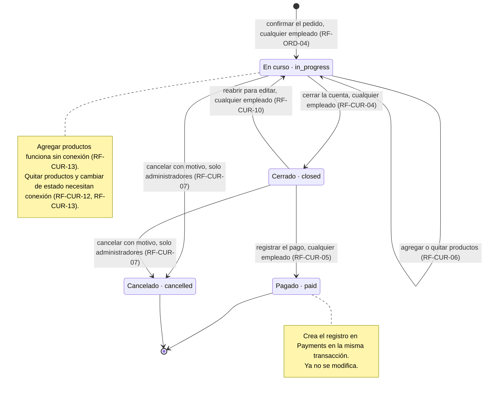

### 16.2 Estado de la habitación
Las tres partes del estado y qué cambia cada una (secciones 6.8 y 6.11 a 6.13).

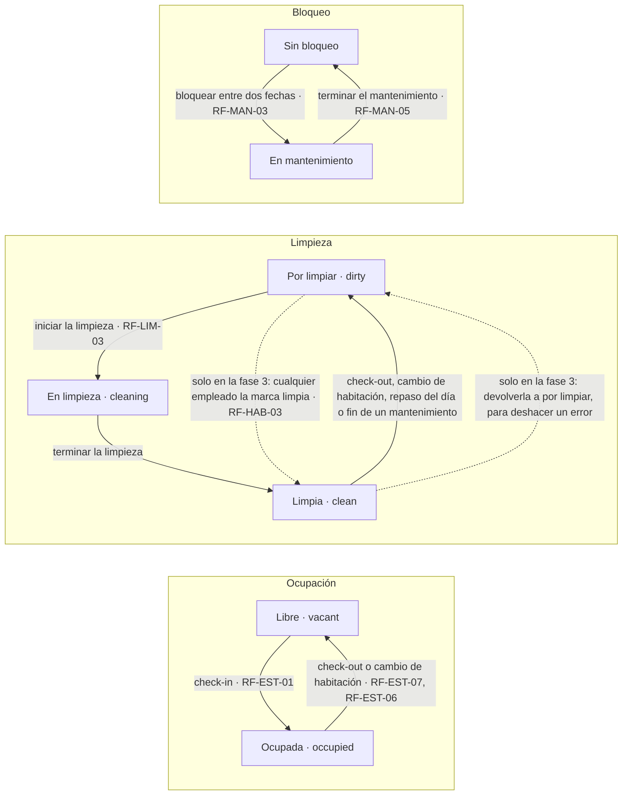

Cómo se combinan las tres partes en el único estado que muestra el tablero (RF-HAB-04):

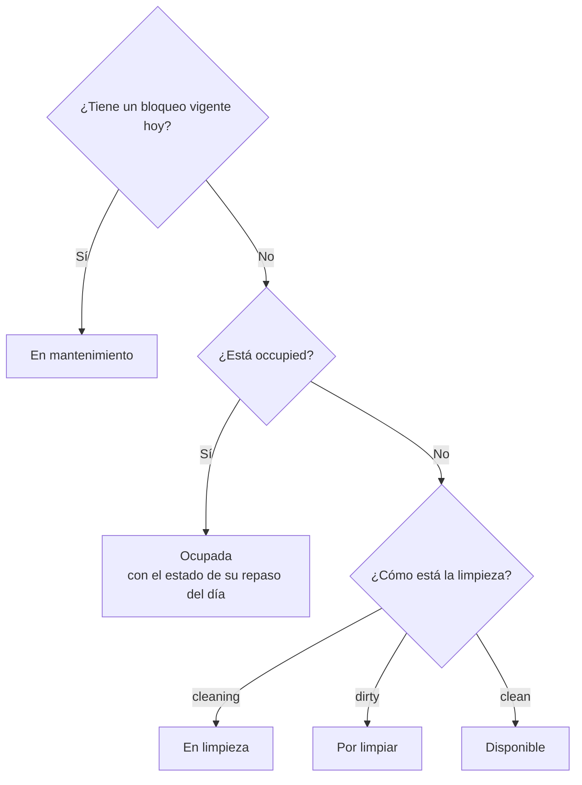

### 16.3 Ciclo de vida de la reserva
Estados de una reserva (secciones 6.9 y 6.10). Todas las acciones las hacen recepción o administración, con conexión.

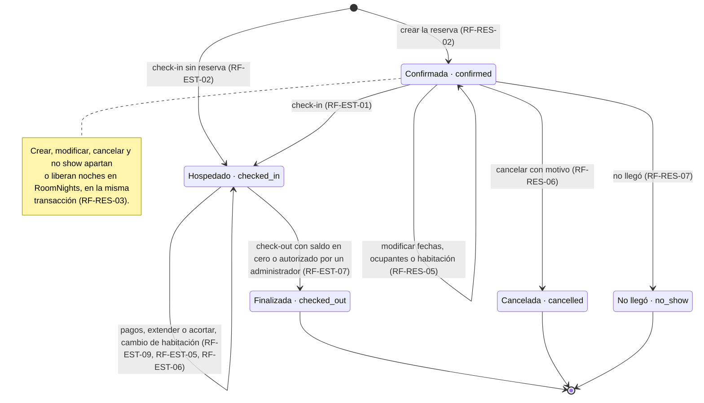

### 16.4 Ciclo de vida de una tarea de habitación
Estados, asignar o tomar, y su efecto en la habitación (secciones 6.11 a 6.13).

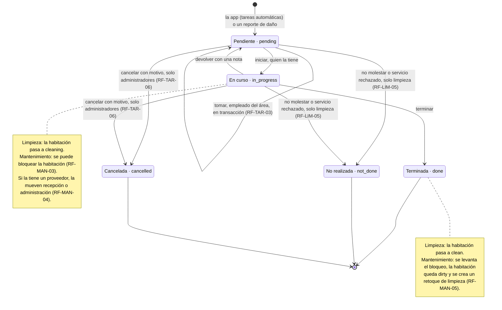

### 16.5 Mapa de navegación
Pantallas de la app y quién llega a cada una según el rol y el área (secciones 3 y 6). Es el destino de la versión 1.0.0, con las cuatro fases. La pantalla de registro desapareció en M2 (RF-AUTH-02) y la introducción en M17.

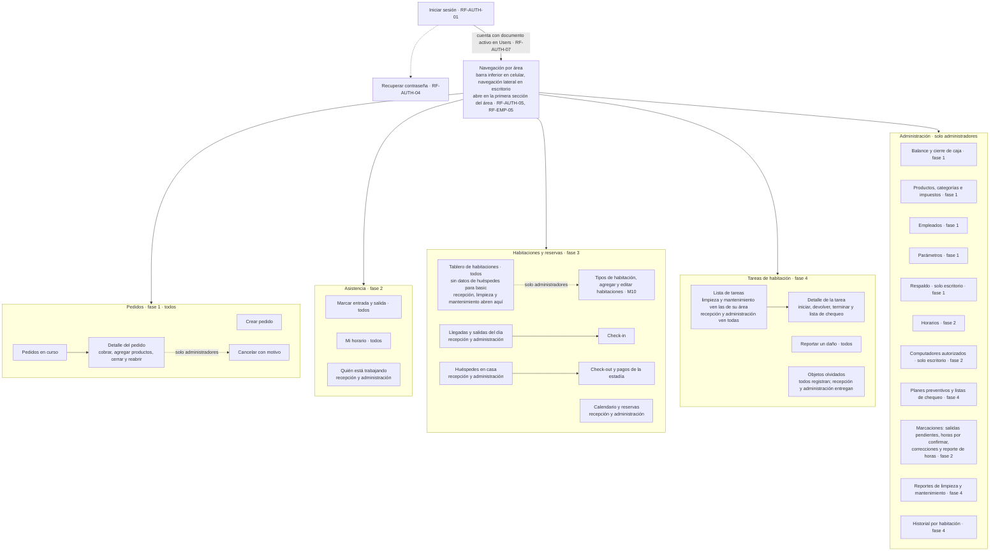

### 16.6 Flujo de un pedido
Pasos desde tomar el pedido hasta registrar el pago (secciones 6.2 y 6.3).

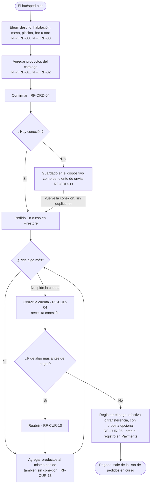

### 16.7 Flujo de check-in y check-out
Pasos de recepción con y sin reserva (secciones 6.9 y 6.10).

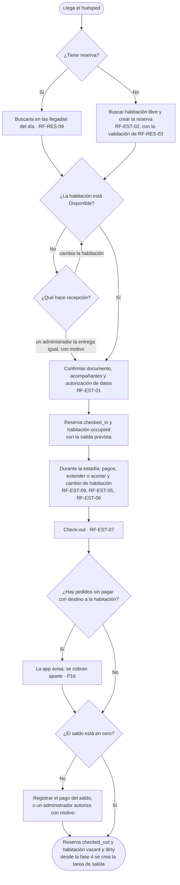

### 16.8 Día de limpieza
Desde la creación de las tareas hasta dejar las habitaciones disponibles (sección 6.12).

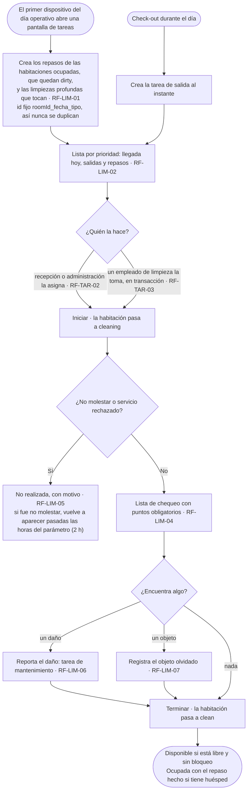

### 16.9 Flujo de asistencia
Marcación con ubicación o en recepción, olvidos y correcciones (sección 6.7).

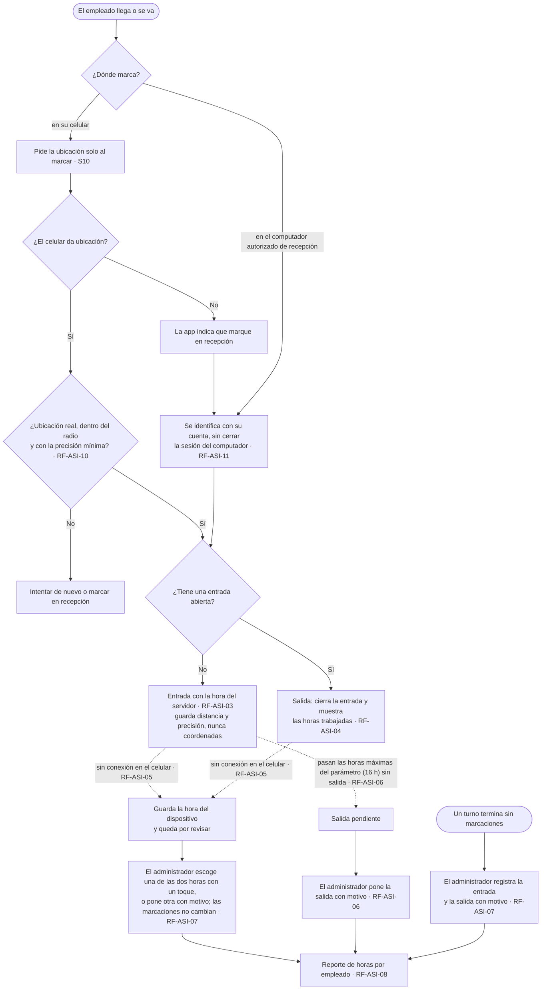

### 16.10 Modelo de datos
Colecciones de Firestore y sus relaciones (sección 8). Los campos de cada colección están en las tablas de esa sección.

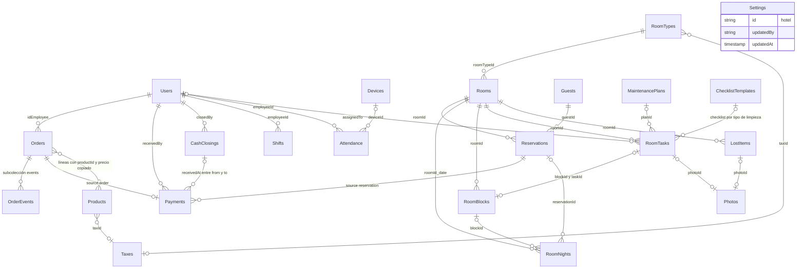

### 16.11 Arquitectura
Módulos de Kotlin Multiplatform, capas de `shared` y servicios de Firebase (secciones 1 y 4). Las flechas apuntan hacia la dependencia.

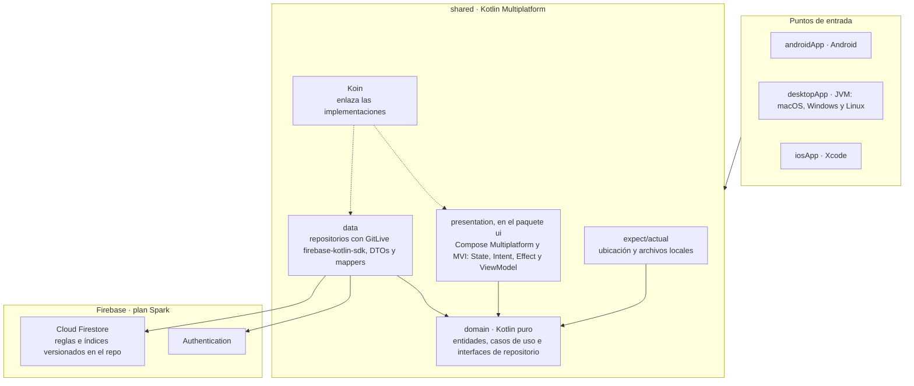

### 16.12 Hoja de ruta
Hitos, fases y dependencias (sección 10). M7, M9 y M13 se unieron a M16.

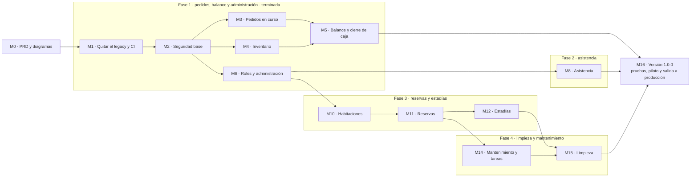
