# PRD: Hotel Management

| | |
|---|---|
| **Estado** | Alcance cerrado. Versión 1.0 del documento. |
| **Fecha** | 2026-11-02 |
| **Repositorio** | `PeakDevCol/HotelManagement` |
| **Responsable de producto** | Por definir |

> **Cómo leer este documento.**
> El alcance de la app, de la v1.0 a la v1.3, quedó cerrado el 2026-11-02 ([sección 5](#5-alcance-por-versión)).
> Lo que sale del código actual se escribe como hecho. Lo demás es el diseño acordado.
> Los valores marcados como **por defecto** los puede cambiar el administrador ([P33](#12-preguntas-abiertas), RF-EMP-06).
> Lo que todavía hay que comprobar técnicamente está en la [sección 12](#12-preguntas-abiertas) como validaciones (V1 a V8), cada una con el hito en que se resuelve.
> **Control de cambios:** una función nueva entra primero a la columna "Después" de la sección 5 y se anota en la [sección 13](#13-registro-de-decisiones). Solo pasa a una versión con una decisión explícita.
> Los riesgos están en la [sección 14](#14-riesgos), el glosario en la [15](#15-glosario) y los diagramas en la [16](#16-diagramas).

---

## 1. Resumen

Hotel Management es la app interna del **Hotel Juan Majestic** (desde 2014), un hotel de unas 30 habitaciones ([P30](#12-preguntas-abiertas)).
Con ella los empleados toman pedidos a habitaciones, mesas, piscina y bar, siguen su estado hasta el pago, administran el catálogo de productos y consultan el balance de ventas (v1.0).
El alcance sigue en tres versiones más:

- **v1.1, turnos y asistencia:** horarios y registro de la hora de llegada y de salida de cada empleado.
- **v1.2, reservas y estadías:** habitaciones, reservas, check-in y check-out.
- **v1.3, limpieza y mantenimiento:** tareas sobre cada habitación que se asignan o que el empleado toma, bloqueo de habitaciones, mantenimiento preventivo y objetos olvidados.

Es una sola base de código en Kotlin Multiplatform y Compose Multiplatform, que corre en **Android, iOS y escritorio** (macOS, Windows y Linux), con **Firebase** (Authentication y Firestore) como backend.
Al inicio se distribuye solo en Android y escritorio ([P22](#12-preguntas-abiertas)), y todo funciona en el plan gratuito de Firebase, Spark ([P34](#12-preguntas-abiertas)).

## 2. Problema y objetivos

### Problema
Hoy los pedidos del hotel se anotan en papel ([P12](#12-preguntas-abiertas)).
Así es difícil saber qué está pendiente de entregar o cobrar, cuánto se vendió en el día y qué empleado atendió cada pedido.
Las reservas, la asistencia, la limpieza y el mantenimiento tienen el mismo problema: sin un registro compartido, una habitación se puede reservar dos veces o entregarse sin limpiar, un daño reportado se olvida y no hay forma confiable de saber a qué hora llegó y salió cada empleado.

### Objetivos
| # | Objetivo | Métrica de éxito | Cómo se mide | Versión |
|---|---|---|---|---|
| O1 | Registrar todos los pedidos en la app | El 100 % de los pedidos del turno quedan en Firestore | Durante el piloto (M7), comparar en varios turnos las comandas en papel con los pedidos de la app | v1.0 |
| O2 | Saber en todo momento qué está pendiente | Cualquier empleado ve los pedidos en curso en tiempo real | Prueba con dos dispositivos: un cambio en uno se ve en el otro en menos de 5 s (RNF-05) | v1.0 |
| O3 | Cuadrar la caja | El balance coincide con el dinero recibido | La diferencia de cada cierre de caja (RF-BAL-06) es $0 o queda justificada en la nota | v1.0 |
| O4 | Tomar un pedido rápido | Crear un pedido de 3 productos toma menos de 1 minuto | Cronometrar a 3 empleados durante el piloto | v1.0 |
| O5 | Registrar la asistencia | El 100 % de los turnos tienen entrada y salida | Reporte de horas (RF-ASI-08): turnos sin marcación o corregidos por el administrador | v1.1 |
| O6 | No reservar dos veces la misma habitación | Cero noches con dos reservas | Imposible por diseño (RF-RES-03), y revisado en el calendario durante el piloto | v1.2 |
| O7 | Saber la ocupación en todo momento | Recepción ve el estado de cada habitación | Tablero en tiempo real (RF-HAB-04) | v1.2 |
| O8 | Entregar siempre habitaciones limpias | Cero check-ins en habitaciones sin limpiar | La app lo impide (RF-EST-03), y cada excepción queda con motivo | v1.3 |
| O9 | Atender los daños a tiempo | Las tareas de mantenimiento empiezan dentro del tiempo objetivo de su prioridad | Reporte de tareas (RF-TAR-09) | v1.3 |

Antes del piloto conviene medir cuánto tarda hoy tomar un pedido en papel y cuántas diferencias de caja hay, para tener con qué comparar.

### Fuera de alcance
- Facturación electrónica ante la DIAN.
- Pagos en línea dentro de la app. La app registra cómo se pagó, pero no cobra.
- Integración con datáfonos.
- Integración con agencias en línea (Booking, Airbnb, Expedia) o con un channel manager, y motor de reservas en la web del hotel.
- Nómina, horas extra y recargos. La app reporta las horas trabajadas, pero no las liquida.
- Inventario de lencería, amenities y repuestos, y compras a proveedores. Mantenimiento solo anota materiales y costo.
- Cerraduras electrónicas, sensores o domótica.
- Impresión de comandas o tiquetes, y pantallas de cocina.
- Pedidos o reservas hechos directamente por los huéspedes.
- Varias sedes: la app atiende un solo hotel.

Lo que se dejó para más adelante está en la columna "Después" de la [sección 5](#5-alcance-por-versión).

## 3. Usuarios y roles

El modelo tiene dos tipos de usuario, `UserType.ADMIN` y `UserType.BASIC` (en `shared/.../domain/model/User.kt`), pero hoy la app no los usa.
Se agrega `RECEPTION` ([P23](#12-preguntas-abiertas)).
El **rol** define los permisos. Además, cada empleado tiene un **área** (servicio, recepción, limpieza, mantenimiento o administración), que define qué tareas ve y qué aparece primero en su menú (RF-EMP-05). No hay un rol de supervisión ([P31](#12-preguntas-abiertas)).
Las cuentas las crea solo un administrador, y el primer administrador se crea a mano en la consola de Firebase ([P1](#12-preguntas-abiertas)).

| Acción | Empleado (`basic`) | Recepción (`reception`) | Administrador (`admin`) |
|---|:---:|:---:|:---:|
| Iniciar y cerrar sesión | ✅ | ✅ | ✅ |
| Crear y editar pedidos | ✅ | ✅ | ✅ |
| Cerrar la cuenta, reabrirla y registrar el pago | ✅ | ✅ | ✅ |
| Cancelar un pedido, con motivo | ❌ | ❌ | ✅ |
| Marcar entrada y salida, y ver su horario | ✅ | ✅ | ✅ |
| Reportar un daño o un objeto olvidado | ✅ | ✅ | ✅ |
| Tomar y hacer tareas de limpieza o mantenimiento | ✅ (según su área) | ❌ | ✅ |
| Asignar tareas a un empleado | ❌ | ✅ | ✅ |
| Bloquear una habitación por mantenimiento | ✅ (área de mantenimiento) | ✅ | ✅ |
| Cancelar una tarea, con motivo | ❌ | ❌ | ✅ |
| Entregar un objeto olvidado a su dueño | ❌ | ✅ | ✅ |
| Ver el tablero de habitaciones | ✅ (sin datos de huéspedes) | ✅ | ✅ |
| Crear y modificar reservas, y hacer check-in y check-out | ❌ | ✅ | ✅ |
| Ver datos personales de huéspedes | ❌ | ✅ | ✅ |
| Hacer el cierre de caja | ❌ | ❌ | ✅ |
| Ver el balance | ❌ | ❌ | ✅ |
| Ver el reporte de horas, los reportes de limpieza y mantenimiento y el historial por habitación ([P37](#12-preguntas-abiertas)) | ❌ | ❌ | ✅ |
| Administrar productos, impuestos, habitaciones, tarifas, parámetros y planes preventivos | ❌ | ❌ | ✅ |
| Crear empleados, asignar rol, área y horario, y autorizar computadores | ❌ | ❌ | ✅ |
| Corregir marcaciones de asistencia y exportar respaldos | ❌ | ❌ | ✅ |

> **Riesgo actual:** el registro está abierto, así que cualquiera que instale la app puede crear una cuenta y escribir pedidos.
> Se cierra en M2 con RF-AUTH-02 y RF-AUTH-07.

### Escenarios de uso
Sirven para revisar que los requisitos cubren el trabajo diario y para guiar el piloto.

1. **Pedido en la piscina.** Un mesero se acerca a una mesa de la piscina, agrega productos y confirma: el pedido queda En curso. Más tarde agrega otra ronda al mismo pedido. Si no hay señal, los productos quedan "pendientes de enviar" y se envían solos al volver la conexión.
2. **Servicio a la habitación.** Recepción recibe la llamada de la habitación 204 y crea el pedido con ese destino.
3. **Cobro en la mesa.** El huésped pide la cuenta. El mesero la cierra, cobra y registra el pago en efectivo o por transferencia, con la propina si la hay. Si el huésped pide algo más después de cerrar, el mesero reabre el pedido.
4. **Cierre de caja.** Al cambiar de turno o al final del día, el administrador revisa lo cobrado, cuenta el efectivo y registra el cierre.
5. **Empleado nuevo.** El administrador crea la cuenta con nombre, correo, rol y área. El empleado recibe un correo para crear su contraseña.
6. **Empleado que se retira.** El administrador desactiva la cuenta y el empleado pierde el acceso de inmediato, aunque conserve la app en su celular.
7. **Llegada al turno.** Una empleada llega al hotel y marca su entrada desde su celular, que confirma que está dentro del hotel. Si no tiene ubicación, marca en el computador de recepción. Al irse marca la salida.
8. **Reserva por teléfono.** Recepción busca una habitación doble libre del 20 al 23 y la reserva a nombre del huésped. Si el mismo huésped necesita otra habitación, recepción hace otra reserva ([P35](#12-preguntas-abiertas)).
9. **Check-in.** El huésped llega. Recepción confirma su documento, registra a los acompañantes y la autorización de datos, y le entrega la habitación, que pasa a Ocupada.
10. **Check-out.** Recepción registra el pago del saldo y la habitación pasa a Por limpiar. Si quedan pedidos sin pagar con destino a esa habitación, la app avisa.
11. **Mañana de limpieza.** Al abrir la app en la mañana ya están las tareas del día: salidas, repasos de habitaciones ocupadas y la limpieza profunda que toca. Recepción asigna algunas, y las camareras toman las demás desde su lista, empezando por las que tienen llegada hoy.
12. **Camarera que encuentra un daño.** Mientras limpia la 305, una camarera ve que el aire acondicionado gotea. Desde su tarea reporta el daño con una foto, y la tarea de mantenimiento aparece al instante en la lista de mantenimiento.
13. **Habitación en mantenimiento.** El técnico toma la tarea y bloquea la 305 por tres días, así nadie puede reservarla. Le falta un repuesto, así que devuelve la tarea a pendiente con esa nota. Al terminar, se levanta el bloqueo y se crea un retoque de limpieza.
14. **Mantenimiento preventivo.** Cada 30 días la app crea la tarea de limpiar los filtros del aire de cada habitación, y sugiere hacerlo en un día en que esté libre.

## 4. Estado actual

### Módulos
| Módulo | Contenido | Estado |
|---|---|---|
| `shared` | Dominio, datos (Firebase vía GitLive), Koin y UI en Compose | En uso |
| `androidApp` | Punto de entrada Android | En uso |
| `desktopApp` | Punto de entrada de escritorio (JVM) | En uso |
| `iosApp` | Proyecto de Xcode | En uso. Falta registrar la app iOS en Firebase, cuando se necesite ([P22](#12-preguntas-abiertas)). |

### Funciones
| Función | Estado | Notas |
|---|---|---|
| Introducción, login y cerrar sesión | ✅ Migrado | La sesión de Firebase decide qué navegación se muestra |
| Registro abierto | ✅ Migrado | Se quita en M2: las cuentas las crea el administrador (P1) |
| Menú principal | ✅ Migrado | Las secciones que faltan muestran "Próximamente" |
| Crear pedido | ✅ Migrado | Catálogo fijo de 9 productos (`StaticProductCatalog`) |
| Pedidos en curso | ⬜ Pendiente | En el menú muestra "Próximamente". Llega en M3. |
| Inventario | ⬜ Pendiente | En el menú muestra "Próximamente". Llega en M4. |
| Balance | ⬜ Pendiente | En el menú muestra "Próximamente". Llega en M5. |
| Recuperar contraseña | ⬜ Pendiente | |
| Roles y permisos | ⬜ Pendiente | `UserType` existe pero no se usa |
| Turnos y asistencia | ⬜ Nuevo | v1.1 |
| Habitaciones, reservas, check-in y check-out | ⬜ Nuevo | v1.2 |
| Limpieza y mantenimiento | ⬜ Nuevo | v1.3 |

Hay 36 tests en `commonTest` (dominio, datos y ViewModels), y pasan en JVM y en Android.

## 5. Alcance por versión

Alcance cerrado el 2026-11-02. Lo que está en "Después" no forma parte de la v1.0 a la v1.3.

| Función | v1.0 | v1.1 | v1.2 | v1.3 | Después |
|---|:---:|:---:|:---:|:---:|:---:|
| Autenticación, roles, áreas y cuentas creadas por el administrador | ✅ | | | | |
| Recuperar contraseña | ✅ | | | | |
| Crear pedido, con destinos piscina y bar | ✅ | | | | |
| Pedidos sin conexión | ✅ | | | | |
| Pedidos en curso: En curso, Cerrado y Pagado | ✅ | | | | |
| Inventario: catálogo en Firestore e impuestos opcionales | ✅ | | | | |
| Balance mensual con filtros | ✅ | | | | |
| Cierre de caja diario y manual | ✅ | | | | |
| Propinas | ✅ | | | | |
| Administración de empleados, parámetros y respaldo manual | ✅ | | | | |
| Distribución en Android y escritorio | ✅ | | | | |
| Horarios y reporte de horas | | ✅ | | | |
| Marcación desde el celular dentro del hotel o desde un computador autorizado | | ✅ | | | |
| Habitaciones y tablero de estado | | | ✅ | | |
| Huéspedes y reservas (una habitación por reserva) | | | ✅ | | |
| Check-in, check-out y pagos de la estadía | | | ✅ | | |
| Tareas de habitación: asignar o tomar, con estado de la habitación | | | | ✅ | |
| Limpieza: tareas automáticas del día y listas de chequeo | | | | ✅ | |
| Mantenimiento: reportes, bloqueo de habitaciones y preventivo | | | | ✅ | |
| Objetos olvidados | | | | ✅ | |
| Fotos en daños y objetos olvidados (guardadas en Firestore) | | | | ✅ | |
| Distribución en iOS | | | | | ✅ (P22) |
| Inventario: control de existencias | | | | | ✅ (P5) |
| Temporadas de tarifas | | | | | ✅ (P27) |
| Anticipos de reservas | | | | | ✅ (P25) |
| Datos y reporte para la TRA y el SIRE | | | | | ✅ (P28) |
| Inspección de habitaciones | | | | | ✅ (P31) |
| Mantenimiento de áreas comunes | | | | | ✅ (P32) |
| Notificaciones push y respaldos automáticos (exigen el plan Blaze) | | | | | ✅ (P34) |
| Exportar el balance y los reportes (CSV o PDF) | | | | | ✅ |
| Descuentos y cortesías | | | | | ✅ (P18) |
| Cargo de consumos a la habitación | | | | | ✅ (P16) |
| Notas en el pedido (por ejemplo, "sin hielo") | | | | | ✅ |

## 6. Requisitos funcionales

Cada requisito tiene un ID para citarlo en ramas, PRs y tests.
Estados: ✅ hecho, 🔄 hecho pero cambia por una decisión nueva, ⬜ pendiente, — descartado o aplazado. Un requisito descartado conserva su ID para no reutilizarlo.

### 6.1 Autenticación (`AUTH`)
| ID | Requisito | Criterios de aceptación | Estado |
|---|---|---|---|
| RF-AUTH-01 | Iniciar sesión con correo y contraseña | Un error de credenciales o de red muestra un mensaje claro. Al entrar se abre el menú. | ✅ |
| RF-AUTH-02 | Quitar el registro abierto ([P1](#12-preguntas-abiertas)) | La pantalla de registro desaparece. Las cuentas se crean desde RF-EMP-04. | 🔄 |
| RF-AUTH-03 | Cerrar sesión | Pide confirmación y vuelve a la introducción. Si hay pedidos pendientes de enviar, avisa y no deja cerrar la sesión (RF-ORD-09). | 🔄 |
| RF-AUTH-04 | Recuperar contraseña | "¿Olvidaste la contraseña?" envía el correo de restablecimiento de Firebase | ⬜ |
| RF-AUTH-05 | Roles y áreas | La app muestra u oculta las secciones según `type` (`basic`, `reception` o `admin`) y ordena el menú según el área. Las reglas de Firestore aplican los mismos permisos. | ⬜ |
| RF-AUTH-06 | ~~Cuentas nuevas pendientes de aprobación~~ | Descartado por P1: ya no hay registro abierto | — |
| RF-AUTH-07 | Sin documento, sin acceso | Una cuenta de Firebase Auth sin documento activo en `Users` no lee ni escribe nada, aunque se haya creado por fuera de la app | ⬜ |

### 6.2 Crear pedido (`ORD`)
| ID | Requisito | Criterios de aceptación | Estado |
|---|---|---|---|
| RF-ORD-01 | Agregar productos desde el catálogo | Búsqueda por nombre y cantidad de 1 a 99. Agregar un producto que ya está en el pedido suma la cantidad. | ✅ |
| RF-ORD-02 | Quitar productos | Quitar un producto actualiza el total | ✅ |
| RF-ORD-03 | Elegir el destino | Habitación o mesa con número, u "Otro" | ✅ |
| RF-ORD-04 | Confirmar el pedido | Solo se puede con al menos un producto y un destino. Guarda con estado `in_progress` (En curso) y la fecha del servidor. Hoy guarda `confirm`. | 🔄 |
| RF-ORD-05 | Reintentar sin duplicar | El borrador conserva su id hasta que se guarda, así que un reintento sobrescribe el mismo documento | ✅ |
| RF-ORD-06 | No quedarse esperando | Sin conexión, el pedido se guarda en el dispositivo (RF-ORD-09) en vez de mostrar un error. Con conexión lenta, a los 15 s avisa y permite reintentar. | 🔄 |
| RF-ORD-07 | Catálogo desde el inventario | Los productos salen de Firestore, y los productos inactivos no aparecen | ⬜ (M4) |
| RF-ORD-08 | Destinos piscina y bar ([P19](#12-preguntas-abiertas)) | Se agregan Piscina y Bar, con número opcional (silla o puesto) | ⬜ |
| RF-ORD-09 | Pedidos sin conexión ([P8](#12-preguntas-abiertas)) | Sin conexión, el pedido queda guardado en el dispositivo con la marca "pendiente de enviar" y se envía solo al volver la conexión, sin duplicarse (V2) | ⬜ |

### 6.3 Pedidos en curso (`CUR`)
Estados del pedido según [P2](#12-preguntas-abiertas) y [P21](#12-preguntas-abiertas): un pedido está En curso desde que se crea, mientras se le agregan productos.
Como no hay datos productivos ([P9](#12-preguntas-abiertas)), los códigos nuevos reemplazan a los actuales sin migración.

| Estado | Código | Significado |
|---|---|---|
| En curso | `in_progress` | El pedido está abierto y se le pueden agregar o quitar productos |
| Cerrado | `closed` | Se culminó y está en proceso de cobro. Para editarlo hay que reabrirlo. |
| Pagado | `paid` | El cliente pagó. Ya no se modifica. |
| Cancelado | `cancelled` | Un administrador lo anuló con un motivo |

```
in_progress ──cerrar cuenta──▶ closed ──registrar pago──▶ paid
     ▲                            │
     └────reabrir para editar─────┘

in_progress o closed ──cancelar (solo administradores, con motivo)──▶ cancelled
```

| Desde | Hacia | Acción | Quién |
|---|---|---|---|
| — | `in_progress` | Confirmar el pedido (RF-ORD-04) | Cualquier empleado |
| `in_progress` | `closed` | Cerrar la cuenta (RF-CUR-04) | Cualquier empleado |
| `closed` | `in_progress` | Reabrir para editar (RF-CUR-10) | Cualquier empleado |
| `closed` | `paid` | Registrar el pago (RF-CUR-05) | Cualquier empleado |
| `in_progress` o `closed` | `cancelled` | Cancelar con motivo (RF-CUR-07) | Solo administradores |

| ID | Requisito | Criterios de aceptación | Estado |
|---|---|---|---|
| RF-CUR-01 | Lista en tiempo real | Muestra los pedidos `in_progress` y `closed`, ordenados por fecha, el más antiguo primero. Un pedido creado en otro dispositivo aparece sin recargar. | ⬜ |
| RF-CUR-02 | Filtros | Mis pedidos o todos, y filtro por estado | ⬜ |
| RF-CUR-03 | Detalle | Productos, cantidades, total, destino, empleado, hora e historial de cambios (RF-CUR-11) | ⬜ |
| RF-CUR-04 | Cerrar la cuenta | `in_progress` → `closed`, guardando `closedAt` y `closedBy` | ⬜ |
| RF-CUR-05 | Registrar el pago | `closed` → `paid`, con el método de pago (efectivo o transferencia, [P4](#12-preguntas-abiertas)) y la propina opcional ([P15](#12-preguntas-abiertas)), guardando `paidAt` y `paidBy`. Crea el registro en `Payments` en la misma transacción. El pedido sale de la lista. | ⬜ |
| RF-CUR-06 | Editar un pedido | Agregar o quitar productos en `in_progress` ([P3](#12-preguntas-abiertas)). El total se recalcula. | ⬜ |
| RF-CUR-07 | Cancelar un pedido ([P20](#12-preguntas-abiertas)) | Solo administradores, con un motivo. Guarda `cancelReason`, `cancelledAt` y `cancelledBy`. | ⬜ |
| RF-CUR-08 | Cambios simultáneos | Si dos dispositivos cambian el estado del mismo pedido a la vez, el cambio se hace en una transacción de Firestore. El segundo ve el estado actualizado y un aviso, y nunca se registra un pago dos veces. | ⬜ |
| RF-CUR-09 | ~~Atender~~ | Descartado por P21: Abierto y En curso son el mismo estado | — |
| RF-CUR-10 | Reabrir | `closed` → `in_progress` para poder editar ([P3](#12-preguntas-abiertas)). Queda en el historial. | ⬜ |
| RF-CUR-11 | Historial | Cada cambio (crear, agregar o quitar productos, cerrar, reabrir, pagar o cancelar) guarda quién, cuándo y qué cambió | ⬜ |
| RF-CUR-12 | Cambios de estado con conexión | Cerrar, reabrir, pagar y cancelar necesitan conexión, porque usan transacciones. Sin conexión, esos botones se desactivan con un aviso. | ⬜ |
| RF-CUR-13 | Agregar productos sin conexión | Sin conexión se pueden agregar productos a un pedido En curso. Al sincronizar se suman a lo que haya agregado otro dispositivo, sin pisarlo (V6). Si al sincronizar el pedido ya no está En curso, las reglas rechazan esos productos y la app avisa cuáles no se agregaron. Quitar productos necesita conexión. | ⬜ |

### 6.4 Inventario (`INV`)
| ID | Requisito | Criterios de aceptación | Estado |
|---|---|---|---|
| RF-INV-01 | Listar productos | Nombre, precio, categoría, impuesto y si está activo | ⬜ |
| RF-INV-02 | Crear y editar productos | Nombre obligatorio y precio mayor que 0. Cambiar un precio no altera los pedidos ya guardados. | ⬜ |
| RF-INV-03 | Desactivar productos | Un producto inactivo no aparece al crear pedidos. Se desactiva, no se borra, para conservar el historial. | ⬜ |
| RF-INV-04 | Categorías | El administrador las define. Por defecto: bebidas, snacks, piscina y bar. Agrupan el selector de productos. | ⬜ |
| RF-INV-05 | Existencias | Queda para después ([P5](#12-preguntas-abiertas)) | — |
| RF-INV-06 | Migrar el catálogo inicial | Los 9 productos de `StaticProductCatalog` se cargan en Firestore una sola vez | ⬜ |
| RF-INV-07 | Impuestos opcionales ([P14](#12-preguntas-abiertas)) | El administrador define impuestos con nombre y porcentaje (por ejemplo, IVA o impuesto al consumo). Cada producto puede tener uno o ninguno. El precio de venta incluye el impuesto, y el pedido guarda cuánto impuesto tiene cada línea. | ⬜ |

### 6.5 Balance (`BAL`)
Todo el balance sale de `Payments` (sección 8), que reúne en un solo lugar los pagos de pedidos y, desde la v1.2, los de reservas.
Las fechas se agrupan por **día operativo**, de 6:00 a. m. a 5:59 a. m. en hora de Colombia por defecto ([P17](#12-preguntas-abiertas)), para no partir un turno nocturno.

| ID | Requisito | Criterios de aceptación | Estado |
|---|---|---|---|
| RF-BAL-01 | Total del periodo ([P6](#12-preguntas-abiertas)) | Por defecto muestra el mes actual: total cobrado y número de pagos (V8) | ⬜ |
| RF-BAL-02 | Filtros | Rango de fechas, método de pago, empleado que cobró, destino, producto y, desde la v1.2, origen (consumos o alojamiento) | ⬜ |
| RF-BAL-03 | Desglose | Por día del mes, por método de pago, por empleado y por producto | ⬜ |
| RF-BAL-04 | Pendientes | Total de lo que está en `in_progress` y `closed`, es decir, lo que falta por cobrar | ⬜ |
| RF-BAL-05 | Exportar | Queda para después: CSV o PDF del rango elegido | — |
| RF-BAL-06 | Cierre de caja ([P17](#12-preguntas-abiertas)) | Cada cierre cubre desde el cierre anterior hasta ese momento. Lo normal es uno por día operativo, y el administrador puede hacer otros, por ejemplo al cambiar de turno (cierre manual). Ingresa el efectivo contado; la app muestra el esperado según los pagos en efectivo, con sus propinas, y guarda la diferencia con una nota. Un cierre guardado no se edita. Si un día operativo termina sin cierre, el balance lo marca. | ⬜ |
| RF-BAL-07 | Conceptos aparte | Las propinas ([P15](#12-preguntas-abiertas)) y los impuestos ([P14](#12-preguntas-abiertas)) se muestran separados de las ventas | ⬜ |
| RF-BAL-08 | Alojamiento (v1.2) | Los pagos de reservas aparecen con origen "alojamiento" y entran al cierre de caja como cualquier otro pago | ⬜ |

### 6.6 Administración (`EMP`)
| ID | Requisito | Criterios de aceptación | Estado |
|---|---|---|---|
| RF-EMP-01 | Listar empleados | Nombre, correo, rol, área y si está activo | ⬜ |
| RF-EMP-02 | Activar o desactivar | Un empleado inactivo no puede usar la app, y las reglas de Firestore lo impiden también | ⬜ |
| RF-EMP-03 | Cambiar el rol | Entre `basic`, `reception` y `admin`. Siempre tiene que quedar al menos un administrador. | ⬜ |
| RF-EMP-04 | Crear empleados ([P1](#12-preguntas-abiertas)) | El administrador ingresa nombre, correo, rol y área. La cuenta se crea sin cerrar la sesión del administrador (V1), y el empleado recibe el correo de Firebase para crear su contraseña, así nadie más la conoce. | ⬜ |
| RF-EMP-05 | Área | Cada empleado tiene un área: servicio, recepción, limpieza, mantenimiento o administración. Define qué tareas de habitación ve y qué aparece primero en su menú. | ⬜ |
| RF-EMP-06 | Parámetros ([P33](#12-preguntas-abiertas)) | El administrador cambia los parámetros de la tabla siguiente desde la app. Cada cambio queda con quién y cuándo. | ⬜ |
| RF-EMP-07 | Respaldo manual ([P34](#12-preguntas-abiertas)) | Desde la app de escritorio, el administrador exporta un respaldo en JSON de las colecciones, completo o desde una fecha. Se recomienda hacerlo cada mes. | ⬜ |

| Parámetro | Por defecto | Desde |
|---|---|---|
| Inicio del día operativo | 6:00 a. m. | v1.0 |
| Tolerancia de llegada tarde | 10 min | v1.1 |
| Horas máximas de una entrada abierta | 16 h | v1.1 |
| Ubicación del hotel, radio y precisión mínima del GPS | Sin ubicación, 150 m y 100 m | v1.1 |
| Horas de check-in y check-out | 3:00 p. m. y 12:00 m. | v1.2 |
| Repaso diario de habitaciones ocupadas | Sí | v1.3 |
| Cambio de sábanas en una estadía | Cada 3 noches | v1.3 |
| Limpieza profunda de cada habitación | Cada 30 días | v1.3 |
| Volver a mostrar una habitación con "no molestar" | A las 2 h | v1.3 |
| Listas de chequeo por tipo de limpieza | Una lista básica por tipo | v1.3 |
| Tiempo objetivo para empezar una tarea de mantenimiento | Urgente 1 h, alta el mismo día, normal 3 días, baja sin plazo | v1.3 |
| Tamaño máximo de una foto y días que se conserva | 200 KB y 180 días | v1.3 |
| Días que se guarda un objeto olvidado | 90 | v1.3 |

> **Nota técnica sobre RF-EMP-04.** Crear una cuenta desde el SDK de cliente inicia sesión con ella.
> Hay dos opciones que funcionan en el plan Spark (V1): una segunda instancia de Firebase solo para crear cuentas, si GitLive lo permite, o la API REST de Firebase Auth, que crea la cuenta sin tocar la sesión de la app.
> La misma técnica sirve para marcar asistencia en el computador de recepción sin cerrar la sesión de quien lo está usando (RF-ASI-11).

### 6.7 Turnos y asistencia (`ASI`, v1.1)
| ID | Requisito | Criterios de aceptación | Estado |
|---|---|---|---|
| RF-ASI-01 | Horarios | El administrador asigna turnos a cada empleado (inicio, fin y área opcional). Un turno puede cruzar la medianoche. Se puede copiar la semana anterior. Avisa si dos turnos del mismo empleado se cruzan. | ⬜ |
| RF-ASI-02 | Mi horario | Cada empleado ve sus turnos de las próximas dos semanas | ⬜ |
| RF-ASI-03 | Marcar entrada ([P29](#12-preguntas-abiertas)) | Desde el celular, solo dentro de la zona del hotel (RF-ASI-10). Desde un computador autorizado de recepción, sin ubicación (RF-ASI-11). Si el celular no da ubicación, la app indica que marque en recepción. Usa la hora del servidor y no deja marcar otra entrada si hay una abierta. | ⬜ |
| RF-ASI-04 | Marcar salida | Con las mismas condiciones de RF-ASI-03. Cierra la entrada abierta y muestra las horas trabajadas. | ⬜ |
| RF-ASI-05 | Marcación sin conexión | En el celular, la ubicación funciona sin internet, así que la marcación se valida igual. Se guarda con la hora del dispositivo y queda "por revisar", porque la hora del servidor solo se conoce al sincronizar. | ⬜ |
| RF-ASI-06 | Salida olvidada | Una entrada abierta por más horas de las del parámetro queda como "salida pendiente" para el administrador | ⬜ |
| RF-ASI-07 | Correcciones | El administrador corrige una marcación con un motivo. Se conservan los valores originales. | ⬜ |
| RF-ASI-08 | Reporte de horas | Por empleado y rango de fechas: horas programadas y trabajadas, llegadas tarde (según la tolerancia) y turnos sin marcación. No calcula nómina ni recargos. Solo lo ve el administrador ([P37](#12-preguntas-abiertas)). | ⬜ |
| RF-ASI-09 | Quién está trabajando | Recepción y administración ven qué empleados tienen una entrada abierta | ⬜ |
| RF-ASI-10 | Zona del hotel | El administrador fija la ubicación del hotel, el radio y la precisión mínima. Se acepta la marcación si el celular está dentro del radio con esa precisión; si no, pide intentar de nuevo o marcar en recepción. Rechaza ubicaciones simuladas, que Android permite detectar (V5). Solo se guardan la distancia y la precisión, no las coordenadas, y no hay rastreo fuera del momento de marcar. | ⬜ |
| RF-ASI-11 | Computadores autorizados | El administrador autoriza el computador de recepción desde la app de escritorio, y puede revocarlo. Solo un computador autorizado muestra la opción de marcar asistencia. El empleado se identifica con su cuenta y marca, sin cerrar la sesión del computador (V1). | ⬜ |

### 6.8 Habitaciones (`HAB`, v1.2)
El estado de una habitación se guarda en tres partes independientes, para que la v1.3 no cambie el modelo:

| Parte | Valores | Qué la cambia |
|---|---|---|
| Ocupación | `vacant` (libre) u `occupied` (ocupada) | El check-in y el check-out |
| Limpieza | `dirty` (por limpiar), `cleaning` (en limpieza) o `clean` (limpia) | El check-out, el repaso del día y las tareas de limpieza |
| Bloqueo | Sin bloqueo, o en mantenimiento entre dos fechas | Las tareas de mantenimiento (RF-MAN-03) |

En el tablero cada habitación muestra un solo estado ([P31](#12-preguntas-abiertas)):

| Se muestra como | Cuándo |
|---|---|
| En mantenimiento | Tiene un bloqueo vigente hoy |
| Ocupada | `occupied`. El tablero indica además si su repaso del día está pendiente, en curso o hecho. |
| En limpieza | `vacant` y `cleaning` |
| Por limpiar | `vacant` y `dirty` |
| Disponible | `vacant` y `clean` |

| ID | Requisito | Criterios de aceptación | Estado |
|---|---|---|---|
| RF-HAB-01 | Tipos de habitación | Nombre, capacidad, tarifa base por noche e impuesto opcional ([P27](#12-preguntas-abiertas)) | ⬜ |
| RF-HAB-02 | Habitaciones | Número, tipo, piso y si está activa. Solo administradores. | ⬜ |
| RF-HAB-03 | Estado de la habitación | Según las tablas de arriba. El check-in la pasa a `occupied`, y el check-out a `vacant` y `dirty`. En la v1.2, cualquier empleado la marca limpia; desde la v1.3 eso lo hacen las tareas de limpieza. | ⬜ |
| RF-HAB-04 | Tablero de habitaciones | Todas las habitaciones con su estado y la salida prevista y, solo para recepción y administración, el huésped actual. En tiempo real. | ⬜ |
| RF-HAB-05 | Temporadas ([P27](#12-preguntas-abiertas)) | Después: el administrador define temporadas con fechas y tarifa por tipo de habitación, y cada noche toma la tarifa de su temporada | — |

### 6.9 Reservas (`RES`, v1.2)
Una reserva es una habitación para un huésped entre dos fechas. Si el mismo huésped necesita otra habitación, se hace otra reserva ([P35](#12-preguntas-abiertas)).

| Estado | Código | Significado |
|---|---|---|
| Confirmada | `confirmed` | La habitación está apartada para esas noches |
| Hospedado | `checked_in` | El huésped llegó y está en la habitación |
| Finalizada | `checked_out` | El huésped se fue y la cuenta quedó saldada |
| Cancelada | `cancelled` | Se anuló con un motivo y liberó las noches |
| No llegó | `no_show` | El huésped no se presentó y las noches se liberaron |

```
confirmed ──check-in──▶ checked_in ──check-out──▶ checked_out
    ├──cancelar──▶ cancelled
    └──no llegó──▶ no_show
```

| ID | Requisito | Criterios de aceptación | Estado |
|---|---|---|---|
| RF-RES-01 | Huéspedes | Crear y buscar huéspedes por nombre o documento. Un documento no se repite. Nombre, tipo y número de documento, nacionalidad, teléfono y correo. | ⬜ |
| RF-RES-02 | Crear reserva | Huésped, habitación, llegada y salida (la salida es posterior a la llegada), adultos y niños (sin pasar la capacidad), tarifa por noche (la base del tipo, que un administrador puede cambiar), total con impuestos, origen (directo, teléfono, WhatsApp o agencia) y notas | ⬜ |
| RF-RES-03 | Sin reservas cruzadas | Buscar habitaciones libres por fechas y número de personas. Una noche de una habitación solo puede estar en una reserva o en un bloqueo, aunque dos personas reserven al mismo tiempo (`RoomNights` en una transacción). Necesita conexión. | ⬜ |
| RF-RES-04 | Calendario de ocupación | Habitaciones por días, con cada reserva y cada bloqueo como una barra. Vista de dos semanas y de un mes. | ⬜ |
| RF-RES-05 | Modificar | Cambiar fechas, ocupantes o habitación con la misma validación de RF-RES-03. El total se recalcula. | ⬜ |
| RF-RES-06 | Cancelar | Con un motivo. Libera las noches. | ⬜ |
| RF-RES-07 | No llegó | Si termina el día de llegada sin check-in, la reserva aparece en la lista de recepción para marcarla como `no_show`, lo que libera las noches | ⬜ |
| RF-RES-08 | ~~Anticipos~~ | Aplazado por P25: por ahora no se cobran anticipos al reservar | — |
| RF-RES-09 | Llegadas y salidas del día | Lista de check-ins y check-outs esperados hoy, con el estado de cada habitación | ⬜ |

### 6.10 Estadías: check-in y check-out (`EST`, v1.2)
| ID | Requisito | Criterios de aceptación | Estado |
|---|---|---|---|
| RF-EST-01 | Check-in con reserva | Confirmar los datos y el documento del huésped, y registrar a los acompañantes (nombre y documento) y la autorización de tratamiento de datos. La reserva pasa a `checked_in` y la habitación a `occupied`, con la hora real de llegada. | ⬜ |
| RF-EST-02 | Check-in sin reserva | Para quien llega sin reservar: crea la reserva y hace el check-in en un solo paso, con la validación de RF-RES-03 | ⬜ |
| RF-EST-03 | Habitación no lista | Solo se entrega una habitación Disponible. Si no lo está, la app avisa y permite cambiarla. Un administrador puede entregarla igual, con un motivo. | ⬜ |
| RF-EST-04 | Huéspedes en casa | Lista de estadías activas, con habitación y salida prevista | ⬜ |
| RF-EST-05 | Extender o acortar | Cambiar la fecha de salida con la validación de RF-RES-03. El total se recalcula. | ⬜ |
| RF-EST-06 | Cambio de habitación | Mueve las noches que faltan a otra habitación. La anterior pasa a `vacant` y `dirty`. | ⬜ |
| RF-EST-07 | Check-out | La reserva pasa a `checked_out`, y la habitación a `vacant` y `dirty`. Exige saldo en cero (RF-EST-09), salvo que un administrador lo autorice con un motivo. Avisa si hay pedidos sin pagar con destino a esa habitación, que se cobran aparte ([P16](#12-preguntas-abiertas)). | ⬜ |
| RF-EST-08 | Datos para la TRA y el SIRE | Aplazado: primero se valida con el hotel cómo hace hoy ese reporte ([P28](#12-preguntas-abiertas)) | — |
| RF-EST-09 | Pagos de la estadía | Registrar pagos en efectivo o por transferencia en cualquier momento entre el check-in y el check-out; cada uno crea un registro en `Payments`. La app muestra noches, tarifa, impuestos, pagos y saldo. | ⬜ |

### 6.11 Tareas de habitación (`TAR`, v1.3)
La limpieza y el mantenimiento se manejan como **tareas sobre una habitación** que cambian su estado ([P31](#12-preguntas-abiertas)).
Cada tarea se asigna a un empleado, o un empleado del área la toma de la lista. No hay rol de supervisión ni inspección.
Por ahora solo hay tareas de habitaciones; las áreas comunes quedan para después ([P32](#12-preguntas-abiertas)).

| Estado | Código | Significado |
|---|---|---|
| Pendiente | `pending` | Creada, asignada o no, y sin empezar |
| En curso | `in_progress` | Alguien la está haciendo |
| Terminada | `done` | Se hizo |
| No realizada | `not_done` | Solo limpieza: "no molestar" o el huésped no quiso servicio |
| Cancelada | `cancelled` | Un administrador la anuló con un motivo |

```
pending ──iniciar──▶ in_progress ──terminar──▶ done
   ▲                     │
   └─devolver con nota───┘

pending o in_progress ──no molestar o servicio rechazado (solo limpieza)──▶ not_done
pending o in_progress ──cancelar (solo administradores, con motivo)──▶ cancelled
```

| Desde | Hacia | Acción | Quién |
|---|---|---|---|
| — | `pending` | Crear: la app (tareas automáticas) o un reporte de daño | La app o cualquier empleado |
| `pending` | `in_progress` | Iniciar | El empleado asignado, o quien la toma (RF-TAR-03). Si la tiene un proveedor, recepción o administración (RF-MAN-04). |
| `in_progress` | `pending` | Devolver con una nota (por ejemplo, falta un repuesto) | El empleado que la tiene. Si la tiene un proveedor, recepción o administración. |
| `in_progress` | `done` | Terminar | El empleado que la tiene. Si la tiene un proveedor, recepción o administración. |
| `pending` o `in_progress` | `not_done` | No molestar o servicio rechazado (RF-LIM-05) | El empleado que la tiene |
| `pending` o `in_progress` | `cancelled` | Cancelar con motivo | Solo administradores |

| ID | Requisito | Criterios de aceptación | Estado |
|---|---|---|---|
| RF-TAR-01 | Lista de tareas | En tiempo real, por prioridad y antigüedad. Cada empleado ve las de su área: las sin asignar y las suyas. Recepción y administración ven todas. | ⬜ |
| RF-TAR-02 | Asignar | Recepción o administración asigna o reasigna una tarea a un empleado del área, mostrando primero a quienes tienen la entrada marcada (RF-ASI-09) | ⬜ |
| RF-TAR-03 | Tomar | Un empleado del área toma una tarea pendiente sin asignar. Se hace en una transacción, para que dos personas no tomen la misma. Necesita conexión. | ⬜ |
| RF-TAR-04 | Estado de la habitación | Iniciar, terminar o bloquear cambian el estado de la habitación (sección 6.8) | ⬜ |
| RF-TAR-05 | Sin conexión | Iniciar, terminar, devolver, marcar la lista de chequeo, reportar daños y registrar objetos se puede sin conexión y se sincroniza después. Tomar, asignar y bloquear necesitan conexión. | ⬜ |
| RF-TAR-06 | Cancelar | Solo administradores, con un motivo | ⬜ |
| RF-TAR-07 | Fotos ([P34](#12-preguntas-abiertas)) | Una foto opcional por tarea u objeto olvidado, comprimida al tamaño máximo del parámetro y guardada en Firestore, aparte de la tarea, para que solo se cargue al abrir el detalle (V7). Se borra pasados los días del parámetro después de cerrar la tarea. | ⬜ |
| RF-TAR-08 | Historial por habitación | Todas las tareas de limpieza y mantenimiento de una habitación, para detectar problemas que se repiten. Solo lo ve el administrador ([P37](#12-preguntas-abiertas)). | ⬜ |
| RF-TAR-09 | Reportes | Limpieza: tareas por persona y por tipo, tiempo promedio y pendientes al cierre del día. Mantenimiento: tareas abiertas por prioridad y antigüedad, porcentaje que empezó a tiempo, noches bloqueadas por habitación y costos por mes. Solo los ve el administrador ([P37](#12-preguntas-abiertas)). | ⬜ |

### 6.12 Limpieza (`LIM`, v1.3)
| Tipo | Código | Cuándo se crea |
|---|---|---|
| Salida | `departure` | Al hacer el check-out. Es la más completa. |
| Repaso | `stayover` | Cada día en las habitaciones ocupadas, si el parámetro está activo |
| Profunda | `deep` | Cuando se cumplen los días del parámetro desde la última |
| Retoque | `touch_up` | Al terminar un mantenimiento, o cuando recepción lo pide |

```
dirty ──iniciar──▶ cleaning ──terminar──▶ clean
```

El check-out, el repaso del día y el fin de un mantenimiento dejan la habitación en `dirty`.

| ID | Requisito | Criterios de aceptación | Estado |
|---|---|---|---|
| RF-LIM-01 | Tareas automáticas | Al empezar el día operativo se crean los repasos de las habitaciones ocupadas y las limpiezas profundas que tocan. Cada check-out crea su tarea de salida al instante. Nunca se duplica una tarea. | ⬜ |
| RF-LIM-02 | Prioridad | Primero las habitaciones con llegada hoy, después las salidas y al final los repasos. Recepción puede subir la prioridad de una tarea. | ⬜ |
| RF-LIM-03 | Hacer la limpieza | Al iniciar, la habitación pasa a `cleaning`; al terminar, a `clean` | ⬜ |
| RF-LIM-04 | Lista de chequeo | Cada tipo de limpieza tiene una lista configurable (por ejemplo: toallas, baño, amenities). El cambio de sábanas aparece en el repaso cada tantas noches como diga el parámetro. Los puntos obligatorios se marcan para poder terminar. | ⬜ |
| RF-LIM-05 | No molestar o servicio rechazado | La tarea pasa a `not_done` con el motivo. Si fue "no molestar", la app la vuelve a mostrar pasadas las horas del parámetro. | ⬜ |
| RF-LIM-06 | Reportar un daño desde la tarea | Crea una tarea de mantenimiento (RF-MAN-01) con la habitación ya puesta | ⬜ |
| RF-LIM-07 | Objetos olvidados | Registrar qué se encontró, en qué habitación, cuándo, quién lo encontró, dónde se guarda y una foto opcional. Estados: guardado, entregado (a quién, cuándo y quién lo entregó) o descartado al pasar los días del parámetro. | ⬜ |

> **Nota técnica sobre RF-LIM-01 y RF-MAN-05.** Sin un servidor, las tareas del día las crea el primer dispositivo que abre una pantalla de tareas ese día.
> Cada tarea automática tiene un id fijo, armado con la habitación, el día operativo y el tipo (sección 8), así que aunque dos dispositivos la creen a la vez queda una sola.

### 6.13 Mantenimiento (`MAN`, v1.3)
| Prioridad | Cuándo |
|---|---|
| Urgente | Riesgo para alguien, o la habitación no se puede usar: agua, electricidad, cerradura o gas |
| Alta | Afecta a un huésped: aire acondicionado, ducha o TV |
| Normal | Se nota pero no impide usar la habitación |
| Baja | Mejoras o detalles estéticos |

| ID | Requisito | Criterios de aceptación | Estado |
|---|---|---|---|
| RF-MAN-01 | Reportar un daño | Cualquier empleado crea una tarea de mantenimiento: habitación, categoría (electricidad, plomería, aire acondicionado, TV o internet, cerrajería, mobiliario u otro), descripción, prioridad y foto opcional. Recepción la crea cuando un huésped se queja. | ⬜ |
| RF-MAN-02 | Avisos de urgencia | Las tareas urgentes se resaltan y muestran un aviso dentro de la app a quienes la tienen abierta. Las notificaciones push quedan para después ([P34](#12-preguntas-abiertas)). | ⬜ |
| RF-MAN-03 | Bloquear la habitación | Al reportar o al hacer la tarea, se puede poner la habitación en mantenimiento entre dos fechas, ampliables. El bloqueo usa `RoomNights`, así que nadie puede reservar esas noches. Si ya hay reservas en esas noches, la app las muestra y no bloquea hasta que recepción las mueva. Si la habitación está ocupada, avisa a recepción para ofrecer un cambio (RF-EST-06). | ⬜ |
| RF-MAN-04 | Proveedor externo | La tarea puede quedar a cargo de un proveedor (nombre y teléfono) en vez de un empleado. Recepción o administración registran el inicio, la devolución y el cierre de esa tarea ([P36](#12-preguntas-abiertas)). | ⬜ |
| RF-MAN-05 | Terminar | Se registra qué se hizo, los materiales, el costo opcional y el tiempo. Se levanta el bloqueo, la habitación queda `dirty` y se crea un retoque de limpieza. | ⬜ |
| RF-MAN-06 | Mantenimiento preventivo | El administrador define planes: qué hacer, en qué habitaciones (todas, un tipo o algunas) y cada cuántos días. La app crea la tarea cuando toca, con prioridad normal, y sugiere los días en que la habitación está libre. | ⬜ |

## 7. Requisitos no funcionales

| ID | Tema | Requisito |
|---|---|---|
| RNF-01 | Plataformas | Android, iOS y escritorio con el mismo código ([P7](#12-preguntas-abiertas)). Al inicio se distribuye solo en Android y escritorio, por instalación directa y sin tiendas ([P10](#12-preguntas-abiertas)). iOS sigue compilando y se distribuye cuando se necesite ([P22](#12-preguntas-abiertas)). |
| RNF-02 | Idioma y moneda | Español de Colombia. Pesos sin decimales con punto de miles (`$24.500`), usando `formatPesos`. |
| RNF-03 | Seguridad | Los permisos se aplican en las **reglas de Firestore**, no solo en la UI. No se guardan contraseñas ni secretos en Firestore ni en el repo. |
| RNF-04 | Conectividad | La app nunca se queda cargando indefinidamente. Sin conexión se pueden crear pedidos y agregarles productos, marcar asistencia en el celular, hacer tareas de habitación y reportar daños u objetos. Los cambios de estado de pedidos, los pagos, las reservas, los check-in y check-out, y tomar, asignar o bloquear necesitan conexión, para no cobrar dos veces ni cruzar reservas. |
| RNF-05 | Tiempo real | Los cambios de un pedido, una habitación o una tarea se ven en los demás dispositivos en menos de 5 s con conexión. |
| RNF-06 | Calidad | El dominio y los ViewModels tienen tests en `commonTest`. Cada PR pasa `./gradlew :shared:allTests :shared:testAndroidHostTest`. |
| RNF-07 | CI | Una GitHub Action en cada PR hacia `develop` corre los tests y compila Android y escritorio. |
| RNF-08 | Accesibilidad | Los íconos tienen descripción, los botones miden al menos 48 dp y hay modo claro y oscuro. Las pantallas de tareas se usan con una mano y con botones grandes. |
| RNF-09 | Compatibilidad de datos | Ya no aplica al legacy: no hay datos productivos ([P9](#12-preguntas-abiertas)) y el legacy se eliminó en M1. Desde el piloto (M7), todo cambio de esquema incluye su migración. |
| RNF-10 | Fechas y zona horaria | Las fechas se guardan con la hora del servidor y se muestran y agrupan en hora de Colombia (`America/Bogota`, UTC−5) en cualquier dispositivo, por día operativo. |
| RNF-11 | Auditoría | Pedidos, pagos, reservas, marcaciones y tareas no se borran. Cada cambio guarda quién y cuándo, y una anulación o corrección conserva el motivo. |
| RNF-12 | Costos | Todo el alcance funciona en el plan gratuito Spark ([P34](#12-preguntas-abiertas)), según la tabla de abajo. Los listeners en tiempo real se limitan a lo abierto, y los reportes consultan solo el rango elegido. El uso real se mide en el piloto (V4). |
| RNF-13 | Índices | Los índices compuestos que necesiten las consultas (por ejemplo `state` + `dateOrder`) se versionan en `firestore.indexes.json`, junto a las reglas. |
| RNF-14 | Datos personales | Desde la v1.1 se usa la ubicación de los empleados, solo al marcar y sin guardar coordenadas (RF-ASI-10). Desde la v1.2 se guardan datos de huéspedes, incluido su documento de identidad, que solo leen recepción y administración, con la autorización de tratamiento de datos registrada. Todo se trata según la Ley 1581 de 2012, y el hotel define por cuánto tiempo conserva los datos de huéspedes. |
| RNF-15 | Respaldo | Respaldo manual en JSON desde la app de escritorio (RF-EMP-07). Los respaldos automáticos de Firestore exigen el plan Blaze y quedan para después. |
| RNF-16 | Reportes oficiales | La app no maneja la TRA ni el SIRE ([P28](#12-preguntas-abiertas)). El hotel sigue con su proceso actual, que se revisará para una versión futura. |
| RNF-17 | Fotos | Se comprimen antes de guardarlas, se guardan en Firestore y solo las ven los roles que ven la tarea o el objeto (RF-TAR-07). |

### Firebase en el plan gratuito ([P34](#12-preguntas-abiertas))
La cuota gratuita de Firestore es de 50.000 lecturas, 20.000 escrituras y 20.000 borrados por día, 1 GiB guardado y 10 GiB de salida al mes.
Con unas 30 habitaciones y unos 15 usuarios, el uso esperado está por debajo de esa cuota, pero hay que medirlo en el piloto (V4).
En Spark, si un día se pasa la cuota, Firestore deja de responder hasta que se reinicia; por eso se vigila el consumo en la consola durante el piloto.

| Necesidad | ¿Exige Blaze? | Cómo se resuelve en Spark | Qué se pierde |
|---|---|---|---|
| Crear cuentas sin sacar al administrador (RF-EMP-04) | Solo si se usa una Cloud Function | Segunda instancia de Firebase o API REST de Firebase Auth (V1) | Nada |
| Roles en las reglas | Solo para custom claims, que necesitan Cloud Functions | `get()` del documento del usuario en las reglas | Una lectura extra por operación |
| Tareas automáticas del día y preventivas (RF-LIM-01, RF-MAN-06) | Solo para crearlas a una hora fija | El primer dispositivo del día las crea, con ids fijos | Se crean al abrir la app, no a una hora exacta |
| Fotos (RF-TAR-07) | Sí, si se usa Cloud Storage | Foto comprimida guardada en Firestore, en su propia colección | Calidad de la foto. Con 200 KB por foto y 180 días de retención, ocupan una parte pequeña del 1 GiB. |
| Notificaciones push | Sí: enviarlas necesita un servidor | Avisos dentro de la app, en tiempo real, mientras está abierta (RF-MAN-02) | No llegan con la app cerrada. Quedan para después. |
| Respaldos automáticos | Sí | Respaldo manual desde escritorio (RF-EMP-07) | La automatización. Queda para después. |

## 8. Modelo de datos (Firestore)

### Actual
**`Orders/{id}`**, que escribe `shared`:

| Campo | Tipo | Notas |
|---|---|---|
| `id` | string | UUID, igual al id del documento |
| `idEmployee` | string | `uid` de Firebase Auth |
| `products` | array | `{productId, productName, quantity, unitAmount, totalAmount}`. El precio queda copiado en el pedido. |
| `typeOrder` | string | `room`, `table` u `other` |
| `typeOrderNumber` | int o null | Número de habitación o mesa |
| `dateOrder` | timestamp | Lo pone el servidor |
| `state` | string | `confirm`, `close` o `pay` |
| `totalPayAmount` | long | Total en pesos |

**`Users/{uid}`**, desde M1: `fullName`, `email`, `type` (`basic` o `admin`) y `createdAt`.
La ruta anterior, `Users/basic/Users/{uid}`, ya no se usa. Sus documentos, con contraseñas en texto plano, se borraron con los datos de prueba (S1).

Como no hay datos productivos ([P9](#12-preguntas-abiertas)), el modelo objetivo reemplaza al actual sin migración. Los datos de prueba se borraron en M0 (S1).

### Modelo objetivo

**Base y pedidos (v1.0)**

| Colección | Campos principales | Notas | Hito |
|---|---|---|---|
| `Users/{uid}` | `fullName`, `email`, `type` (`basic`, `reception` o `admin`), `area` (`service`, `reception`, `housekeeping`, `maintenance` o `management`), `active`, `createdAt`, `createdBy` | Reemplaza a `Users/basic/Users/{uid}` (P9). Sin campos de contraseña. M1 crea la ruta con `fullName`, `email`, `type` y `createdAt`; M2 agrega `area`, `active` y el rol `reception`, y M6, `createdBy`. | M1, M2 y M6 |
| `Orders/{id}` | Los actuales, más `closedAt/By`, `paidAt/By`, `paymentMethod`, `tipAmount`, `taxAmount` y, al cancelar, `cancelReason` y `cancelledAt/By` | `state`: `in_progress`, `closed`, `paid` o `cancelled`. `typeOrder`: `room`, `table`, `pool`, `bar` u `other`. Cada línea tiene su propio id, `taxRate` y `taxAmount`. Las líneas se agregan con `arrayUnion` y el total con `increment`, para que dos dispositivos agreguen productos a la vez, incluso sin conexión, sin pisarse (RF-CUR-13, V6). | M3 |
| `Orders/{id}/events/{id}` | `type`, `by`, `at` y el detalle del cambio | Historial (RF-CUR-11) | M3 |
| `Payments/{id}` | `amount`, `tipAmount`, `method` (`cash` o `transfer`), `source` (`order` o `reservation`), `sourceId`, `receivedBy`, `receivedAt` | Un registro por cada pago recibido. El balance y el cierre de caja salen de aquí. El cierre toma los pagos por `receivedAt` entre su `from` y su `to`, así que un pago nunca se edita. | M3 |
| `CashClosings/{id}` | `from`, `to`, `type` (`daily` o `manual`), `expectedCash`, `countedCash`, `difference`, `note`, `closedBy`, `createdAt` | Cierre de caja (P17) | M5 |
| `Products/{id}` | `name`, `unitPrice`, `category`, `taxId`, `active` | Inventario | M4 |
| `Taxes/{id}` | `name`, `rate`, `active` | Impuestos opcionales (P14) | M4 |
| `Settings/hotel` | Los parámetros de RF-EMP-06, con `updatedBy` y `updatedAt` | Cada versión agrega los suyos | M6 |

**Asistencia (v1.1)**

| Colección | Campos principales | Notas | Hito |
|---|---|---|---|
| `Shifts/{id}` | `employeeId`, `startAt`, `endAt`, `area`, `createdBy` | Horarios | M8 |
| `Attendance/{id}` | `employeeId`, `clockInAt`, `clockOutAt`, `source` (`phone` o `kiosk`), `deviceId`, `distanceMeters`, `accuracyMeters`, `offline`, `deviceTime`, `needsReview` y `correction` (`by`, `reason` y valores originales) | Marcaciones. Sin coordenadas (RF-ASI-10). | M8 |
| `Devices/{id}` | `name`, `authorizedBy`, `authorizedAt`, `active` | Computadores autorizados para marcar (RF-ASI-11) | M8 |

**Habitaciones, reservas y estadías (v1.2)**

| Colección | Campos principales | Notas | Hito |
|---|---|---|---|
| `RoomTypes/{id}` | `name`, `capacity`, `baseRate`, `taxId`, `active` | | M10 |
| `Rooms/{id}` | `number`, `roomTypeId`, `floor`, `occupancy`, `housekeeping`, `expectedCheckOutDate`, `active` | Estado en partes (sección 6.8). Los bloqueos viven en `RoomBlocks`. `expectedCheckOutDate` solo tiene valor mientras la habitación está ocupada: la pone el check-in, la cambian RF-EST-05 y RF-EST-06 y la borra el check-out. Así todos ven la salida prevista sin leer `Reservations` (RF-HAB-04). | M10 |
| `Guests/{id}` | `fullName`, `documentType`, `documentNumber`, `nationality`, `phone`, `email`, `dataConsentAt` | Datos personales: solo recepción y administración (RNF-14) | M11 |
| `Reservations/{id}` | `guestId`, `roomId`, `checkInDate`, `checkOutDate`, `adults`, `children`, `companions`, `nightlyRates`, `taxAmount`, `total`, `paidAmount`, `source`, `state`, `notes`, y quién y cuándo de cada cambio | Una habitación por reserva (P35). `nightlyRates` guarda la tarifa de cada noche, así las temporadas (RF-HAB-05) no cambian el modelo. | M11 |
| `RoomNights/{roomId}_{date}` | `reservationId` o `blockId`, y `arrival` | Un documento por habitación y noche, con `date` en formato `yyyy-MM-dd`, creado en la misma transacción que la reserva o el bloqueo. Como las reglas solo permiten crearlo si no existe, no se puede reservar ni bloquear dos veces la misma noche. `arrival` es `true` en la primera noche de una reserva, así limpieza sabe qué habitaciones tienen llegada hoy sin leer `Reservations` (RF-LIM-02). | M11 |

**Limpieza y mantenimiento (v1.3)**

| Colección | Campos principales | Notas | Hito |
|---|---|---|---|
| `RoomTasks/{id}` | `roomId`, `kind` (`cleaning` o `maintenance`), `type` (`departure`, `stayover`, `deep`, `touch_up`, `corrective` o `preventive`), `priority`, `category`, `description`, `state`, `assignedTo` o `provider` (`name`, `phone`), `takenAt`, `startedAt`, `finishedAt`, `checklist`, `notes`, `notDoneReason`, `resolution` (`work`, `materials`, `cost`, `minutes`), `photoId`, `blockId`, `planId`, `createdBy/At`, `cancelReason` | Las tareas automáticas usan el id fijo `{roomId}_{date}_{type}`, con `date` como día operativo en formato `yyyy-MM-dd` (RF-LIM-01) | M14 |
| `RoomBlocks/{id}` | `roomId`, `from`, `until`, `reason`, `taskId`, `createdBy`, `active` | Habitación en mantenimiento. Sus noches se apartan en `RoomNights`. | M14 |
| `MaintenancePlans/{id}` | `title`, `scope` (todas, un tipo o algunas habitaciones), `everyDays`, `nextDueAt` por habitación, `active` | Mantenimiento preventivo | M14 |
| `Photos/{id}` | `data`, `sizeBytes`, `ownerType`, `ownerId`, `createdBy`, `createdAt` | Fotos comprimidas (RF-TAR-07). Separadas para no cargarlas con las listas. | M14 |
| `ChecklistTemplates/{type}` | `items` (`text`, `required`) | Una lista por tipo de limpieza | M15 |
| `LostItems/{id}` | `description`, `roomId`, `foundBy`, `foundAt`, `storedAt`, `photoId`, `state` (`stored`, `returned` o `discarded`), `returnedTo`, `returnedBy`, `returnedAt` | Objetos olvidados | M15 |

### Reglas de seguridad (esquema)
- Solo usuarios autenticados **con documento activo en `Users`** leen o escriben (RF-AUTH-07).
- Un administrador activo lee todas las colecciones.
- `Users`: todos los empleados activos lo leen (nombre, rol, área y si está activo), para mostrar quién atendió un pedido (RF-CUR-03) y para asignar tareas (RF-TAR-02). Solo un administrador crea usuarios y cambia `type`, `area` o `active`. Nadie escribe campos de contraseña.
- `Orders`:
  - Cualquier empleado activo crea pedidos con `idEmployee` igual a su `uid` y estado `in_progress`.
  - Los cambios de estado siguen la tabla de la sección 6.3.
  - Los productos y el total solo cambian en `in_progress`.
  - Pasar a `paid` exige `paymentMethod`, y `paidBy` igual al `uid` de quien lo registra.
  - Solo un administrador cancela. Nadie modifica un pedido `paid` o `cancelled`.
- `Payments`, `CashClosings` y los historiales (`events`): se crean y no se editan ni se borran. Solo un administrador crea cierres.
- `Products`, `Taxes`, `RoomTypes`, `Settings`, `ChecklistTemplates`, `MaintenancePlans` y `Devices`: todos leen y solo un administrador escribe.
- `Rooms`: todos leen. Solo un administrador cambia los datos de la habitación. `occupancy` cambia con el check-in y el check-out, y `housekeeping` con las tareas de limpieza.
- `Shifts`: cada empleado lee los suyos y solo un administrador escribe.
- `Attendance`: cada empleado crea y cierra sus propias marcaciones. Recepción también las lee, para ver quién está trabajando (RF-ASI-09, RF-TAR-02). Solo un administrador las corrige.
- `Guests` y `Reservations`: solo recepción y administración.
- `RoomNights`: todos los leen, porque no tienen datos personales. Solo se crea si no existe. Recepción y administración los crean para reservas; mantenimiento, recepción y administración, para bloqueos. Se borran para liberar noches (cancelar, no show, modificar, acortar, cambiar de habitación o levantar un bloqueo), en la misma transacción que ese cambio, y los borra quien puede crearlos.
- `RoomTasks`: cualquier empleado activo crea tareas. Un empleado del área toma una tarea sin asignar, poniendo su propio `uid`. Solo el empleado asignado la inicia, la devuelve o la termina; si la tarea está a cargo de un proveedor, lo hacen recepción y administración ([P36](#12-preguntas-abiertas)). Recepción y administración asignan. Solo un administrador cancela.
- `Photos` y `LostItems`: cualquier empleado activo crea. Solo recepción y administración entregan o descartan objetos.

**Cómo saber el rol en las reglas:** leer `type`, `area` y `active` del documento del usuario con `get()`. Cada `get()` se cobra como una lectura de Firestore.

**Límite de las reglas con la ubicación:** la ubicación la reporta el celular, y las reglas no pueden comprobarla. El riesgo se reduce con la detección de ubicaciones simuladas y la revisión del administrador (R12).

## 9. Seguridad y deuda técnica

| # | Tema | Acción | Hito |
|---|---|---|---|
| S1 | El legacy guarda contraseñas en texto plano en `Users` | Como no hay datos productivos, una persona borra todos los datos de prueba de Firestore antes de publicar este PRD, porque el repo es público. Al eliminar el legacy (M1) se revisa que no queden. | M0 ✅ |
| S2 | La API key de `google-services.json` está en el historial público del repo | Se decidió mitigar sin reescribir el historial: reglas de Firestore estrictas y la key restringida al paquete y a la SHA-1 de Android. Como con esa key se pueden crear cuentas de Auth por la API REST, RF-AUTH-07 es obligatorio. | M2 |
| S3 | Las reglas de Firestore no se sabe si están desplegadas | Versionar las reglas en el repo (`firestore.rules`) y desplegarlas | M2 |
| S4 | Protección adicional | Secret scanning y push protection en GitHub. Firebase App Check en modo de monitoreo: no se puede exigir mientras la app de escritorio use Firestore directamente, porque no tiene proveedor de App Check (V3). | M7 |
| S5 | Módulo legacy `app` duplicado | Eliminarlo en M1: ya no quedan pantallas por migrar desde ahí ni usuarios que lo usen | M1 ✅ |
| S6 | Primer administrador | Crearlo a mano en Firebase Auth y en `Users/{uid}` antes de desplegar las reglas (P1) | M2 |
| S7 | Las reglas nuevas pueden bloquear a todos o dejar huecos | Tests de las reglas en el emulador de Firebase para cada rol y cada cambio de estado, y despliegue en un horario de poca operación | M2 |
| S8 | Registro abierto | Quitar la pantalla (RF-AUTH-02) y exigir documento activo en las reglas (RF-AUTH-07) | M2 |
| S9 | Datos personales de huéspedes | Reglas por rol probadas en el emulador. Los documentos de identidad no aparecen en logs, mensajes de error ni respaldos sin control. | M11 |
| S10 | Ubicación de los empleados | Pedir el permiso solo al marcar, explicar para qué se usa y no guardar coordenadas (RF-ASI-10) | M8 |

## 10. Hoja de ruta

Cada hito sale de `develop` en su propia rama y vuelve con un PR, y empieza resolviendo sus validaciones de la [sección 12](#12-preguntas-abiertas).

| Hito | Versión | Rama | Contenido | Depende de |
|---|---|---|---|---|
| M0 | — | `task/prd` | Este PRD (primer PR) y los diagramas de la [sección 16](#16-diagramas) (segundo PR). Borrar los datos de prueba (S1). | — |
| M1 | v1.0 | `feature/remove-legacy` | Eliminar `app` (S5), revisar que no queden datos de prueba (S1), ruta `Users/{uid}` (P9) y CI (RNF-07). Va primero porque, sin usuarios productivos, es el momento más barato. | M0 |
| M2 | v1.0 | `feature/security-baseline` | S2, S3, S6, S7 y S8. Roles, áreas y `active` en las reglas. RF-AUTH-02 y RF-AUTH-07. | M1 |
| M3 | v1.0 | `feature/current-orders` | Estados nuevos (RF-ORD-04), RF-ORD-06, RF-ORD-08, RF-ORD-09, RF-AUTH-03, RF-CUR-01 a RF-CUR-08, RF-CUR-10 a RF-CUR-13 y `Payments`. Validaciones V2 y V6. | M2 |
| M4 | v1.0 | `feature/inventory` | RF-INV-01 a RF-INV-04, RF-INV-06, RF-INV-07 y RF-ORD-07 | M2 |
| M5 | v1.0 | `feature/balance` | RF-BAL-01 a RF-BAL-04, RF-BAL-06 y RF-BAL-07. Validación V8. | M3 y M4 |
| M6 | v1.0 | `feature/roles-admin` | RF-AUTH-04, RF-AUTH-05 y RF-EMP-01 a RF-EMP-07. Validación V1. | M2 |
| M7 | v1.0 | `release/1.0.0` | Pruebas en dispositivos reales, S4, piloto de 1 a 2 semanas en un área del hotel, distribución en Android y escritorio (P10 y P22), etiqueta `v1.0.0` y merge a `main`. Validaciones V3 y V4. | M3 a M6 |
| M8 | v1.1 | `feature/attendance` | RF-ASI-01 a RF-ASI-11 y S10. Validación V5. | M7 |
| M9 | v1.1 | `release/1.1.0` | Pruebas de ubicación dentro y alrededor del hotel, etiqueta `v1.1.0` y merge a `main` | M8 |
| M10 | v1.2 | `feature/rooms` | RF-HAB-01 a RF-HAB-04 | M7 |
| M11 | v1.2 | `feature/reservations` | RF-RES-01 a RF-RES-07, RF-RES-09 y S9 | M10 |
| M12 | v1.2 | `feature/stays` | RF-EST-01 a RF-EST-07, RF-EST-09 y RF-BAL-08 | M11 |
| M13 | v1.2 | `release/1.2.0` | Pruebas, piloto en recepción, etiqueta `v1.2.0` y merge a `main` | M9 y M12 |
| M14 | v1.3 | `feature/maintenance` | RF-TAR-01 a RF-TAR-09 y RF-MAN-01 a RF-MAN-06. Validación V7. | M13 |
| M15 | v1.3 | `feature/housekeeping` | RF-LIM-01 a RF-LIM-07 | M14 |
| M16 | v1.3 | `release/1.3.0` | Pruebas, piloto con limpieza y mantenimiento, etiqueta `v1.3.0` y merge a `main` | M15 |

M3, M4 y M6 son independientes y pueden avanzar en paralelo. M8 y M10 también, si hay más de una persona en el equipo.
M14 trae la base de tareas que usa la limpieza, por eso va antes que M15.

## 11. Definición de terminado

Un hito está terminado cuando:
- [ ] Los requisitos del hito cumplen sus criterios de aceptación.
- [ ] Las validaciones del hito (sección 12) están resueltas y su resultado quedó en la sección 13.
- [ ] Hay tests para la lógica nueva en `commonTest`, y `./gradlew :shared:allTests :shared:testAndroidHostTest` pasa.
- [ ] Android, escritorio e iOS compilan.
- [ ] Las pantallas nuevas se revisaron en modo claro y oscuro.
- [ ] No se subieron secretos (`google-services.json`, `GoogleService-Info.plist`, keystores).
- [ ] Si el hito cambia reglas o índices, `firestore.rules` y `firestore.indexes.json` se actualizaron y las reglas se probaron en el emulador.
- [ ] Si el hito guarda datos personales o usa la ubicación, solo los roles autorizados pueden leerlos y los tests de reglas lo comprueban.
- [ ] El PR hacia `develop` cita los IDs de los requisitos que cubre.
- [ ] Este PRD se actualizó: estado de cada requisito y decisiones nuevas.

## 12. Preguntas abiertas

No quedan preguntas de negocio abiertas. Quedan validaciones técnicas, que se resuelven al empezar el hito indicado.

### Validaciones técnicas
| # | Qué hay que comprobar | Si no se cumple | Afecta | Hito |
|---|---|---|---|---|
| V1 | Crear cuentas sin cerrar la sesión actual: con una segunda instancia de Firebase en GitLive, o con la API REST de Firebase Auth | Usar la otra opción; las dos funcionan en Spark | RF-EMP-04, RF-ASI-11 | M6 |
| V2 | Que los pedidos guardados sin conexión se conserven al cerrar y abrir la app, en Android y en escritorio | En escritorio, guardar los pendientes en un archivo local propio | RF-ORD-09 | M3 |
| V3 | Que App Check no tiene proveedor para la app de escritorio (JVM) | Si lo tuviera, exigirlo; si no, dejarlo en modo de monitoreo | S4, R12 | M7 |
| V4 | Uso real de Firestore durante el piloto, contra la cuota diaria de Spark | Reducir listeners y lecturas. Pasar a Blaze solo con una decisión nueva. | RNF-12 | M7 |
| V5 | Precisión del GPS dentro del hotel y detección de ubicaciones simuladas | Ajustar el radio y la precisión; siempre queda el computador de recepción | RF-ASI-10 | M8 |
| V6 | Que agregar productos sin conexión desde dos dispositivos no pise líneas ni el total (`arrayUnion` e `increment`). Y que, si otro dispositivo cerró el pedido mientras tanto, la app detecte que el servidor rechazó esos productos y avise, aunque se haya cerrado y abierto la app. | Permitir agregar productos solo con conexión | RF-CUR-13 | M3 |
| V7 | Tamaño de las fotos comprimidas, y que solo se lean al abrir el detalle | Bajar la calidad o quitar las fotos | RF-TAR-07 | M14 |
| V8 | Si GitLive permite consultas de suma y conteo en Firestore para el balance | Sumar en el cliente, consultando solo el rango elegido | RF-BAL-01 | M5 |

### Preguntas resueltas
| # | Pregunta | Respuesta |
|---|---|---|
| P1 | ¿Quién puede crear cuentas? | Solo el administrador. El primer administrador se crea a mano. |
| P2 | ¿Qué significa cada estado del pedido? | Cerrado: ya se culminó y está en proceso de cobro. Pagado: el cliente pagó. Abierto y En curso resultaron ser el mismo estado (P21). |
| P3 | ¿Se puede editar o cancelar un pedido? | Se edita en todos los estados menos en Pagado. Un pedido Cerrado debe volver a En curso para modificarse. |
| P4 | ¿Qué métodos de pago hay? | Efectivo y transferencia |
| P5 | ¿El inventario controla existencias? | Solo catálogo en la v1.0 |
| P6 | ¿Qué reportes necesita el balance? | Total mensual con filtros (fecha, método de pago, etc.) |
| P7 | ¿En qué plataformas se usará? | Se mantienen Android, iOS y escritorio, porque el esfuerzo es casi el mismo |
| P8 | ¿Hay que tomar pedidos sin conexión? | Sí |
| P9 | ¿Se puede cambiar la ruta de usuarios a `Users/{uid}`? | Sí. No hay usuarios productivos, así que no hace falta migrar datos. |
| P10 | ¿Cómo se distribuye la app? | Solo versiones locales, sin publicar en tiendas |
| P11 | ¿Hay una fecha objetivo para la v1.0? | No |
| P12 | ¿Qué se usa hoy para registrar pedidos? | Papel, así que no hay datos digitales que migrar |
| P13 | ¿Cuántos empleados y dispositivos la usarán? | 2 administradores y hasta 10 empleados, con no más de 5 a la vez |
| P14 | ¿Los precios incluyen impuestos? | Permitir agregar impuestos cuando se quiera |
| P15 | ¿Se manejan propinas? | Sí, como campo opcional |
| P16 | ¿Cómo funciona el cargo a la habitación? | Por ahora no se tendrá esa opción |
| P17 | ¿Hay turnos y cierre de caja? | Cierre diario, con el día de 6:00 a. m. a 5:59 a. m., y opción de un cierre de turno manual |
| P18 | ¿Hay cortesías o descuentos? | Quedan para otra versión |
| P19 | ¿Piscina y bar necesitan destinos propios? | Sí, se agregan los dos |
| P20 | ¿Quién puede cancelar un pedido? | Solo un administrador, con un motivo |
| P21 | ¿Qué diferencia a Abierto de En curso? | Son el mismo estado: el mesero se acerca a una mesa, agrega productos y el pedido queda En curso |
| P22 | ¿Cómo se distribuye en iOS sin tiendas? | Al inicio solo Android y escritorio. iOS queda listo en el código y se hace el procedimiento cuando se necesite. |
| P23 | ¿Se agrega un rol de recepción? | Sí |
| P24 | ¿Qué va primero después de la v1.0? | Asistencia (control de entrada y salida de empleados) en la v1.1, y reservas en la v1.2 |
| P25 | ¿Se cobran anticipos al reservar? | Por ahora no |
| P26 | ¿Una reserva puede incluir varias habitaciones? | Un mismo huésped puede tener varias habitaciones, cada una con su reserva (aclarado en P35) |
| P27 | ¿Las tarifas son fijas o por temporada? | Generalmente fijas, pero tener temporadas no estaría mal |
| P28 | ¿La app debe manejar la TRA y el SIRE? | Por ahora no. Se validará con el hotel cómo lleva ese proceso, para ayudarlo en próximas versiones. |
| P29 | ¿Desde dónde se marca la asistencia? | Desde el celular, solo dentro de la ubicación del hotel, o desde el computador de recepción. Sin ubicación, solo desde recepción. |
| P30 | ¿Cuántas habitaciones tiene el hotel? | Unas 30, aunque el número exacto no es decisivo para el diseño |
| P31 | ¿Quién inspecciona las habitaciones? | No hace falta un rol de supervisión. Limpieza y mantenimiento se manejan como estados de la habitación, con tareas que se asignan a un empleado o que el empleado toma. |
| P32 | ¿Mantenimiento cubre áreas comunes? | Por ahora solo habitaciones. Las áreas comunes se revisan después. |
| P33 | ¿Cada cuánto se hacen los repasos y el cambio de sábanas? | Todos esos valores los configura el administrador |
| P34 | ¿Se pasa Firebase al plan Blaze? | Lo ideal es no hacerlo. La validación de la sección 7 muestra que el alcance cerrado funciona en Spark. |
| P35 | ¿Cómo se paga una reserva de varias habitaciones? | No es una función: cada habitación es su propia reserva, aunque sea del mismo huésped y las mismas fechas |
| P36 | ¿Quién mueve el estado de una tarea a cargo de un proveedor externo? | Recepción o administración: inician, devuelven y terminan la tarea |
| P37 | ¿Quién ve el reporte de horas, los reportes de limpieza y mantenimiento y el historial por habitación? | Por ahora, solo el administrador |

## 13. Registro de decisiones

| Fecha | Decisión | Motivo |
|---|---|---|
| 2026-10-31 | Gitflow: `main`, `develop`, `feature/*`, `release/*` y `hotfix/*`. `task/*` para trabajo que no es código. | Base ordenada para las siguientes funciones |
| 2026-10-31 | Mitigar la API key expuesta con reglas y restricciones, sin reescribir el historial | Menor riesgo y menor costo |
| 2026-10-31 | Kotlin Multiplatform con Compose Multiplatform para Android, iOS y escritorio | Una sola base de código para las 3 plataformas |
| 2026-10-31 | Firebase vía GitLive `firebase-kotlin-sdk` y Koin para la inyección de dependencias | Mantener el backend actual. Hilt solo funciona en Android. |
| 2026-10-31 | Migración por fases, conservando el legacy `app` hasta el final | No romper la app Android actual |
| 2026-11-01 | El borrador del pedido conserva su id entre reintentos, y guardar tiene un tiempo límite de 15 s | Evitar pedidos duplicados y esperas indefinidas sin conexión |
| 2026-11-02 | Ampliar el alcance con turnos y asistencia, y con reservas, check-in y check-out | Cubrir las necesidades principales del hotel |
| 2026-11-02 | Solo el administrador crea cuentas y se quita el registro abierto | Respuesta a P1 |
| 2026-11-02 | Pagos en efectivo y transferencia, con propina opcional. Sin cargo a la habitación, descuentos ni cortesías por ahora. | Respuestas a P4, P15, P16 y P18 |
| 2026-11-02 | Inventario solo como catálogo, con impuestos opcionales | Respuestas a P5 y P14 |
| 2026-11-02 | Balance mensual con filtros, y cierre de caja diario (día de 6:00 a. m. a 5:59 a. m.) o manual | Respuestas a P6 y P17 |
| 2026-11-02 | Se pueden tomar pedidos sin conexión | Respuesta a P8 |
| 2026-11-02 | Ruta `Users/{uid}` sin migración de datos, porque no hay usuarios productivos | Respuesta a P9 |
| 2026-11-02 | Destinos piscina y bar | Respuesta a P19 |
| 2026-11-02 | Estados del pedido: En curso, Cerrado y Pagado, más Cancelado. Se edita en En curso; un pedido Cerrado se reabre para editarlo. Reemplaza la decisión de cuatro estados. | Respuestas a P2, P3 y P21 |
| 2026-11-02 | Solo un administrador cancela pedidos, con un motivo | Respuesta a P20 |
| 2026-11-02 | Al inicio se distribuye solo en Android y escritorio; iOS cuando se necesite | Respuestas a P7, P10 y P22 |
| 2026-11-02 | Rol de recepción | Respuesta a P23 |
| 2026-11-02 | Orden de fases: asistencia en la v1.1 y reservas en la v1.2 | Respuesta a P24 |
| 2026-11-02 | Reservas sin anticipos y tarifas fijas, con temporadas más adelante | Respuestas a P25 y P27 |
| 2026-11-02 | La TRA y el SIRE quedan fuera por ahora; se validará el proceso con el hotel | Respuesta a P28 |
| 2026-11-02 | Marcación desde el celular solo dentro del hotel, o desde el computador de recepción | Respuesta a P29 |
| 2026-11-02 | Agregar limpieza y mantenimiento como v1.3 | Pedido del negocio |
| 2026-11-02 | Una reserva es una habitación. Un mismo huésped puede tener varias reservas. Reemplaza el modelo de varias habitaciones por reserva. | Respuestas a P26 y P35 |
| 2026-11-02 | Limpieza y mantenimiento como tareas sobre la habitación, asignadas o tomadas por el empleado, sin rol de supervisión ni inspección. Los IDs de limpieza y mantenimiento se reorganizaron en `TAR`, `LIM` y `MAN`. | Respuesta a P31 |
| 2026-11-02 | Solo habitaciones; las áreas comunes se revisan después | Respuesta a P32 |
| 2026-11-02 | Los valores de operación los configura el administrador (RF-EMP-06) | Respuesta a P33 |
| 2026-11-02 | Quedarse en el plan Spark: fotos en Firestore, tareas creadas por el cliente y respaldo manual. Push y respaldos automáticos, después. | Respuesta a P34 |
| 2026-11-02 | Alcance cerrado de la v1.0 a la v1.3, según la sección 5. Lo nuevo entra por "Después". | Pedido del negocio |
| 2026-11-02 | Eliminar el legacy `app` en M1, antes de construir las pantallas que faltan. Reemplaza la decisión de conservarlo hasta el final. | No hay usuarios productivos (P9) ni pantallas por migrar desde ahí |
| 2026-11-02 | Borrar los datos de prueba de Firestore (S1) antes de publicar este PRD | El repo es público y este documento describe los riesgos que siguen abiertos hasta M2 |
| 2026-11-02 | Clean Architecture con MVI en `shared`. Las reglas de código están en `CLAUDE.md`. | Una base común y fácil de probar para todo el código que viene |
| 2026-11-02 | Las tareas a cargo de un proveedor externo las mueven recepción o administración | Respuesta a P36 |
| 2026-11-03 | Empezar M1 sin esperar los diagramas de M0, que avanzan en paralelo en su propia rama | Los diagramas son documentación y no bloquean el código |
| 2026-11-03 | En M1, `Users/{uid}` guarda solo `fullName`, `email`, `type` y `createdAt`. `area`, `active` y el rol `reception` llegan en M2 con las reglas, y `createdBy` en M6. | Mientras el registro siga abierto, no hay quién asigne el área ni quién figure como creador |
| 2026-11-03 | El CI no usa secretos: Android aplica el plugin de Google Services solo si existe `google-services.json` y, sin él, arranca sin Firebase, como escritorio | No hay que guardar la configuración de Firebase en GitHub |
| 2026-11-03 | El CI usa el caché básico de Gradle (`actions/cache`) y no el caché propietario que `setup-gradle` trae por defecto | Es abierto y sigue siendo gratis si el repo deja de ser público |
| 2026-11-03 | El código común de iOS se verifica con `./gradlew :shared:linkDebugFrameworkIosSimulatorArm64`, en macOS. El CI solo compila Android y escritorio (RNF-07). | La definición de terminado exige que iOS compile, y no había un comando para comprobarlo |
| 2026-11-03 | Por ahora, solo el administrador ve el reporte de horas (RF-ASI-08), los reportes de limpieza y mantenimiento (RF-TAR-09) y el historial por habitación (RF-TAR-08) | Respuesta a P37 |

## 14. Riesgos

| # | Riesgo | Impacto | Mitigación |
|---|---|---|---|
| R1 | Los empleados siguen anotando en papel y la app queda incompleta | Alto: el balance no cuadra (O1 y O3) | Piloto en un área, capacitación corta y O4 (pedido en menos de 1 minuto) como prioridad de diseño |
| R2 | Varios empleados comparten una sola cuenta en el computador de la caja | Medio: no se sabe quién cobró | Cerrar sesión rápido en escritorio, y un usuario por empleado como regla del hotel |
| R3 | Las reglas nuevas bloquean a todos o dejan huecos | Alto | S6, S7 y S8 |
| R4 | El alcance es grande y las versiones siguientes pueden retrasar la v1.0 | Medio | Versiones separadas y alcance cerrado: la v1.0 no espera a ninguna otra |
| R5 | Pedidos guardados sin conexión que nunca se envían (celular perdido o sesión cerrada) | Medio | RF-ORD-09 y RF-AUTH-03: aviso visible, y no se cierra sesión con pedidos pendientes |
| R6 | Un día se pasa la cuota gratuita y Firestore deja de responder | Alto si pasa en plena operación | Listeners limitados, medición en el piloto (V4) y Blaze como plan B con una decisión nueva |
| R7 | GitLive `firebase-kotlin-sdk` es una librería de terceros y puede quedarse atrás de los SDK oficiales | Medio | Mantener Firebase dentro de la capa de datos de `shared`, para poder cambiar de librería sin tocar el dominio ni la UI |
| R8 | El comportamiento sin conexión puede no ser igual en Android, iOS y escritorio | Medio | V2, y probar RF-ORD-09, RF-ASI-05 y RF-TAR-05 en cada plataforma |
| R9 | Dos reservas, o una reserva y un bloqueo, en la misma habitación y noche | Alto | `RoomNights` en una transacción, y reservas y bloqueos solo con conexión |
| R10 | Filtración de datos personales de huéspedes | Alto | RNF-14, S9 y reglas por rol |
| R11 | El hotel incumple el reporte a la TRA o al SIRE | Alto: sanciones | Queda en el proceso actual del hotel (P28). Revisarlo con el hotel antes de la v1.2. |
| R12 | Marcaciones con ubicación falsa | Medio | RF-ASI-10 (rechaza ubicaciones simuladas) y revisión del administrador. Las reglas no pueden comprobar la ubicación, y App Check no se puede exigir mientras exista la app de escritorio (S4). |
| R13 | El GPS es impreciso dentro del edificio y un empleado no logra marcar | Medio | Radio y precisión configurables (V5), y siempre la alternativa del computador de recepción |
| R14 | Sin servidor, las tareas del día no se crean si nadie abre la app | Bajo | Se crean al abrir cualquier pantalla de tareas, con ids fijos |
| R15 | El personal de limpieza o mantenimiento no usa la app | Alto para O8 y O9 | Pantallas simples con botones grandes (RNF-08), tareas que se pueden tomar sin esperar asignación y piloto en la v1.3 |
| R16 | Las fotos llenan el almacenamiento gratuito | Bajo | Compresión y borrado automático según los parámetros (RF-TAR-07) |

## 15. Glosario

| Término | Significado |
|---|---|
| Pedido | Lista de productos para un destino. Se guarda en `Orders`. |
| Destino | Dónde se entrega el pedido: habitación, mesa, piscina, bar u otro lugar (`typeOrder`). |
| En curso | Pedido abierto al que se le pueden agregar o quitar productos (`in_progress`). |
| Cerrar la cuenta | Pasar el pedido a `closed`: se culminó y queda pendiente de cobro. Para editarlo hay que reabrirlo. |
| Pago | Dinero recibido por un pedido o una reserva. Se guarda en `Payments`. |
| Catálogo | Productos que se pueden pedir, con su precio. Hoy es `StaticProductCatalog` y en M4 pasa a `Products`. |
| Balance | Resumen de lo cobrado en un periodo, con filtros y desgloses. |
| Día operativo | De 6:00 a. m. a 5:59 a. m. del día siguiente por defecto, en hora de Colombia. |
| Cierre de caja | Comparación entre el efectivo contado y el esperado desde el cierre anterior. Puede ser diario o manual (cierre de turno). |
| Parámetro | Valor de operación que el administrador puede cambiar (RF-EMP-06). |
| Área | Parte del hotel donde trabaja un empleado: servicio, recepción, limpieza, mantenimiento o administración. |
| Turno | Horario asignado a un empleado (`Shifts`). |
| Marcación | Registro de la entrada o la salida de un empleado (`Attendance`). |
| Zona del hotel | Radio alrededor de la ubicación del hotel dentro del cual se puede marcar desde el celular. |
| Computador autorizado | Computador de recepción que el administrador habilitó para marcar asistencia. |
| Reserva | Una habitación apartada para un huésped entre dos fechas. |
| Estadía | Una reserva desde el check-in hasta el check-out. |
| Check-in y check-out | Llegada y salida del huésped. |
| No show | Reserva cuyo huésped no llegó. |
| Tarea de habitación | Trabajo de limpieza o mantenimiento sobre una habitación (`RoomTasks`). Se asigna o se toma. |
| Tomar una tarea | Cuando un empleado del área se asigna a sí mismo una tarea pendiente. |
| En mantenimiento | Habitación bloqueada entre dos fechas, que no se puede reservar ni entregar (`RoomBlocks`). |
| Mantenimiento preventivo | Trabajo que se repite cada cierto número de días, aunque nada esté dañado (`MaintenancePlans`). |
| Salida, repaso, profunda y retoque | Los tipos de limpieza (sección 6.12). |
| Objeto olvidado | Algo que un huésped dejó en el hotel (`LostItems`). |
| Spark y Blaze | Los planes de Firebase: el gratuito, que usa esta app, y el de pago por uso. |
| TRA | Tarjeta de Registro de Alojamiento del MinCIT, para todos los huéspedes. |
| SIRE | Sistema de Información para el Reporte de Extranjeros, de Migración Colombia. |
| Empleado activo | Usuario con `active: true`. Solo los activos pueden usar la app. |
| Legacy | El módulo `app`, la app Android original en XML y Hilt, que se eliminó en M1. |

## 16. Diagramas

Se escriben en Mermaid dentro de este archivo, porque GitHub los muestra como imagen y quedan versionados con el PRD.
Resumen las secciones 6 y 8: si un diagrama y el texto no coinciden, manda el texto, y el diagrama se corrige en el mismo PR.
Los wireframes de las pantallas pendientes se enlazarán aparte.

### 16.1 Ciclo de vida del pedido
Estados, transiciones y quién puede hacer cada una (secciones 3, 6.3 y 8).

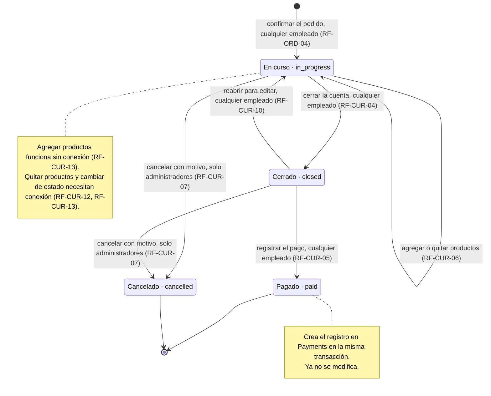

### 16.2 Estado de la habitación
Las tres partes del estado y qué cambia cada una (secciones 6.8 y 6.11 a 6.13).

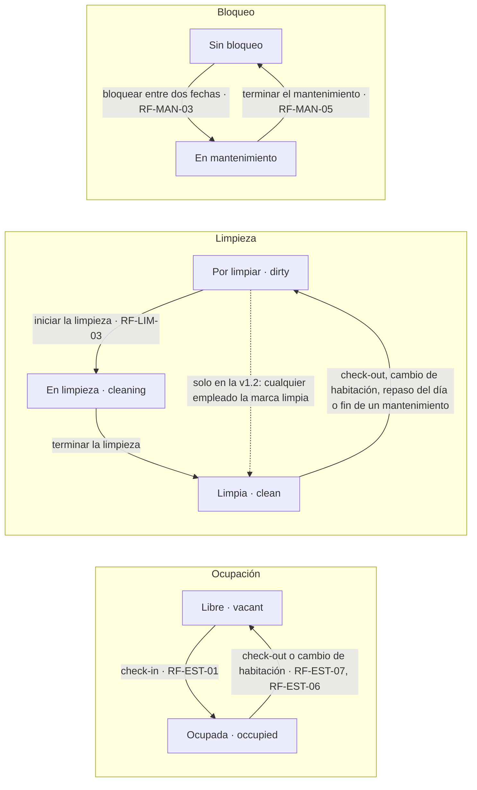

Cómo se combinan las tres partes en el único estado que muestra el tablero (RF-HAB-04):

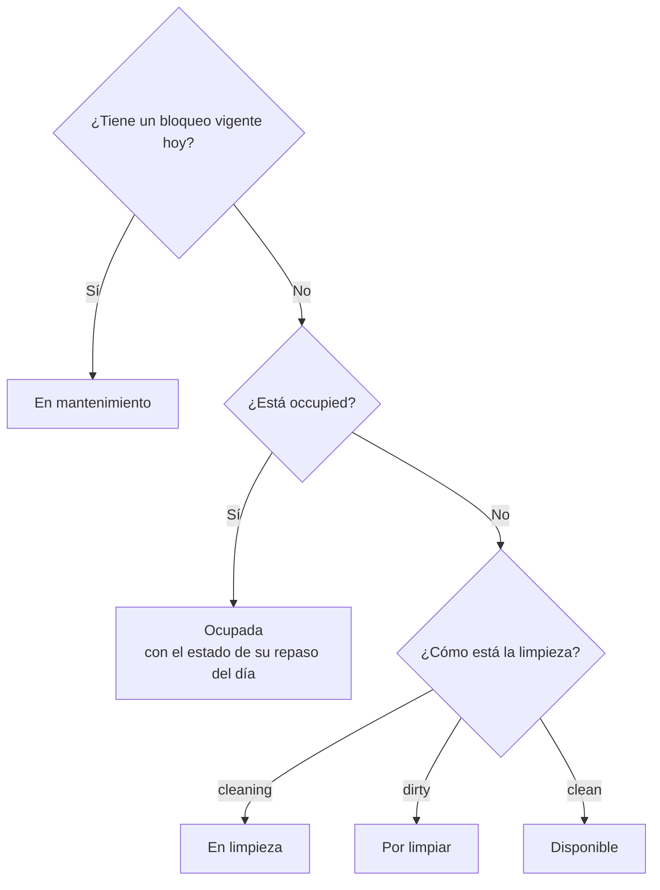

### 16.3 Ciclo de vida de la reserva
Estados de una reserva (secciones 6.9 y 6.10). Todas las acciones las hacen recepción o administración, con conexión.

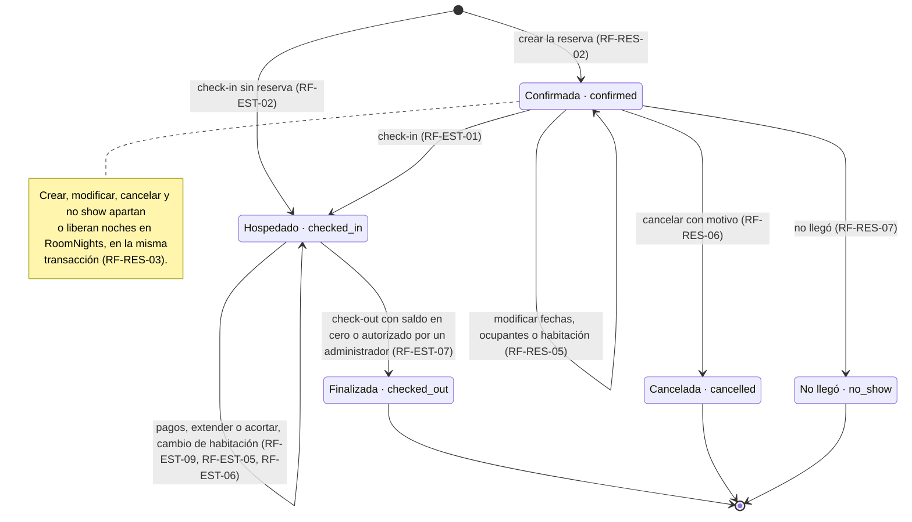

### 16.4 Ciclo de vida de una tarea de habitación
Estados, asignar o tomar, y su efecto en la habitación (secciones 6.11 a 6.13).

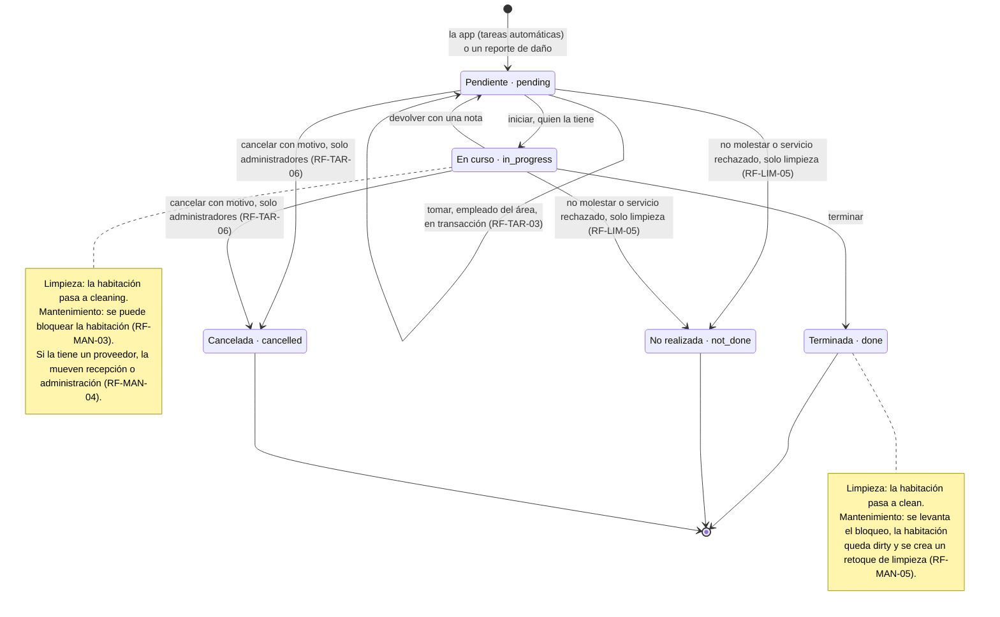

### 16.5 Mapa de navegación
Pantallas de la app y quién llega a cada una según el rol y el área (secciones 3 y 6). Es el destino de la v1.3: la pantalla de registro desaparece en M2 (RF-AUTH-02).

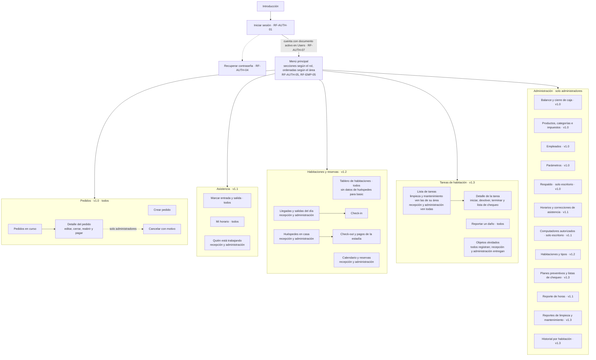

### 16.6 Flujo de un pedido
Pasos desde tomar el pedido hasta registrar el pago (secciones 6.2 y 6.3).

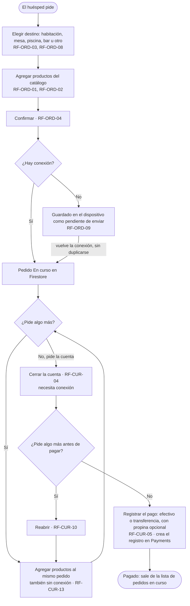

### 16.7 Flujo de check-in y check-out
Pasos de recepción con y sin reserva (secciones 6.9 y 6.10).

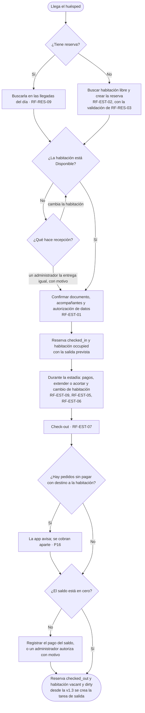

### 16.8 Día de limpieza
Desde la creación de las tareas hasta dejar las habitaciones disponibles (sección 6.12).

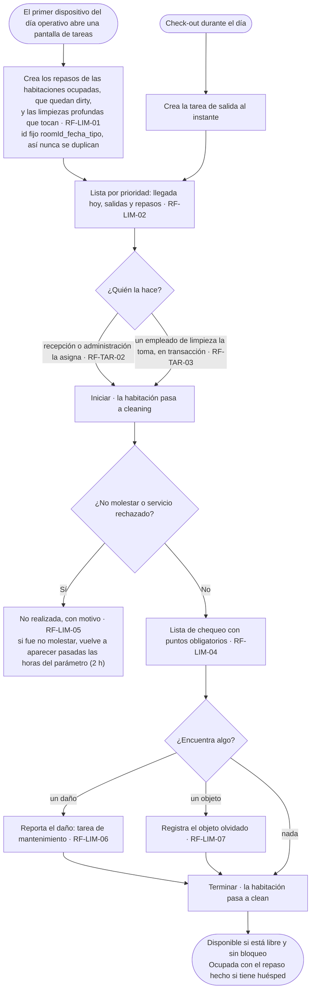

### 16.9 Flujo de asistencia
Marcación con ubicación o en recepción, olvidos y correcciones (sección 6.7).

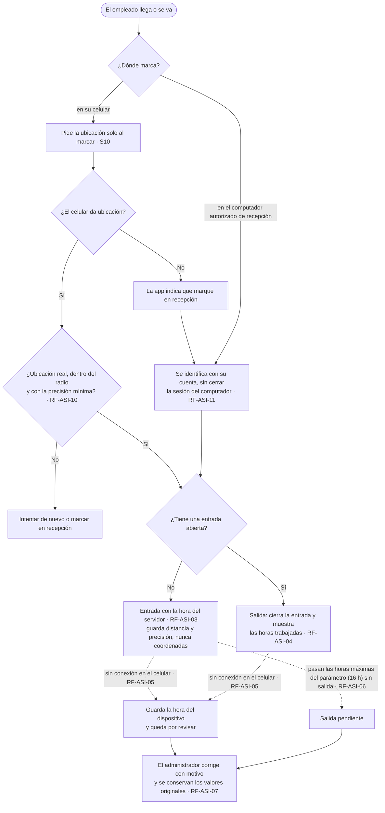

### 16.10 Modelo de datos
Colecciones de Firestore y sus relaciones (sección 8). Los campos de cada colección están en las tablas de esa sección.

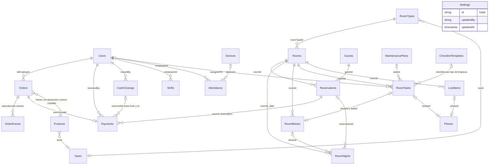

### 16.11 Arquitectura
Módulos de Kotlin Multiplatform, capas de `shared` y servicios de Firebase (secciones 1 y 4). Las flechas apuntan hacia la dependencia.

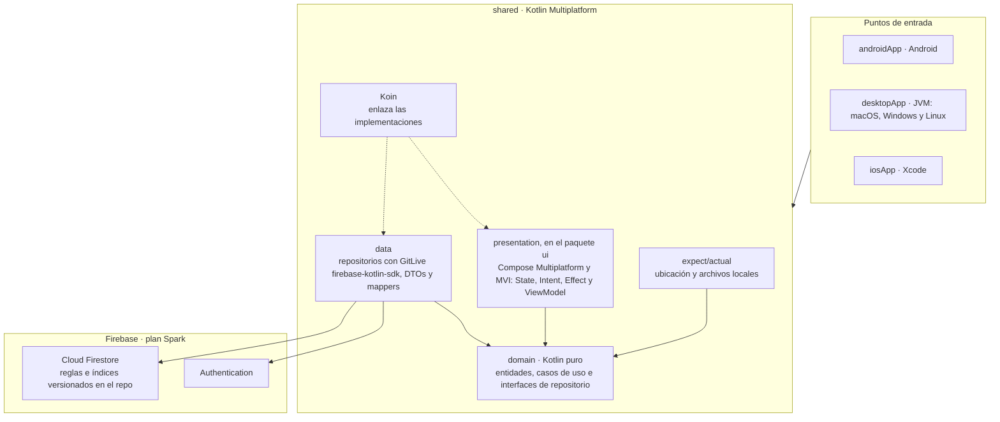

### 16.12 Hoja de ruta
Hitos, versiones y dependencias (sección 10).

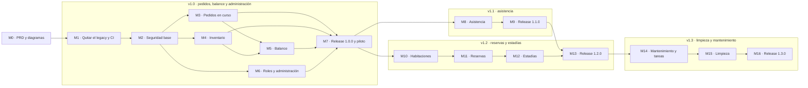
